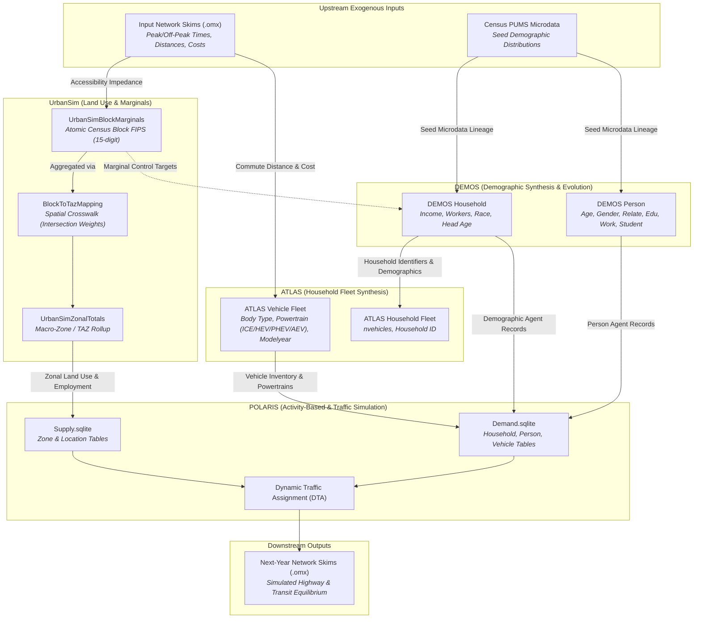
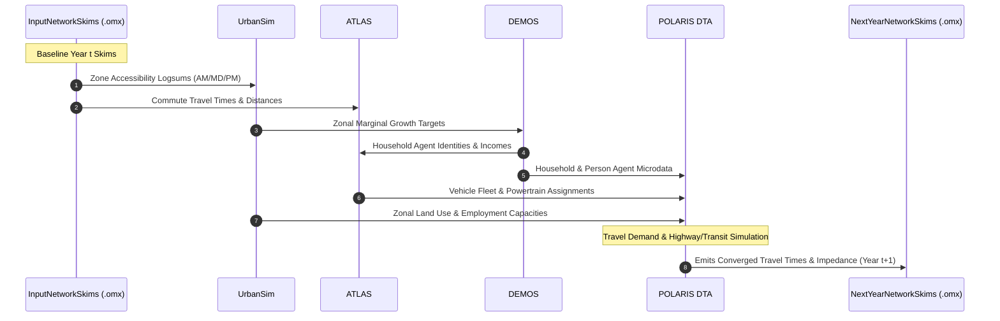

# Cross-Model Data Contract at a Glance

This document summarizes the static single-year data exchange relationships, identifier bindings, categorical crosswalks, and residue boundaries across **UrbanSim**, **DEMOS**, **ATLAS**, **POLARIS**, and **Network Skims** (`.omx`).

---

## 1. Multi-Model Data Flow Architecture

---

## 2. Table-to-Table Exchange Summary Matrix

| Channel ID | Source Model & Artifact | Target Model & Artifact | Channel Type | Join / Reference Key | Core Attributes Transferred |
| :--- | :--- | :--- | :--- | :--- | :--- |
| **SKIM-IN-US** | `InputNetworkSkims` (`.omx`) | **UrbanSim** (`input_skims`) | Matrix Skims | Zone $(i, j)$ | `sov_time_am`, `sov_distance`, transit accessibility |
| **SKIM-IN-AT** | `InputNetworkSkims` (`.omx`) | **ATLAS** (`input_skims`) | Matrix Skims | Zone $(i, j)$ | `sov_time_am`, `sov_time_md`, `sov_distance` |
| **US-SUPPLY** | `UrbanSimZonalTotals` | **POLARIS** `Supply.sqlite/Zone` | Zonal Aggregation | `zone_id` $\leftrightarrow$ `zone` | `residential_area`, `commercial_area`, `pop_households`, `employment_*` |
| **US-DEMOS** | `UrbanSimBlockMarginals` | **DEMOS** (`marginal_targets`) | Control Totals | `block_id` | `total_households`, `total_population`, `total_workers` |
| **DEMOS-POL-H**| `DEMOS` Household | **POLARIS** `Demand.sqlite/Household` | Tabular Microdata | `household` | `income`, `workers`, `persons`, `age_of_head`, `race_of_head` |
| **DEMOS-POL-P**| `DEMOS` Person | **POLARIS** `Demand.sqlite/Person` | Tabular Microdata | `(household, id)` | `age`, `gender`, `relp`, `education`, `employment`, `school_enrollment` |
| **DEMOS-AT-H** | `DEMOS` Household | **ATLAS** `atlas_hh` | Tabular Microdata | `household` $\leftrightarrow$ `HOUSEID` | Household identity, composition, and income |
| **AT-POL-V** | `ATLAS` Vehicle | **POLARIS** `Demand.sqlite/Vehicle` | Tabular Microdata | `(HOUSEID, VEHID)` $\leftrightarrow$ `(household, id)` | `bodytype`, `pred_power`, `modelyear`, `annual_mileage` |
| **POL-SKIM-OUT**| **POLARIS** DTA Solver | `NextYearNetworkSkims` (`.omx`) | Matrix Skims | Zone $(i, j)$ | `sov_time_am`, `sov_time_pm`, `congestion_index` |

---

## 3. Detailed Column-Level Mapping Specifications

### 3.1 DEMOS Household $\to$ POLARIS `Household`

| DEMOS Column | POLARIS Column | Mode | Crosswalk / Rule | Description & Residue Handling |
| :--- | :--- | :--- | :--- | :--- |
| `household` | `household` | `direct` | — | Integer household primary key. |
| `income` | `income` | `direct` | — | Annual gross household income in USD. |
| `persons` | `size` | `renamed` | — | Total count of individuals in household. |
| `workers` | `workers` | `direct` | — | Count of employed workers in household. |
| `age_of_head` | `age_of_head` | `direct` | — | Age of reference person (head of household). |
| `race_of_head`| `race` | `enum_crosswalk` | **X-P3** | Census PUMS race code to POLARIS race integer. |
| `lcm_county_id`| `county` | `direct` | — | 5-digit State/County FIPS (e.g. 48453). |
| `block_id` | `location` | `derived` | Spatial Lookup | Block FIPS resolved to POLARIS `Location.location` via `Supply.sqlite`. |
| `SERIALNO_PUMS`| — | *Residue* | Lineage Trace | Census PUMS seed record identifier; retained for auditability, not stored in POLARIS. |
| `is_reorg_household`| — | *Residue* | Internal State | DEMOS demographic restructuring flag; unmapped in POLARIS. |
| *(Default)* | `housing_type` | `derived` | **X-H1** | Housing type assigned from UrbanSim dwelling inventory or defaulted to 1 (Single Family). |
| *(Aggregated)* | `vehicles` | `aggregated`| — | Count of associated records in ATLAS vehicle table for this household. |

---

### 3.2 DEMOS Person $\to$ POLARIS `Person`

| DEMOS Column | POLARIS Column | Mode | Crosswalk / Rule | Description & Residue Handling |
| :--- | :--- | :--- | :--- | :--- |
| `household` | `household` | `direct` | — | Foreign key to Household table. |
| `id` | `id` | `direct` | — | Within-household person sequence ordinal (1, 2, ...). |
| `person` | — | *Residue* | Lineage Trace | Global synthetic person identifier; preserved in DEMOS outputs. |
| `age` | `age` | `direct` | — | Person chronological age in years. |
| `gender` | `gender` | `enum_crosswalk` | **X-P2** | `1` = Male, `2` = Female. |
| `relp` | `relate` | `enum_crosswalk` | **X-P1** | PUMS relationship code to POLARIS relationship classification. |
| `education` | `education` | `enum_crosswalk` | **X-P4** | PUMS educational attainment to POLARIS tier (1=Less than HS, 2=HS, 3=College, 4=Grad). |
| `employment` | `worker_type`| `enum_crosswalk` | **X-P5** | Employment status code to POLARIS worker category. |
| `school_enrollment`| `student_status`| `enum_crosswalk`| **X-P6**| PUMS school enrollment flag mapped to POLARIS student status. |
| `income` | `income` | `direct` | — | Individual personal earned income. |
| `marital_status`| — | *Residue* | Context | Marital status code retained in DEMOS microdata. |
| `SERIALNO_PUMS`| — | *Residue* | Lineage Trace | Census PUMS household seed identifier. |
| `SPORDER` | — | *Residue* | Lineage Trace | Census PUMS person seed sequence ordinal. |

---

### 3.3 ATLAS Vehicle $\to$ POLARIS `Vehicle`

| ATLAS Column | POLARIS Column | Mode | Crosswalk / Rule | Description & Residue Handling |
| :--- | :--- | :--- | :--- | :--- |
| `HOUSEID` | `household` | `renamed` | — | Foreign key joining to DEMOS & POLARIS Household. |
| `VEHID` | `id` | `renamed` | — | Within-household vehicle ordinal index (1, 2, ...). |
| `pred_power` | `type` / `powertrain`| `enum_crosswalk` | **X-V1** | Powertrain classification (`ICE` $\to$ 1, `Hybrid` $\to$ 3, `PHEV` $\to$ 4, `AEV` $\to$ 5). |
| `bodytype` | `class` | `enum_crosswalk` | **X-V2** | Body type (`car` $\to$ 1, `suv` $\to$ 2, `pickup` $\to$ 3, `van` $\to$ 4). |
| `modelyear` | `modelyear` | `direct` | — | 4-digit vehicle model year (e.g. 2018). |
| `vintage_category`| — | *Residue* | Validation | Categorical vehicle age (`0~5 years`, `6~11 years`, `12+ years`) cross-checked against `modelyear`. |
| `annual_mileage`| — | *Residue* | Behavioral Model | Estimated annual vehicle miles traveled (VMT); informs vehicle allocation. |
| *(Default)* | `odometer` | `derived` | Constant | Initialized to `0` or computed as `(SimulationYear - modelyear) * annual_mileage`. |

---

### 3.4 UrbanSim Zonal Totals $\to$ POLARIS `Supply.sqlite/Zone`

| UrbanSim Column | POLARIS Column | Mode | Description |
| :--- | :--- | :--- | :--- |
| `zone_id` | `zone` | `direct` | Traffic Analysis Zone (TAZ) integer primary key. |
| `residential_area` | `residential_area` | `direct` | Total residential floor/lot area. |
| `commercial_area` | `commercial_area` | `direct` | Total commercial development area. |
| `office_area` | `office_area` | `direct` | Total office floor area. |
| `retail_area` | `retail_area` | `direct` | Total retail shopping area. |
| `industrial_area` | `industrial_area` | `direct` | Industrial/warehouse space. |
| `institutional_area`| `institutional_area`| `direct`| Civic, institutional, and medical land area. |
| `pop_households` | `pop_households` | `direct` | Marginal control total of households residing in zone. |
| `pop_persons` | `pop_persons` | `direct` | Marginal control total of persons residing in zone. |
| `employment_total` | `employment_total` | `direct` | Total employment count located in zone. |
| `employment_retail`| `employment_retail`| `direct` | Retail sector employment. |
| `employment_services`| `employment_services`| `direct`| Service sector employment. |
| `employment_government`| `employment_government`| `direct`| Public administration & government employment. |
| `employment_manufacturing`| `employment_manufacturing`| `direct`| Manufacturing sector employment. |
| `hh_inc_avg` | `hh_inc_avg` | `direct` | Mean household income within zone. |

---

## 4. Discrete Categorical Crosswalk Reference

### Crosswalk X-H1: Housing Tenure & Type
Maps dwelling unit types from UrbanSim / DEMOS to POLARIS `Household.housing_type`:
- `1` $\to$ Single-Family Detached
- `2` $\to$ Multi-Family / Apartment
- `3` $\to$ Townhouse / Attached
- `4` $\to$ Mobile Home / Other

### Crosswalk X-P1: Relationship to Head (`relp` $\to$ `relate`)
Maps Census PUMS `relp` codes to POLARIS Person relationship categories:
- `0` (Reference person) $\to$ `0` (Head)
- `1` (Husband/wife) $\to$ `1` (Spouse)
- `2` (Biological son/daughter) $\to$ `2` (Child)
- `3` (Adopted child) $\to$ `2` (Child)
- `4` (Stepchild) $\to$ `2` (Child)
- `5..15` (Other relative) $\to$ `3` (Other Relative)
- `16..17` (Nonrelative/roommate) $\to$ `4` (Non-relative)

### Crosswalk X-P2: Gender
- `1` $\to$ `1` (Male)
- `2` $\to$ `2` (Female)

### Crosswalk X-P3: Race of Head
Maps Census PUMS race (`race_of_head` / `RAC1P`) to POLARIS race integer categories:
- `1` (White alone) $\to$ `1` (White)
- `2` (Black or African American alone) $\to$ `2` (Black)
- `3..5` (American Indian / Alaska Native) $\to$ `3` (American Indian / Alaska Native)
- `6` (Asian alone) $\to$ `4` (Asian)
- `7` (Native Hawaiian and Other Pacific Islander) $\to$ `5` (Pacific Islander)
- `8..9` (Some other race / Two or more races) $\to$ `6` (Other / Multiracial)

### Crosswalk X-P4: Educational Attainment
Maps PUMS educational attainment (`education`) to POLARIS educational tiers:
- `1..15` (Less than high school diploma) $\to$ `1` (Less than HS)
- `16..17` (High school diploma / GED) $\to$ `2` (High School)
- `18..21` (Some college / Associate / Bachelor's) $\to$ `3` (College Undergraduate)
- `22..24` (Master's / Professional / Doctorate) $\to$ `4` (Graduate Degree)

### Crosswalk X-P5: Employment Status
Maps PUMS employment status (`employment`) to POLARIS worker classifications:
- `1.0` (Civilian employed, at work) $\to$ `1` (Full-time worker)
- `2.0` (Civilian employed, with a job but not at work) $\to$ `2` (Part-time worker)
- `3.0` (Unemployed) $\to$ `3` (Unemployed)
- `4.0..5.0` (Armed forces) $\to$ `1` (Full-time military)
- `6.0` (Not in labor force) $\to$ `0` (Non-worker / Retired / Homemaker)

### Crosswalk X-P6: School Enrollment
Maps PUMS school enrollment (`school_enrollment`) to POLARIS student status:
- `1.0` (No, has not attended in last 3 months) $\to$ `0` (Non-student)
- `2.0` (Yes, public school or college) $\to$ `1` (Student)
- `3.0` (Yes, private school or college) $\to$ `1` (Student)

### Crosswalk X-V1: Vehicle Powertrain Type
Maps ATLAS `pred_power` enums to POLARIS vehicle powertrain codes:
- `ICE` (Internal Combustion Engine) $\to$ `1` (Conventional Gasoline/Diesel)
- `Hybrid` (Non-plug-in Hybrid Electric Vehicle) $\to$ `3` (HEV)
- `PHEV` (Plug-in Hybrid Electric Vehicle) $\to$ `4` (PHEV)
- `AEV` (All-Electric Vehicle / BEV) $\to$ `5` (BEV)

### Crosswalk X-V2: Vehicle Body Type & Class
Maps ATLAS `bodytype` enums to POLARIS vehicle classifications:
- `car` $\to$ `1` (Sedan / Coupe / Compact)
- `suv` $\to$ `2` (SUV / Crossover)
- `pickup` $\to$ `3` (Pickup Truck)
- `van` $\to$ `4` (Minivan / Passenger Van)

---

## 5. Network Skims Boundary (`.omx`)

