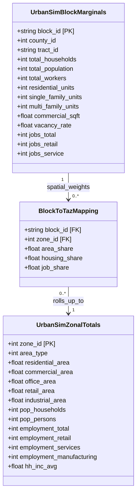
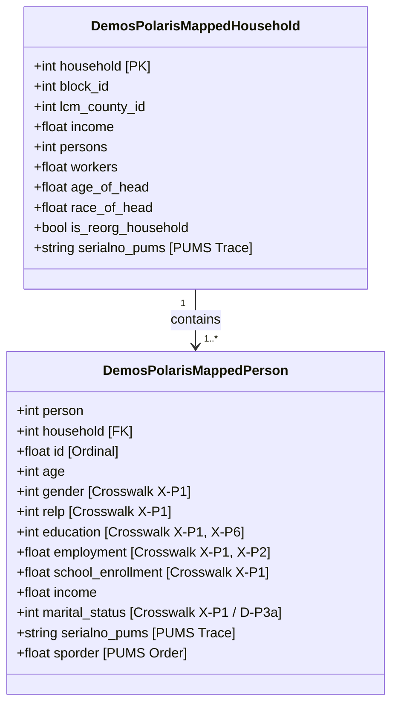
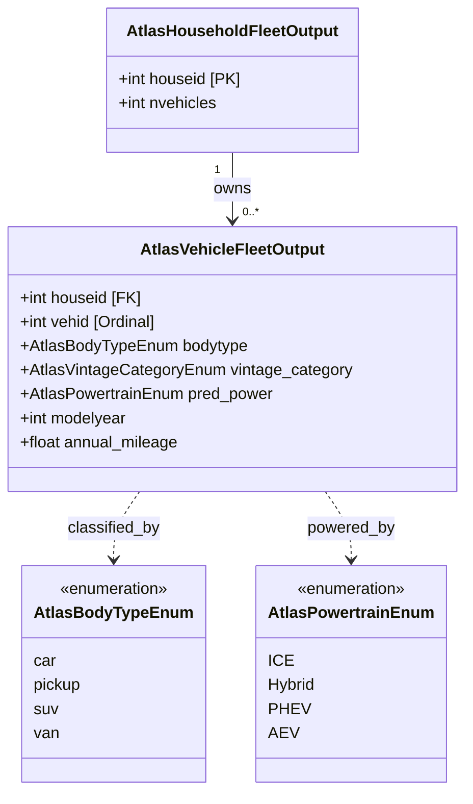
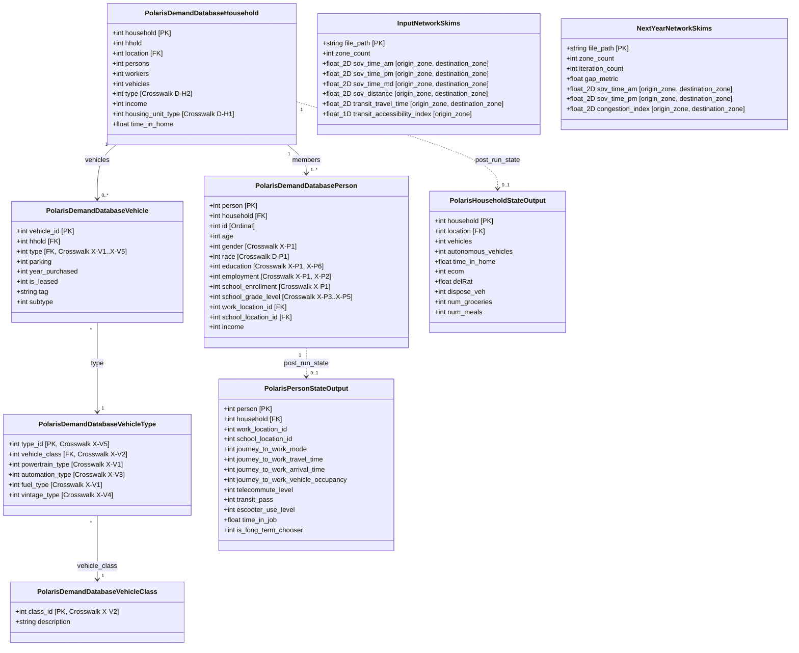
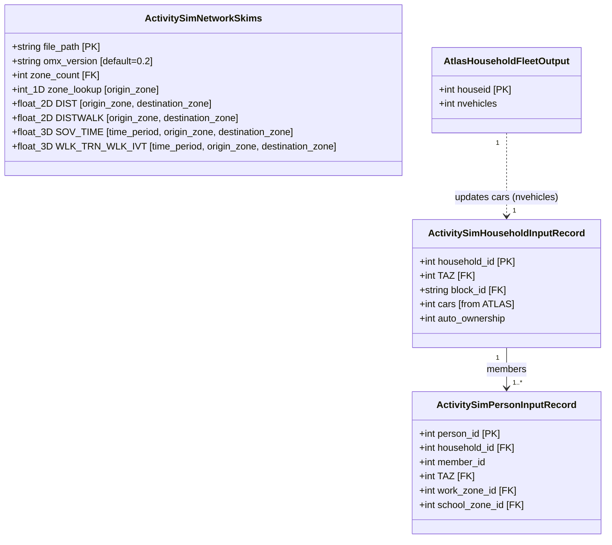
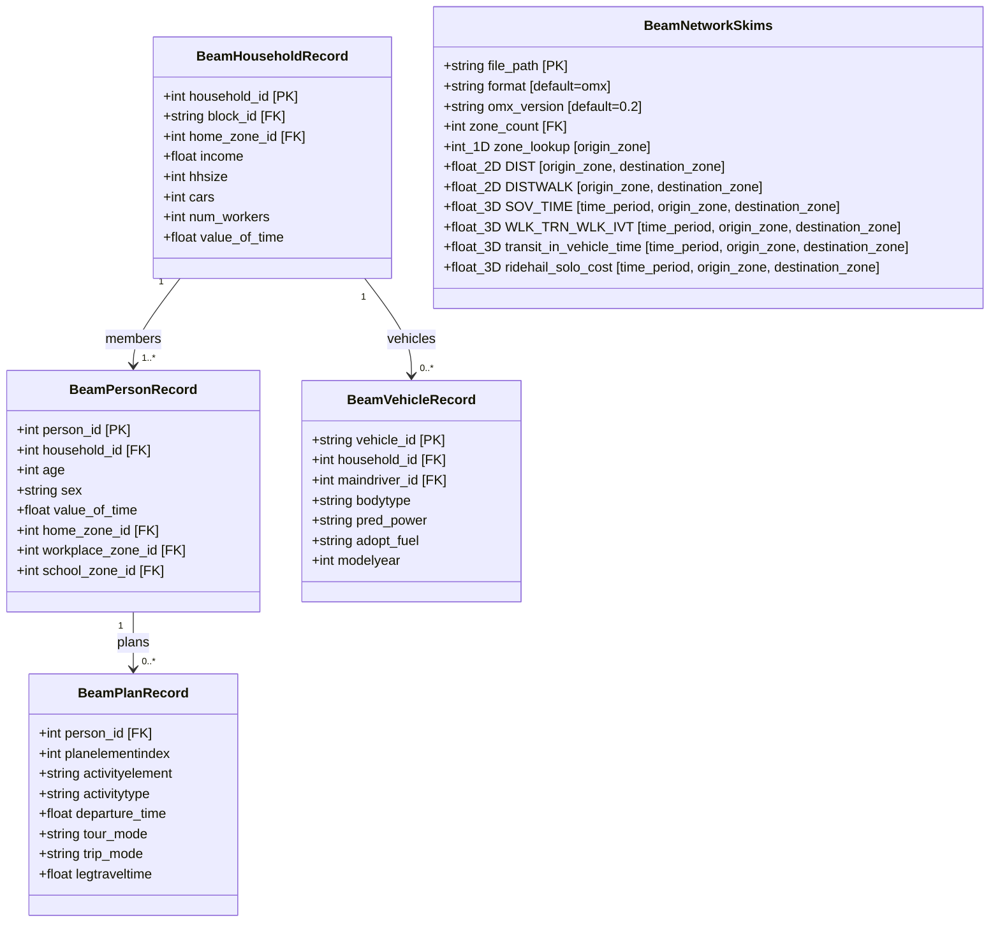
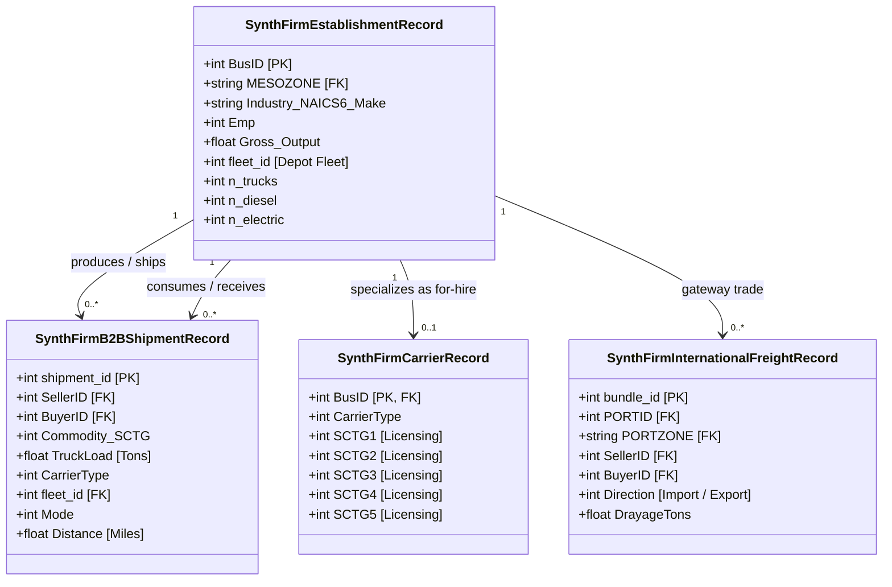

# Architecture & Per-Model UML Class Diagrams

This page maps the single-year module entry points, workflow pipelines, and class structures across **UrbanSim**, **DEMOS**, **ATLAS**, **POLARIS**, **ActivitySim**, **BEAM**, **SynthFirm**, and **Network Skims** (`.omx` / `.zarr`).
These interfaces allow BEAM CORE tools and POLARIS to run as standalone components or in coordinated serial and parallel workflows. Click any node or class header in a diagram to open its LinkML field specification.

---

## 1. Multi-Model Architecture & Data Exchange Pipeline

=== "Primary Workflow: POLARIS Dynamic Traffic Assignment"

    In the primary POLARIS workflow, containerized **UrbanSim** land-use marginals, **DEMOS** (NLR) synthetic households and persons, and **ATLAS** (LBNL) household vehicle fleets populate **POLARIS** (ANL, `Supply.sqlite` and `Demand.sqlite`) for activity-based simulation and dynamic traffic assignment:

    ```mermaid
    flowchart TD
        subgraph Inputs ["Exogenous Inputs & Skims"]
            SkimsIn["Input Network Skims (.omx)<br/><i>Peak/Off-Peak Times & Distances</i>"]
            PUMS["Census PUMS Microdata<br/><i>Seed Demographic Distributions</i>"]
        end

        subgraph UrbanSim ["UrbanSim (Land Use & Marginals)"]
            US_Block["UrbanSimBlockMarginals<br/><i>Atomic Census Block FIPS</i>"]
            US_Map["BlockToTazMapping<br/><i>Spatial Crosswalk</i>"]
            US_Zone["UrbanSimZonalTotals<br/><i>Macro-Zone (TAZ) Totals</i>"]
        end

        subgraph DEMOS ["DEMOS (Demographic Synthesis)"]
            DEMOS_HH["DemosHousehold<br/><i>Income, Workers, Size, Head Age</i>"]
            DEMOS_P["DemosPerson<br/><i>Age, Gender, Relate, Edu, Work</i>"]
        end

        subgraph ATLAS ["ATLAS (Household Fleet Synthesis)"]
            ATLAS_HH["AtlasHousehold<br/><i>nvehicles</i>"]
            ATLAS_V["AtlasVehicle<br/><i>Body Type, Powertrain (ICE/HEV/PHEV/AEV)</i>"]
        end

        subgraph POLARIS ["POLARIS (Activity-Based Demand & Supply, t+1)"]
            POL_Supply["Supply.sqlite<br/><i>Zone & Location Tables</i>"]
            POL_Demand["Demand.sqlite<br/><i>Household, Person, Vehicle</i>"]
            POL_DTA["POLARIS Simulation (t+1)<br/><i>Job & Household Tenure, Workplace/Destination/Mode Choice, Activity Scheduling & DTA</i>"]
        end

        subgraph Outputs ["Downstream Outputs & Feedback to Next Iteration"]
            POL_StateOut["PolarisPersonStateOutput & PolarisHouseholdStateOutput<br/><i>Population State P_t: Work/School Locations & Tenure Choices</i>"]
            SkimsOut["Next-Year Network Skims (.omx)<br/><i>Simulated Highway/Transit Impedance (Skim_t)</i>"]
        end

        %% Connections
        SkimsIn -->|"Accessibility Logsums (Skim_t)"| US_Block
        PUMS -->|"Base-Year Seed Lineage"| DEMOS_HH
        PUMS -->|"Base-Year Seed Lineage"| DEMOS_P

        US_Block -->|"Area/Housing Allocation"| US_Map
        US_Map --> US_Zone
        US_Zone -->|"Zonal Capacity & Employment"| POL_Supply
        US_Block -->|"Block-Level Spatial Marginals (M_t+1)"| DEMOS_HH

        DEMOS_HH -->|"Evolved Population (P_t+1)"| ATLAS_HH
        DEMOS_HH -->|"Household Records (P_t+1)"| POL_Demand
        DEMOS_P -->|"Person Records (P_t+1)"| POL_Demand

        ATLAS_HH --> ATLAS_V
        ATLAS_HH -->|"Household Vehicle Counts"| POL_Demand
        ATLAS_V -->|"Vehicle Inventory & Powertrains"| POL_Demand

        POL_Supply --> POL_DTA
        POL_Demand --> POL_DTA
        POL_DTA --> POL_StateOut
        POL_DTA --> SkimsOut
        POL_StateOut -.->|"Population Feedback (P_t)"| DEMOS_HH
        SkimsOut -.->|"Skim_t Feedback to Next Iteration"| US_Block

        %% Interactive Clickable Schema Links
        click SkimsIn "../schema/InputNetworkSkims/" "View InputNetworkSkims LinkML documentation"
        click US_Block "../schema/UrbanSimBlockMarginals/" "View UrbanSimBlockMarginals LinkML documentation"
        click US_Map "../schema/BlockToTazMapping/" "View BlockToTazMapping LinkML documentation"
        click US_Zone "../schema/UrbanSimZonalTotals/" "View UrbanSimZonalTotals LinkML documentation"
        click DEMOS_HH "../schema/DemosPolarisMappedHousehold/" "View DemosPolarisMappedHousehold LinkML documentation"
        click DEMOS_P "../schema/DemosPolarisMappedPerson/" "View DemosPolarisMappedPerson LinkML documentation"
        click ATLAS_HH "../schema/AtlasHouseholdFleetOutput/" "View AtlasHouseholdFleetOutput LinkML documentation"
        click ATLAS_V "../schema/AtlasVehicleFleetOutput/" "View AtlasVehicleFleetOutput LinkML documentation"
        click POL_Demand "../schema/PolarisDemandDatabaseHousehold/" "View POLARIS Demand Database LinkML documentation"
        click POL_StateOut "../schema/PolarisPersonStateOutput/" "View PolarisPersonStateOutput LinkML documentation"
        click SkimsOut "../schema/NextYearNetworkSkims/" "View NextYearNetworkSkims LinkML documentation"
    ```

=== "LBL Counterpart Workflow: ActivitySim Demand & BEAM Dynamic Simulation"

    In the LBNL counterpart workflow, the same upstream scenario state (containerized **UrbanSim** land use, **DEMOS** population, and **ATLAS** vehicles) feeds LBNL's maintained **ActivitySim** tour/trip demand implementation and **BEAM** multi-agent traffic, transit, and charging simulation:

    ```mermaid
    flowchart TD
        subgraph Inputs_B ["Exogenous Inputs & Skims"]
            SkimsIn_B["Input Network Skims (.omx / Zarr)<br/><i>Peak/Off-Peak Times & Distances</i>"]
            PUMS_B["Census PUMS Microdata<br/><i>Seed Demographic Distributions</i>"]
        end

        subgraph UrbanSim_B ["UrbanSim (Land Use & Marginals)"]
            US_Block_B["UrbanSimBlockMarginals<br/><i>Atomic Census Block FIPS</i>"]
            US_Map_B["BlockToTazMapping<br/><i>Spatial Crosswalk</i>"]
            US_Zone_B["UrbanSimZonalTotals<br/><i>Macro-Zone (TAZ) Totals</i>"]
        end

        subgraph DEMOS_B ["DEMOS (Demographic Synthesis)"]
            DEMOS_HH_B["DemosHousehold<br/><i>Income, Workers, Size, Head Age</i>"]
            DEMOS_P_B["DemosPerson<br/><i>Age, Gender, Relate, Edu, Work</i>"]
        end

        subgraph ATLAS_B ["ATLAS (Household Fleet Synthesis)"]
            ATLAS_HH_B["AtlasHousehold<br/><i>nvehicles</i>"]
            ATLAS_V_B["AtlasVehicle<br/><i>Body Type, Powertrain (ICE/HEV/PHEV/AEV)</i>"]
        end

        subgraph ActivitySim ["ActivitySim (Activity-Based Demand)"]
            AS_Pop["ActivitySim Population<br/><i>Households (with ATLAS cars) & Persons</i>"]
            AS_Core["Core Demand Models<br/><i>Tours, Mandatory/Non-Mandatory Trips</i>"]
            AS_Plans["Activity-Travel Schedules<br/><i>Activity Types, Times & Modes</i>"]
        end

        subgraph BEAM ["BEAM (Dynamic Multi-Agent Simulation)"]
            BEAM_Pop["BeamHouseholdRecord & BeamPersonRecord<br/><i>Demographics & Values of Time</i>"]
            BEAM_Veh["BeamVehicleRecord<br/><i>Staged ATLAS Fleet with Powertrains</i>"]
            BEAM_Plans["BeamPlanRecord<br/><i>Sequenced Activities & Travel Legs</i>"]
            BEAM_Sim["Dynamic Multi-Agent Simulation<br/><i>Router, Transit & EV Charging</i>"]
        end

        subgraph Outputs_B ["Downstream Outputs & Feedback"]
            BEAM_Out["BeamPlanOutputRecord<br/><i>Executed Agent Plans</i>"]
            BEAM_Skims["BeamNetworkSkims (.omx / Zarr)<br/><i>Simulated Highway/Transit Impedance</i>"]
        end

        %% Connections
        SkimsIn_B -->|"Accessibility Logsums (Skim_t)"| US_Block_B
        SkimsIn_B -->|"Travel Skims"| AS_Core
        PUMS_B -->|"Base-Year Seed Lineage"| DEMOS_HH_B
        PUMS_B -->|"Base-Year Seed Lineage"| DEMOS_P_B

        US_Block_B -->|"Area/Housing Allocation"| US_Map_B
        US_Map_B --> US_Zone_B
        US_Zone_B -->|"Zonal Land Use & Employment"| AS_Pop
        US_Block_B -->|"Block-Level Spatial Marginals (M_t+1)"| DEMOS_HH_B

        DEMOS_HH_B -->|"Evolved Population (P_t+1)"| ATLAS_HH_B
        DEMOS_HH_B -->|"Household Records (P_t+1)"| AS_Pop
        DEMOS_P_B -->|"Person Records (P_t+1)"| AS_Pop

        ATLAS_HH_B --> ATLAS_V_B
        ATLAS_HH_B ==>|"Updates cars per household"| AS_Pop
        ATLAS_V_B -->|"Staged Vehicle Fleet"| BEAM_Veh

        AS_Pop --> AS_Core
        AS_Core --> AS_Plans

        DEMOS_HH_B -->|"Household Records & Attributes"| BEAM_Pop
        DEMOS_P_B -->|"Person Demographics & VOT"| BEAM_Pop
        AS_Plans -->|"Activity & Leg Sequences"| BEAM_Plans

        BEAM_Pop --> BEAM_Sim
        BEAM_Veh --> BEAM_Sim
        BEAM_Plans --> BEAM_Sim

        BEAM_Sim --> BEAM_Out
        BEAM_Sim --> BEAM_Skims
        BEAM_Out -.->|"Population State Feedback (P_t)"| DEMOS_HH_B
        BEAM_Skims -.->|"Skim_t Feedback to Next Iteration"| US_Block_B

        %% Interactive Clickable Schema Links
        click SkimsIn_B "../schema/InputNetworkSkims/" "View InputNetworkSkims LinkML documentation"
        click US_Block_B "../schema/UrbanSimBlockMarginals/" "View UrbanSimBlockMarginals LinkML documentation"
        click US_Map_B "../schema/BlockToTazMapping/" "View BlockToTazMapping LinkML documentation"
        click US_Zone_B "../schema/UrbanSimZonalTotals/" "View UrbanSimZonalTotals LinkML documentation"
        click DEMOS_HH_B "../schema/DemosPolarisMappedHousehold/" "View DemosPolarisMappedHousehold LinkML documentation"
        click DEMOS_P_B "../schema/DemosPolarisMappedPerson/" "View DemosPolarisMappedPerson LinkML documentation"
        click ATLAS_HH_B "../schema/AtlasHouseholdFleetOutput/" "View AtlasHouseholdFleetOutput LinkML documentation"
        click ATLAS_V_B "../schema/AtlasVehicleFleetOutput/" "View AtlasVehicleFleetOutput LinkML documentation"
        click AS_Pop "../schema/ActivitySimHouseholdInputRecord/" "View ActivitySim Population LinkML documentation"
        click BEAM_Pop "../schema/BeamHouseholdRecord/" "View BEAM Population LinkML documentation"
        click BEAM_Veh "../schema/BeamVehicleRecord/" "View BEAM Vehicle LinkML documentation"
        click BEAM_Plans "../schema/BeamPlanRecord/" "View BeamPlanRecord LinkML documentation"
        click BEAM_Out "../schema/BeamPlanOutputRecord/" "View BeamPlanOutputRecord LinkML documentation"
        click BEAM_Skims "../schema/BeamNetworkSkims/" "View BeamNetworkSkims LinkML documentation"
    ```

=== "Freight & Commercial Demand Pipeline: SynthFirm to POLARIS & BEAM"

    **SynthFirm** synthesizes business establishments, carrier fleets, and B2B commodity shipments from FAF5 trade forecasts and **UrbanSim** employment marginals, supplying commercial vehicles and freight tours to **POLARIS** and **BEAM**:

    ```mermaid
    flowchart TD
        subgraph Inputs_F ["Macro & Network Inputs"]
            SkimsIn_F["Input Network Skims (.omx)<br/><i>Zone-to-Zone Impedance & Distances</i>"]
            FAF5["FAF5 Commodity Trade Data<br/><i>Inter-Regional Baseline Flows</i>"]
        end

        subgraph UrbanSim_F ["UrbanSim (Zonal Marginals)"]
            US_Marg_F["UrbanSimBlockMarginals<br/><i>Census Block Group Employment</i>"]
            US_Zone_F["UrbanSimZonalTotals<br/><i>TAZ Employment & Floor Space</i>"]
        end

        subgraph SynthFirm ["SynthFirm (Freight & Firm Synthesis)"]
            SF_Firm["SynthFirmEstablishmentRecord<br/><i>Firms, Depots & Private Fleets</i>"]
            SF_Carrier["SynthFirmCarrierRecord<br/><i>For-Hire Trucking Operators</i>"]
            SF_B2B["SynthFirmB2BShipmentRecord<br/><i>B2B Commodity Flows (SCTG 1-5)</i>"]
            SF_Intl["SynthFirmInternationalFreightRecord<br/><i>Port & Airport Drayage Flows</i>"]
        end

        subgraph Consumers ["Demand & Traffic Simulators"]
            POL_CV["POLARIS Demand.sqlite<br/><i>Commercial Vehicle Fleet & Cordon Trips</i>"]
            BEAM_Freight["BEAM Simulation<br/><i>Freight Plans, Tours & Depot Charging</i>"]
        end

        %% Connections
        US_Marg_F -->|"Employment by Industry / Zone"| SF_Firm
        US_Zone_F -->|"Zonal Commercial Space"| SF_Firm
        FAF5 -->|"Inter-Regional Control Totals"| SF_B2B
        SkimsIn_F -->|"Distance & Travel Time"| SF_B2B

        SF_Firm --> SF_Carrier
        SF_Firm -->|"Shipper / Receiver Depots"| SF_B2B
        SF_Firm -->|"Import / Export Facilities"| SF_Intl

        SF_Firm -->|"Commercial Vehicle Allocations"| POL_CV
        SF_B2B -->|"Truck Tour Generation & DTA"| POL_CV
        SF_Firm -->|"Depot Locations & EV Powertrains"| BEAM_Freight
        SF_B2B -->|"Freight Plans & Multi-Stop Tours"| BEAM_Freight

        %% Interactive Clickable Schema Links
        click SkimsIn_F "../schema/InputNetworkSkims/" "View InputNetworkSkims LinkML documentation"
        click US_Marg_F "../schema/UrbanSimBlockMarginals/" "View UrbanSimBlockMarginals LinkML documentation"
        click US_Zone_F "../schema/UrbanSimZonalTotals/" "View UrbanSimZonalTotals LinkML documentation"
        click SF_Firm "../schema/SynthFirmEstablishmentRecord/" "View SynthFirmEstablishmentRecord LinkML documentation"
        click SF_Carrier "../schema/SynthFirmCarrierRecord/" "View SynthFirmCarrierRecord LinkML documentation"
        click SF_B2B "../schema/SynthFirmB2BShipmentRecord/" "View SynthFirmB2BShipmentRecord LinkML documentation"
        click SF_Intl "../schema/SynthFirmInternationalFreightRecord/" "View SynthFirmInternationalFreightRecord LinkML documentation"
        click POL_CV "../schema/PolarisDemandDatabaseVehicle/" "View POLARIS Commercial Vehicles LinkML documentation"
        click BEAM_Freight "../schema/BeamVehicleRecord/" "View BEAM Commercial Fleet LinkML documentation"
    ```

---

## 2. UrbanSim Land Use & Zonal Marginals Schema

UrbanSim forecasts household, population, and employment marginals at the Census Block level ([`UrbanSimBlockMarginals`](../schema/UrbanSimBlockMarginals.md))
and rolls them up to Traffic Analysis Zones ([`UrbanSimZonalTotals`](../schema/UrbanSimZonalTotals.md)) through [`BlockToTazMapping`](../schema/BlockToTazMapping.md).



---

## 3. DEMOS Synthetic Population Schema

DEMOS evolves household and person microdata ([`DemosPolarisMappedHousehold`](../schema/DemosPolarisMappedHousehold.md), [`DemosPolarisMappedPerson`](../schema/DemosPolarisMappedPerson.md)) while retaining Census PUMS seed lineage (`SERIALNO_PUMS`, `SPORDER`) for auditability before staging into ATLAS, POLARIS, or ActivitySim.



---

## 4. ATLAS Vehicle Fleet Synthesis Schema

ATLAS predicts household vehicle counts ([`AtlasHouseholdFleetOutput`](../schema/AtlasHouseholdFleetOutput.md)) and vehicle-level body types, vintages, and powertrains ([`AtlasVehicleFleetOutput`](../schema/AtlasVehicleFleetOutput.md)).



---

## 5. POLARIS Activity-Based Demand & Network Skims Schema

POLARIS ingests households, persons, and vehicles into `Demand.sqlite` ([`PolarisDemandDatabaseHousehold`](../schema/PolarisDemandDatabaseHousehold.md), [`PolarisDemandDatabasePerson`](../schema/PolarisDemandDatabasePerson.md), [`PolarisDemandDatabaseVehicle`](../schema/PolarisDemandDatabaseVehicle.md), [`PolarisDemandDatabaseVehicleClass`](../schema/PolarisDemandDatabaseVehicleClass.md), [`PolarisDemandDatabaseVehicleType`](../schema/PolarisDemandDatabaseVehicleType.md)).
After simulation, POLARIS produces converged network skims ([`NextYearNetworkSkims`](../schema/NextYearNetworkSkims.md)) and post-run population state updates ([`PolarisHouseholdStateOutput`](../schema/PolarisHouseholdStateOutput.md), [`PolarisPersonStateOutput`](../schema/PolarisPersonStateOutput.md), marked **provisional** pending ANL verification of exact SQLite output column names).



---

## 6. LBL Tool Integration: ActivitySim & BEAM Schemas

To run the same regional scenarios through LBNL's demand and simulation stack, the schema defines counterpart interfaces for **ActivitySim** and **BEAM**.

### ActivitySim Demand & Population Schema

ActivitySim consumes households and persons staged from DEMOS ([`ActivitySimHouseholdInputRecord`](../schema/ActivitySimHouseholdInputRecord.md),
[`ActivitySimPersonInputRecord`](../schema/ActivitySimPersonInputRecord.md)), zonal land-use totals from UrbanSim, and Open Matrix / Zarr network skims ([`ActivitySimNetworkSkims`](../schema/ActivitySimNetworkSkims.md)).
ATLAS updates household auto ownership (`cars` via [`AtlasHouseholdFleetOutput`](../schema/AtlasHouseholdFleetOutput.md)) prior to tour and mode choice.



### BEAM Multi-Agent Population, Fleet, Plans & Skims Schema

BEAM ingests demographic agents ([`BeamHouseholdRecord`](../schema/BeamHouseholdRecord.md), [`BeamPersonRecord`](../schema/BeamPersonRecord.md)),
the ATLAS vehicle fleet ([`BeamVehicleRecord`](../schema/BeamVehicleRecord.md)), and ActivitySim daily plans ([`BeamPlanRecord`](../schema/BeamPlanRecord.md), [`BeamPlanOutputRecord`](../schema/BeamPlanOutputRecord.md)),
and outputs [`BeamNetworkSkims`](../schema/BeamNetworkSkims.md) (`.omx` / `.zarr` LinkML arrays). The production MTC / BEAM `skims.omx` baseline requires `DIST`, `DISTWALK`, `SOV_*`, and `WLK_TRN_WLK_*` arrays, while marking managed-lane, HOV, transit submode, and ridehail skims as **provisional** optional extensions pending collaborator verification.



---

## 7. SynthFirm Synthetic Firm, Fleet, and Freight Flow Schema

SynthFirm synthesizes business establishments ([`SynthFirmEstablishmentRecord`](../schema/SynthFirmEstablishmentRecord.md)),
for-hire carriers ([`SynthFirmCarrierRecord`](../schema/SynthFirmCarrierRecord.md)), commercial fleets,
and B2B commodity shipments ([`SynthFirmB2BShipmentRecord`](../schema/SynthFirmB2BShipmentRecord.md),
[`SynthFirmInternationalFreightRecord`](../schema/SynthFirmInternationalFreightRecord.md)) from FAF5 trade forecasts and UrbanSim employment controls.


