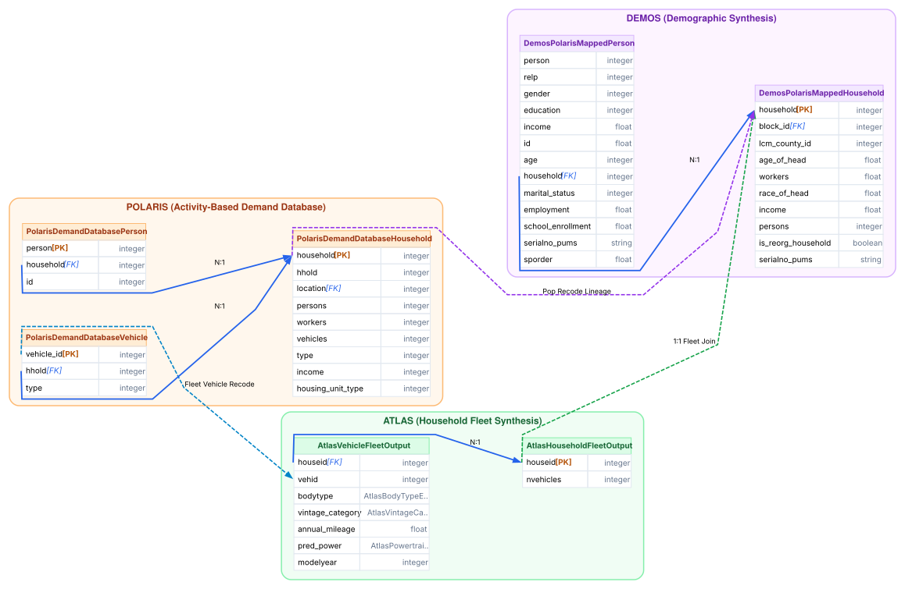
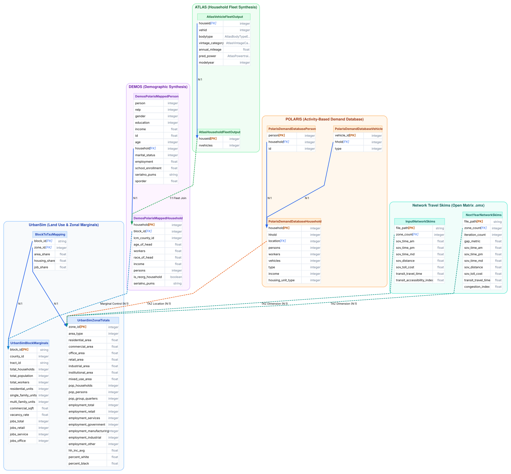

# Database Schema & Entity-Relationship Diagrams

This page presents the compiled Entity-Relationship (ER) diagrams and foreign key contracts linking the multi-model population, vehicle fleet, land-use, and network skim tables across **UrbanSim**, **DEMOS**, **ATLAS**, **POLARIS**, and **OMX Skims** for Deliverable #1.

All tables, column definitions, primary keys, foreign keys, and cross-model handoff relationships are **generated directly from the LinkML schema contracts** (`src/synergy_schema/schema/deliverable_1_static_schema.yaml`).

---

## 1. Core Population & Vehicle Fleet ERD

The diagram below isolates the synthetic agent tables across DEMOS, ATLAS, and POLARIS with explicit relational cardinalities:

=== "Mermaid ER Diagram (Standard Crows-Feet)"

    ```mermaid
    erDiagram
        DemosPolarisMappedHousehold ||--|{ DemosPolarisMappedPerson : "contains"
        AtlasHouseholdFleetOutput ||--|{ AtlasVehicleFleetOutput : "owns"
        PolarisDemandDatabaseHousehold ||--|{ PolarisDemandDatabasePerson : "contains"
        PolarisDemandDatabaseHousehold ||--|{ PolarisDemandDatabaseVehicle : "owns"
        DemosPolarisMappedHousehold ||--|| AtlasHouseholdFleetOutput : "1:1 fleet join"
        DemosPolarisMappedHousehold ||--|| PolarisDemandDatabaseHousehold : "pop recode lineage"
        AtlasVehicleFleetOutput ||--|| PolarisDemandDatabaseVehicle : "vehicle recode"

        AtlasHouseholdFleetOutput {
            int houseid PK "Authoritative household identifier in..."
            int nvehicles "Household vehicle-count value"
        }

        AtlasVehicleFleetOutput {
            int vehid PK "Observed vehicle identifier within a..."
            int houseid FK "Household identifier joining to..."
            string bodytype "Observed bodytype value"
            string vintage_category "Observed vintage_category value"
            float annual_mileage "Observed annual_mileage value"
            string pred_power "Observed pred_power value"
            int modelyear "Observed modelyear value"
        }

        DemosPolarisMappedHousehold {
            int household PK "Physical household identifier column"
            int block_id FK "Physical block identifier column"
            int lcm_county_id "Physical LCM county identifier column"
            float age_of_head "Physical household-head age column"
            float workers "Physical household workers column"
            float race_of_head "Physical household-head race code column"
            float income "Physical household income column"
            int persons "Physical household persons-count column"
            bool is_reorg_household "Physical household reorganization..."
            string serialno_pums "Physical Census PUMS seed household..."
        }

        DemosPolarisMappedPerson {
            int person PK "Physical person identifier column"
            int household FK "Physical household identifier column"
            int relp "Physical relationship-to-household..."
            int gender "Physical gender code column"
            int education "Physical education code column"
            float income "Physical person income column"
            float id "Physical within-row/person ordinal-..."
            int age "Physical person age column"
            int marital_status "Physical marital-status code column"
            float employment "Physical employment code column"
            float school_enrollment "Physical school-enrollment code column"
            string serialno_pums "Physical Census PUMS seed household..."
            float sporder "Physical Census PUMS seed person..."
        }

        PolarisDemandDatabaseHousehold {
            int household PK "Physical Household primary-key column"
            int location FK "Physical household location identifier"
            int hhold "Physical household column retained as..."
            int persons "Physical household person-count column"
            int workers "Physical household worker-count column"
            int vehicles "Physical household vehicle-count column"
            int type "Physical household type field; code..."
            int income "Physical household income field;..."
            int housing_unit_type "Physical housing-unit-type field;..."
        }

        PolarisDemandDatabasePerson {
            int person PK "Physical Person primary-key column"
            int household FK "Physical household join value checked..."
            int id "Physical within-household person..."
        }

        PolarisDemandDatabaseVehicle {
            int vehicle_id PK "Physical Vehicle primary-key column"
            int hhold FK "Physical household join value checked..."
            int type "Physical vehicle type field; code..."
        }
    ```

=== "Graphviz Diagram (Attribute Ports)"

    <div class="erd-diagram-card">
      <p><a href="../assets/images/deliverable_1_population_erd.svg" target="_blank" class="md-button md-button--primary">Open High-Resolution Population ERD (Vector SVG)</a></p>
      
    </div>

---

## 2. Complete 5-Model Regional Architecture ERD

The regional architecture diagram links all 12 tables across the 5 models, including UrbanSim Census Block marginals, Block-to-TAZ aggregation tables, and Open Matrix (`.omx`) travel impedance matrices.

=== "Mermaid ER Diagram (Standard Crows-Feet)"

    ```mermaid
    erDiagram
        DemosPolarisMappedHousehold ||--|{ DemosPolarisMappedPerson : "contains"
        AtlasHouseholdFleetOutput ||--|{ AtlasVehicleFleetOutput : "owns"
        PolarisDemandDatabaseHousehold ||--|{ PolarisDemandDatabasePerson : "contains"
        PolarisDemandDatabaseHousehold ||--|{ PolarisDemandDatabaseVehicle : "owns"
        UrbanSimBlockMarginals ||--|{ BlockToTazMapping : "maps_to"
        UrbanSimZonalTotals ||--|{ BlockToTazMapping : "aggregates"
        DemosPolarisMappedHousehold ||--|| AtlasHouseholdFleetOutput : "1:1 fleet join"
        DemosPolarisMappedHousehold ||--|| PolarisDemandDatabaseHousehold : "pop recode lineage"
        AtlasVehicleFleetOutput ||--|| PolarisDemandDatabaseVehicle : "vehicle recode"
        UrbanSimBlockMarginals ||--o{ DemosPolarisMappedHousehold : "marginal control"
        UrbanSimZonalTotals ||--o{ PolarisDemandDatabaseHousehold : "TAZ location"
        UrbanSimZonalTotals ||--o{ InputNetworkSkims : "TAZ dimension"
        UrbanSimZonalTotals ||--o{ NextYearNetworkSkims : "TAZ dimension"

        AtlasHouseholdFleetOutput {
            int houseid PK "Authoritative household identifier in..."
            int nvehicles "Household vehicle-count value"
        }

        AtlasVehicleFleetOutput {
            int vehid PK "Observed vehicle identifier within a..."
            int houseid FK "Household identifier joining to..."
            string bodytype "Observed bodytype value"
            string vintage_category "Observed vintage_category value"
            float annual_mileage "Observed annual_mileage value"
            string pred_power "Observed pred_power value"
            int modelyear "Observed modelyear value"
        }

        BlockToTazMapping {
            string block_id FK "Census block identifier referencing..."
            int zone_id FK "Macro-zone / Traffic Analysis Zone..."
            float area_share "Proportion of block area intersecting..."
            float housing_share "Proportion of block housing units..."
            float job_share "Proportion of block employment..."
        }

        DemosPolarisMappedHousehold {
            int household PK "Physical household identifier column"
            int block_id FK "Physical block identifier column"
            int lcm_county_id "Physical LCM county identifier column"
            float age_of_head "Physical household-head age column"
            float workers "Physical household workers column"
            float race_of_head "Physical household-head race code column"
            float income "Physical household income column"
            int persons "Physical household persons-count column"
            bool is_reorg_household "Physical household reorganization..."
            string serialno_pums "Physical Census PUMS seed household..."
        }

        DemosPolarisMappedPerson {
            int person PK "Physical person identifier column"
            int household FK "Physical household identifier column"
            int relp "Physical relationship-to-household..."
            int gender "Physical gender code column"
            int education "Physical education code column"
            float income "Physical person income column"
            float id "Physical within-row/person ordinal-..."
            int age "Physical person age column"
            int marital_status "Physical marital-status code column"
            float employment "Physical employment code column"
            float school_enrollment "Physical school-enrollment code column"
            string serialno_pums "Physical Census PUMS seed household..."
            float sporder "Physical Census PUMS seed person..."
        }

        InputNetworkSkims {
            string file_path PK "Relative path to the"
            int zone_count FK "Number of Traffic Analysis Zones..."
            float sov_time_am "Single-occupant auto highway travel..."
            float sov_time_pm "Single-occupant auto highway travel..."
            float sov_time_md "Single-occupant auto highway travel..."
            float sov_distance "Network highway travel distance (in..."
            float sov_toll_cost "Monetary toll cost for auto travel..."
            float transit_travel_time "Total transit travel time including..."
            float transit_accessibility_index "Composite regional accessibility..."
        }

        NextYearNetworkSkims {
            string file_path PK "Relative path to the output"
            int zone_count FK "Number of Traffic Analysis Zones..."
            int iteration_count "Number of DTA feedback iterations..."
            float gap_metric "Relative duality gap or convergence..."
            float sov_time_am "Converged morning peak (AM) auto..."
            float sov_time_pm "Converged evening peak (PM) auto..."
            float sov_time_md "Converged midday (MD) auto travel..."
            float sov_distance "Converged network highway travel..."
            float sov_toll_cost "Converged auto toll costs"
            float transit_travel_time "Simulated transit travel time"
            float congestion_index "Ratio of congested peak travel time..."
        }

        PolarisDemandDatabaseHousehold {
            int household PK "Physical Household primary-key column"
            int location FK "Physical household location identifier"
            int hhold "Physical household column retained as..."
            int persons "Physical household person-count column"
            int workers "Physical household worker-count column"
            int vehicles "Physical household vehicle-count column"
            int type "Physical household type field; code..."
            int income "Physical household income field;..."
            int housing_unit_type "Physical housing-unit-type field;..."
        }

        PolarisDemandDatabasePerson {
            int person PK "Physical Person primary-key column"
            int household FK "Physical household join value checked..."
            int id "Physical within-household person..."
        }

        PolarisDemandDatabaseVehicle {
            int vehicle_id PK "Physical Vehicle primary-key column"
            int hhold FK "Physical household join value checked..."
            int type "Physical vehicle type field; code..."
        }

        UrbanSimBlockMarginals {
            string block_id PK "15-digit Census Block FIPS identifier..."
            int county_id "5-digit State and County FIPS..."
            string tract_id "11-digit Census Tract identifier"
            int total_households "Target marginal count of occupied..."
            int total_population "Target marginal count of total..."
            int total_workers "Target marginal count of resident..."
            int residential_units "Total residential dwelling unit..."
            int single_family_units "Count of detached single-family..."
            int multi_family_units "Count of multi-family residential..."
            float commercial_sqft "Commercial real estate floor space..."
            float vacancy_rate "Residential vacancy rate in this block"
            int jobs_total "Total employment located in this block"
            int jobs_retail "Retail employment located in this block"
            int jobs_service "Service-sector employment located in..."
            int jobs_office "Office/professional employment..."
        }

        UrbanSimZonalTotals {
            int zone_id PK "Traffic Analysis Zone (TAZ)..."
            int area_type "Urban form / density classification (e"
            float residential_area "Total residential floor or lot area"
            float commercial_area "Total commercial floor or lot area"
            float office_area "Total office floor area"
            float retail_area "Total retail floor area"
            float industrial_area "Total industrial/warehouse floor area"
            float institutional_area "Institutional / medical / civic land..."
            float mixed_use_area "Mixed-use development area"
            int pop_households "Zonal total households matching..."
            int pop_persons "Zonal total persons matching POLARIS..."
            int pop_group_quarters "Group quarters population (dorms,..."
            int employment_total "Total zonal employment matching..."
            int employment_retail "Retail employment"
            int employment_services "Service industry employment"
            int employment_government "Government/civic employment"
            int employment_manufacturing "Manufacturing employment"
            int employment_industrial "Industrial employment"
            int employment_other "Other employment categories"
            float hh_inc_avg "Average household income within the zone"
            float percent_white "Proportion of Caucasian population"
            float percent_black "Proportion of African American..."
        }
    ```

=== "Graphviz Diagram (Attribute Ports)"

    <div class="erd-diagram-card">
      <p><a href="../assets/images/deliverable_1_erd.svg" target="_blank" class="md-button md-button--primary">Open High-Resolution Regional ERD (Vector SVG)</a></p>
      
    </div>

---

## 3. Foreign Key & Pipeline Linkage Reference Table

The table below documents every intra-model foreign key and cross-model handoff contract compiled from the schema:

| Child Table | Child Column | Parent Table | Parent Column | Cardinality | Link Type | Pipeline Purpose |
| :--- | :--- | :--- | :--- | :---: | :--- | :--- |
| `BlockToTazMapping` | `block_id` `[FK]` | `UrbanSimBlockMarginals` | `block_id` `[PK]` | $N:1$ | Intra-Model FK | Associates Census Blocks with regional marginal controls |
| `BlockToTazMapping` | `zone_id` `[FK]` | `UrbanSimZonalTotals` | `zone_id` `[PK]` | $N:1$ | Intra-Model FK | Maps Census Blocks into POLARIS-compatible TAZ zones |
| `DemosPolarisMappedPerson` | `household` `[FK]` | `DemosPolarisMappedHousehold` | `household` `[PK]` | $N:1$ | Intra-Model FK | Enforces person membership in synthetic households |
| `AtlasVehicleFleetOutput` | `houseid` `[FK]` | `AtlasHouseholdFleetOutput` | `houseid` `[PK]` | $N:1$ | Intra-Model FK | Associates discrete vehicles with synthesized household fleets |
| `PolarisDemandDatabasePerson` | `household` `[FK]` | `PolarisDemandDatabaseHousehold` | `household` `[PK]` | $N:1$ | Intra-Model FK | Enforces POLARIS traveler membership in households |
| `PolarisDemandDatabaseVehicle` | `hhold` `[FK]` | `PolarisDemandDatabaseHousehold` | `household` `[PK]` | $N:1$ | Intra-Model FK | Associates POLARIS vehicles with households |
| `AtlasHouseholdFleetOutput` | `houseid` `[FK]` | `DemosPolarisMappedHousehold` | `household` `[PK]` | $1:1$ | Cross-Model Join | Joins ATLAS synthesized vehicle counts to DEMOS households |
| `PolarisDemandDatabaseHousehold` | `household` `[FK]` | `DemosPolarisMappedHousehold` | `household` `[PK]` | $1:1$ | Cross-Model Lineage | Lineage tracking from DEMOS base population to POLARIS demand |
| `PolarisDemandDatabaseVehicle` | `vehicle_id` `[FK]` | `AtlasVehicleFleetOutput` | `vehid` `[PK]` | $1:1$ | Cross-Model Lineage | Recodes ATLAS discrete vehicles to POLARIS vehicle types |
| `PolarisDemandDatabaseHousehold` | `location` `[FK]` | `UrbanSimZonalTotals` | `zone_id` `[PK]` | $N:1$ | Cross-Model Spatial | Assigns household residence to UrbanSim TAZ zones |
| `DemosPolarisMappedHousehold` | `block_id` `[FK]` | `UrbanSimBlockMarginals` | `block_id` `[PK]` | $N:1$ | Cross-Model Spatial | Controls demographic synthesis by Census Block marginals |
| `InputNetworkSkims` | `zone_count` `[FK]` | `UrbanSimZonalTotals` | `zone_id` `[PK]` | $N:1$ | Cross-Model Spatial | Confirms skim matrix dimensions match active TAZ zones |
| `NextYearNetworkSkims` | `zone_count` `[FK]` | `UrbanSimZonalTotals` | `zone_id` `[PK]` | $N:1$ | Cross-Model Spatial | Confirms iterative skim matrix dimensions match active TAZ zones |

---

## 4. Interactive Schema Inspector

The interactive canvas below provides dynamic filtering and metadata inspection for individual tables and columns:

<div class="schema-explorer-outer">
  <!-- Controls Bar -->
  <div class="schema-explorer-toolbar">
    <div class="schema-filter-group">
      <span class="schema-toolbar-label">Model:</span>
      <button class="schema-filter-btn active" data-model="ALL">All Models</button>
      <button class="schema-filter-btn" data-model="UrbanSim">UrbanSim</button>

      <button class="schema-filter-btn" data-model="DEMOS">DEMOS</button>
      <button class="schema-filter-btn" data-model="ATLAS">ATLAS</button>
      <button class="schema-filter-btn" data-model="POLARIS">POLARIS</button>
      <button class="schema-filter-btn" data-model="Skims">OMX Skims</button>
    </div>
    <div class="schema-actions-group">
      <div class="schema-search-box">
        <input type="text" id="schema-search-input" placeholder="Search tables or columns..." />
      </div>
      <div class="schema-zoom-controls">
        <button id="schema-zoom-in" title="Zoom In">+</button>
        <button id="schema-zoom-out" title="Zoom Out">&minus;</button>
        <button id="schema-zoom-fit" title="Fit to View">Fit View</button>
        <button id="schema-fullscreen" title="Toggle Fullscreen">&#x26F6;</button>
      </div>
    </div>
  </div>

  <!-- Main Viewport -->
  <div id="schema-viewport" class="schema-viewport">
    <svg id="schema-svg-layer" class="schema-svg-layer"></svg>
    <div id="schema-nodes-layer" class="schema-nodes-layer"></div>

    <!-- Inspector Drawer -->
    <div id="schema-inspector" class="schema-inspector hidden">
      <div class="schema-inspector-header">
        <div class="schema-inspector-title-wrap">
          <span id="inspector-model-badge" class="schema-model-badge">MODEL</span>
          <h3 id="inspector-table-name">Table Name</h3>
        </div>
        <button id="inspector-close-btn" class="schema-close-btn">&times;</button>
      </div>
      <div class="schema-inspector-body">
        <p id="inspector-description" class="schema-inspector-desc"></p>

        <h4>Relationships</h4>
        <div id="inspector-relationships" class="schema-relationships-list"></div>

        <h4>Columns & Field Types</h4>
        <div id="inspector-columns-table-wrap">
          <table class="schema-columns-table">
            <thead>
              <tr>
                <th>Field</th>
                <th>Type</th>
                <th>Key / Crosswalk</th>
                <th>Description</th>
              </tr>
            </thead>
            <tbody id="inspector-columns-body"></tbody>
          </table>
        </div>
      </div>
    </div>
  </div>

  <!-- Legend -->
  <div class="schema-legend">
    <span class="legend-item"><span class="legend-line solid-line"></span> Solid Line: Within-Model Foreign Key</span>
    <span class="legend-item"><span class="legend-line dashed-line"></span> Dashed Line: Cross-Model Data Handoff Channel</span>
    <span class="legend-item"><span class="legend-badge pk-badge">PK</span> Primary Key</span>
    <span class="legend-item"><span class="legend-badge fk-badge">FK</span> Foreign Key</span>
    <span class="legend-item"><span class="legend-badge cw-badge">X-*</span> Categorical Crosswalk Rule</span>
  </div>
</div>

<script>
window.SCHEMA_GRAPH_DATA = {"tables": [{"id": "InputNetworkSkims", "name": "InputNetworkSkims", "alias": "InputNetworkSkims", "model": "Skims", "description": "Open Matrix (.omx) container representing baseline zone-to-zone travel times, distances, and generalized costs provided as input to UrbanSim and ATLAS.", "x": 40, "y": 60, "width": 310, "columns": [{"name": "file_path", "type": "string", "required": true, "pk": true, "fk": null, "crosswalk": null, "description": "Relative path to the .omx HDF5 matrix file."}, {"name": "zone_count", "type": "integer", "required": true, "pk": false, "fk": null, "crosswalk": null, "description": "Number of Traffic Analysis Zones (TAZ) in the square matrix dimension."}, {"name": "sov_time_am", "type": "float", "required": false, "pk": false, "fk": null, "crosswalk": null, "description": "Single-occupant auto highway travel time in minutes during the morning peak period (AM)."}, {"name": "sov_time_pm", "type": "float", "required": false, "pk": false, "fk": null, "crosswalk": null, "description": "Single-occupant auto highway travel time in minutes during the evening peak period (PM)."}, {"name": "sov_time_md", "type": "float", "required": false, "pk": false, "fk": null, "crosswalk": null, "description": "Single-occupant auto highway travel time in minutes during the midday off-peak period (MD)."}, {"name": "sov_distance", "type": "float", "required": false, "pk": false, "fk": null, "crosswalk": null, "description": "Network highway travel distance (in miles or kilometers)."}, {"name": "sov_toll_cost", "type": "float", "required": false, "pk": false, "fk": null, "crosswalk": null, "description": "Monetary toll cost for auto travel between zone pairs."}, {"name": "transit_travel_time", "type": "float", "required": false, "pk": false, "fk": null, "crosswalk": null, "description": "Total transit travel time including in-vehicle, waiting, and transfer times."}, {"name": "transit_accessibility_index", "type": "float", "required": false, "pk": false, "fk": null, "crosswalk": null, "description": "Composite regional accessibility logsum or job count reachable within a travel threshold."}]}, {"id": "NextYearNetworkSkims", "name": "NextYearNetworkSkims", "alias": "NextYearNetworkSkims", "model": "Skims", "description": "Converged dynamic traffic assignment (DTA) network skims emitted as output by POLARIS at the conclusion of Year t travel simulation. These skims capture simulated congestion, route choices, and travel times, serving as the input impedance for subsequent multi-year iterations.", "x": 40, "y": 550, "width": 310, "columns": [{"name": "file_path", "type": "string", "required": true, "pk": true, "fk": null, "crosswalk": null, "description": "Relative path to the output .omx matrix file."}, {"name": "zone_count", "type": "integer", "required": true, "pk": false, "fk": null, "crosswalk": null, "description": "Number of Traffic Analysis Zones (TAZ) in the square matrix dimension."}, {"name": "iteration_count", "type": "integer", "required": false, "pk": false, "fk": null, "crosswalk": null, "description": "Number of DTA feedback iterations completed to achieve user-equilibrium convergence."}, {"name": "gap_metric", "type": "float", "required": false, "pk": false, "fk": null, "crosswalk": null, "description": "Relative duality gap or convergence metric attained by the DTA solver."}, {"name": "sov_time_am", "type": "float", "required": false, "pk": false, "fk": null, "crosswalk": null, "description": "Converged morning peak (AM) auto travel time in minutes."}, {"name": "sov_time_pm", "type": "float", "required": false, "pk": false, "fk": null, "crosswalk": null, "description": "Converged evening peak (PM) auto travel time in minutes."}, {"name": "sov_time_md", "type": "float", "required": false, "pk": false, "fk": null, "crosswalk": null, "description": "Converged midday (MD) auto travel time in minutes."}, {"name": "sov_distance", "type": "float", "required": false, "pk": false, "fk": null, "crosswalk": null, "description": "Converged network highway travel distance."}, {"name": "sov_toll_cost", "type": "float", "required": false, "pk": false, "fk": null, "crosswalk": null, "description": "Converged auto toll costs."}, {"name": "transit_travel_time", "type": "float", "required": false, "pk": false, "fk": null, "crosswalk": null, "description": "Simulated transit travel time."}, {"name": "congestion_index", "type": "float", "required": false, "pk": false, "fk": null, "crosswalk": null, "description": "Ratio of congested peak travel time to free-flow travel time across the network."}]}, {"id": "UrbanSimBlockMarginals", "name": "UrbanSimBlockMarginals", "alias": "UrbanSimBlockMarginals", "model": "UrbanSim", "description": "Atomic census block / block-group marginal control totals and land-use capacities forecasted by UrbanSim. These totals act as demographic and housing targets for downstream micro-population synthesis and evolution.", "x": 420, "y": 60, "width": 320, "columns": [{"name": "block_id", "type": "string", "required": true, "pk": true, "fk": null, "crosswalk": null, "description": "15-digit Census Block FIPS identifier or 11-digit Block Group FIPS, preserving leading zeros (e.g. 484530018041002)."}, {"name": "county_id", "type": "integer", "required": true, "pk": false, "fk": null, "crosswalk": null, "description": "5-digit State and County FIPS identifier (e.g. 48453 for Travis County)."}, {"name": "tract_id", "type": "string", "required": false, "pk": false, "fk": null, "crosswalk": null, "description": "11-digit Census Tract identifier."}, {"name": "total_households", "type": "integer", "required": true, "pk": false, "fk": null, "crosswalk": null, "description": "Target marginal count of occupied households in this block."}, {"name": "total_population", "type": "integer", "required": true, "pk": false, "fk": null, "crosswalk": null, "description": "Target marginal count of total residents in this block."}, {"name": "total_workers", "type": "integer", "required": false, "pk": false, "fk": null, "crosswalk": null, "description": "Target marginal count of resident workers."}, {"name": "residential_units", "type": "integer", "required": true, "pk": false, "fk": null, "crosswalk": null, "description": "Total residential dwelling unit capacity in this block."}, {"name": "single_family_units", "type": "integer", "required": false, "pk": false, "fk": null, "crosswalk": null, "description": "Count of detached single-family residential units."}, {"name": "multi_family_units", "type": "integer", "required": false, "pk": false, "fk": null, "crosswalk": null, "description": "Count of multi-family residential units (apartments, condos)."}, {"name": "commercial_sqft", "type": "float", "required": false, "pk": false, "fk": null, "crosswalk": null, "description": "Commercial real estate floor space (square feet)."}, {"name": "vacancy_rate", "type": "float", "required": false, "pk": false, "fk": null, "crosswalk": null, "description": "Residential vacancy rate in this block."}, {"name": "jobs_total", "type": "integer", "required": false, "pk": false, "fk": null, "crosswalk": null, "description": "Total employment located in this block."}, {"name": "jobs_retail", "type": "integer", "required": false, "pk": false, "fk": null, "crosswalk": null, "description": "Retail employment located in this block."}, {"name": "jobs_service", "type": "integer", "required": false, "pk": false, "fk": null, "crosswalk": null, "description": "Service-sector employment located in this block."}, {"name": "jobs_office", "type": "integer", "required": false, "pk": false, "fk": null, "crosswalk": null, "description": "Office/professional employment located in this block."}]}, {"id": "BlockToTazMapping", "name": "BlockToTazMapping", "alias": "BlockToTazMapping", "model": "UrbanSim", "description": "Spatial crosswalk relationship mapping atomic Census Blocks to macro-zones (TAZs), supporting deterministic rollup and aggregation.", "x": 780, "y": 60, "width": 280, "columns": [{"name": "block_id", "type": "string", "required": true, "pk": false, "fk": "UrbanSimBlockMarginals.block_id", "crosswalk": null, "description": "Census block identifier referencing UrbanSimBlockMarginals."}, {"name": "zone_id", "type": "integer", "required": true, "pk": false, "fk": "UrbanSimZonalTotals.zone_id", "crosswalk": null, "description": "Macro-zone / Traffic Analysis Zone (TAZ) identifier."}, {"name": "area_share", "type": "float", "required": false, "pk": false, "fk": null, "crosswalk": null, "description": "Proportion of block area intersecting the TAZ (1.0 for coterminous boundaries)."}, {"name": "housing_share", "type": "float", "required": false, "pk": false, "fk": null, "crosswalk": null, "description": "Proportion of block housing units allocated to this TAZ."}, {"name": "job_share", "type": "float", "required": false, "pk": false, "fk": null, "crosswalk": null, "description": "Proportion of block employment allocated to this TAZ."}]}, {"id": "UrbanSimZonalTotals", "name": "UrbanSimZonalTotals", "alias": "UrbanSimZonalTotals", "model": "UrbanSim", "description": "Aggregated macro-zone (TAZ) land use, marginal population, and employment totals matching POLARIS Supply.sqlite Zone table attributes.", "x": 1100, "y": 60, "width": 310, "columns": [{"name": "zone_id", "type": "integer", "required": true, "pk": true, "fk": null, "crosswalk": null, "description": "Traffic Analysis Zone (TAZ) identifier matching POLARIS Zone.zone."}, {"name": "area_type", "type": "integer", "required": false, "pk": false, "fk": null, "crosswalk": null, "description": "Urban form / density classification (e.g. 1=CBD, 2=Urban, 3=Suburban, 4=Rural)."}, {"name": "residential_area", "type": "float", "required": false, "pk": false, "fk": null, "crosswalk": null, "description": "Total residential floor or lot area."}, {"name": "commercial_area", "type": "float", "required": false, "pk": false, "fk": null, "crosswalk": null, "description": "Total commercial floor or lot area."}, {"name": "office_area", "type": "float", "required": false, "pk": false, "fk": null, "crosswalk": null, "description": "Total office floor area."}, {"name": "retail_area", "type": "float", "required": false, "pk": false, "fk": null, "crosswalk": null, "description": "Total retail floor area."}, {"name": "industrial_area", "type": "float", "required": false, "pk": false, "fk": null, "crosswalk": null, "description": "Total industrial/warehouse floor area."}, {"name": "institutional_area", "type": "float", "required": false, "pk": false, "fk": null, "crosswalk": null, "description": "Institutional / medical / civic land area."}, {"name": "mixed_use_area", "type": "float", "required": false, "pk": false, "fk": null, "crosswalk": null, "description": "Mixed-use development area."}, {"name": "pop_households", "type": "integer", "required": false, "pk": false, "fk": null, "crosswalk": null, "description": "Zonal total households matching POLARIS Zone.pop_households."}, {"name": "pop_persons", "type": "integer", "required": false, "pk": false, "fk": null, "crosswalk": null, "description": "Zonal total persons matching POLARIS Zone.pop_persons."}, {"name": "pop_group_quarters", "type": "integer", "required": false, "pk": false, "fk": null, "crosswalk": null, "description": "Group quarters population (dorms, barracks, correctional)."}, {"name": "employment_total", "type": "integer", "required": false, "pk": false, "fk": null, "crosswalk": null, "description": "Total zonal employment matching POLARIS Zone.employment_total."}, {"name": "employment_retail", "type": "integer", "required": false, "pk": false, "fk": null, "crosswalk": null, "description": "Retail employment."}, {"name": "employment_services", "type": "integer", "required": false, "pk": false, "fk": null, "crosswalk": null, "description": "Service industry employment."}, {"name": "employment_government", "type": "integer", "required": false, "pk": false, "fk": null, "crosswalk": null, "description": "Government/civic employment."}, {"name": "employment_manufacturing", "type": "integer", "required": false, "pk": false, "fk": null, "crosswalk": null, "description": "Manufacturing employment."}, {"name": "employment_industrial", "type": "integer", "required": false, "pk": false, "fk": null, "crosswalk": null, "description": "Industrial employment."}, {"name": "employment_other", "type": "integer", "required": false, "pk": false, "fk": null, "crosswalk": null, "description": "Other employment categories."}, {"name": "hh_inc_avg", "type": "float", "required": false, "pk": false, "fk": null, "crosswalk": null, "description": "Average household income within the zone."}, {"name": "percent_white", "type": "float", "required": false, "pk": false, "fk": null, "crosswalk": null, "description": "Proportion of Caucasian population."}, {"name": "percent_black", "type": "float", "required": false, "pk": false, "fk": null, "crosswalk": null, "description": "Proportion of African American population."}]}, {"id": "DemosPolarisMappedHousehold", "name": "DemosPolarisMappedHousehold", "alias": "DemosHousehold", "model": "DEMOS", "description": "Authoritative household schema for DEMOS synthetic population mapped for POLARIS simulation. Physical columns match the DEMOS household export.", "x": 420, "y": 520, "width": 320, "columns": [{"name": "household", "type": "integer", "required": true, "pk": true, "fk": null, "crosswalk": null, "description": "Physical household identifier column."}, {"name": "block_id", "type": "integer", "required": true, "pk": false, "fk": "UrbanSimBlockMarginals.block_id", "crosswalk": null, "description": "Physical block identifier column."}, {"name": "lcm_county_id", "type": "integer", "required": true, "pk": false, "fk": null, "crosswalk": null, "description": "Physical LCM county identifier column."}, {"name": "age_of_head", "type": "float", "required": true, "pk": false, "fk": null, "crosswalk": null, "description": "Physical household-head age column."}, {"name": "workers", "type": "float", "required": true, "pk": false, "fk": null, "crosswalk": null, "description": "Physical household workers column."}, {"name": "race_of_head", "type": "float", "required": true, "pk": false, "fk": null, "crosswalk": null, "description": "Physical household-head race code column."}, {"name": "income", "type": "float", "required": true, "pk": false, "fk": null, "crosswalk": null, "description": "Physical household income column."}, {"name": "persons", "type": "integer", "required": true, "pk": false, "fk": null, "crosswalk": null, "description": "Physical household persons-count column."}, {"name": "is_reorg_household", "type": "boolean", "required": true, "pk": false, "fk": null, "crosswalk": null, "description": "Physical household reorganization indicator column."}, {"name": "serialno_pums", "type": "string", "required": false, "pk": false, "fk": null, "crosswalk": null, "description": "Physical Census PUMS seed household identifier column."}]}, {"id": "DemosPolarisMappedPerson", "name": "DemosPolarisMappedPerson", "alias": "DemosPerson", "model": "DEMOS", "description": "Authoritative person schema for DEMOS synthetic population mapped for POLARIS simulation. Physical columns match the DEMOS person export.", "x": 780, "y": 520, "width": 310, "columns": [{"name": "person", "type": "integer", "required": true, "pk": false, "fk": null, "crosswalk": null, "description": "Physical person identifier column."}, {"name": "relp", "type": "integer", "required": true, "pk": false, "fk": null, "crosswalk": "X-P1", "description": "Physical relationship-to-household code column."}, {"name": "gender", "type": "integer", "required": true, "pk": false, "fk": null, "crosswalk": "X-P2", "description": "Physical gender code column."}, {"name": "education", "type": "integer", "required": true, "pk": false, "fk": null, "crosswalk": "X-P4", "description": "Physical education code column."}, {"name": "income", "type": "float", "required": true, "pk": false, "fk": null, "crosswalk": null, "description": "Physical person income column."}, {"name": "id", "type": "float", "required": false, "pk": false, "fk": null, "crosswalk": null, "description": "Physical within-row/person ordinal-like column; it is optional in this provisional shape and uniqueness is not asserted."}, {"name": "age", "type": "integer", "required": true, "pk": false, "fk": null, "crosswalk": null, "description": "Physical person age column."}, {"name": "household", "type": "integer", "required": true, "pk": false, "fk": "DemosPolarisMappedHousehold.household", "crosswalk": null, "description": "Physical household identifier column."}, {"name": "marital_status", "type": "integer", "required": true, "pk": false, "fk": null, "crosswalk": null, "description": "Physical marital-status code column."}, {"name": "employment", "type": "float", "required": true, "pk": false, "fk": null, "crosswalk": "X-P5", "description": "Physical employment code column."}, {"name": "school_enrollment", "type": "float", "required": true, "pk": false, "fk": null, "crosswalk": "X-P6", "description": "Physical school-enrollment code column."}, {"name": "serialno_pums", "type": "string", "required": false, "pk": false, "fk": null, "crosswalk": null, "description": "Physical Census PUMS seed household identifier column."}, {"name": "sporder", "type": "float", "required": false, "pk": false, "fk": null, "crosswalk": null, "description": "Physical Census PUMS seed person sequence order column."}]}, {"id": "AtlasHouseholdFleetOutput", "name": "AtlasHouseholdFleetOutput", "alias": "AtlasHousehold", "model": "ATLAS", "description": "Authoritative household-side fleet summary row contract produced by ATLAS. Summarizes total vehicle counts (nvehicles) by household identifier (HOUSEID).", "x": 1130, "y": 480, "width": 290, "columns": [{"name": "houseid", "type": "integer", "required": true, "pk": true, "fk": null, "crosswalk": null, "description": "Authoritative household identifier in the ATLAS fleet output."}, {"name": "nvehicles", "type": "integer", "required": true, "pk": false, "fk": null, "crosswalk": null, "description": "Household vehicle-count value."}]}, {"id": "AtlasVehicleFleetOutput", "name": "AtlasVehicleFleetOutput", "alias": "AtlasVehicle", "model": "ATLAS", "description": "Authoritative vehicle fleet row contract produced by ATLAS. Details vehicle body type, discrete powertrain technology, model year, and projected annual mileage for each vehicle owned by a household.", "x": 1130, "y": 680, "width": 290, "columns": [{"name": "houseid", "type": "integer", "required": true, "pk": false, "fk": "AtlasHouseholdFleetOutput.houseid", "crosswalk": null, "description": "Household identifier joining to AtlasHouseholdFleetOutput."}, {"name": "vehid", "type": "integer", "required": true, "pk": false, "fk": null, "crosswalk": null, "description": "Observed vehicle identifier within a household."}, {"name": "bodytype", "type": "AtlasBodyTypeEnum", "required": false, "pk": false, "fk": null, "crosswalk": null, "description": "Observed bodytype value."}, {"name": "vintage_category", "type": "AtlasVintageCategoryEnum", "required": false, "pk": false, "fk": null, "crosswalk": null, "description": "Observed vintage_category value."}, {"name": "annual_mileage", "type": "float", "required": false, "pk": false, "fk": null, "crosswalk": null, "description": "Observed annual_mileage value."}, {"name": "pred_power", "type": "AtlasPowertrainEnum", "required": false, "pk": false, "fk": null, "crosswalk": null, "description": "Observed pred_power value."}, {"name": "modelyear", "type": "integer", "required": false, "pk": false, "fk": null, "crosswalk": null, "description": "Observed modelyear value."}]}, {"id": "PolarisDemandDatabaseHousehold", "name": "PolarisDemandDatabaseHousehold", "alias": "PolarisHousehold", "model": "POLARIS", "description": "Authoritative Household table schema for the POLARIS Demand SQLite database.", "x": 580, "y": 980, "width": 320, "columns": [{"name": "household", "type": "integer", "required": true, "pk": true, "fk": null, "crosswalk": null, "description": "Physical Household primary-key column."}, {"name": "hhold", "type": "integer", "required": true, "pk": false, "fk": null, "crosswalk": null, "description": "Physical household column retained as distinct from household; not an alias or uniqueness constraint."}, {"name": "location", "type": "integer", "required": true, "pk": false, "fk": "UrbanSimZonalTotals.zone_id", "crosswalk": null, "description": "Physical household location identifier."}, {"name": "persons", "type": "integer", "required": true, "pk": false, "fk": null, "crosswalk": null, "description": "Physical household person-count column."}, {"name": "workers", "type": "integer", "required": true, "pk": false, "fk": null, "crosswalk": null, "description": "Physical household worker-count column."}, {"name": "vehicles", "type": "integer", "required": true, "pk": false, "fk": null, "crosswalk": null, "description": "Physical household vehicle-count column."}, {"name": "type", "type": "integer", "required": true, "pk": false, "fk": null, "crosswalk": null, "description": "Physical household type field; code semantics are not asserted here."}, {"name": "income", "type": "integer", "required": true, "pk": false, "fk": null, "crosswalk": null, "description": "Physical household income field; units and semantics are not asserted here."}, {"name": "housing_unit_type", "type": "integer", "required": true, "pk": false, "fk": null, "crosswalk": null, "description": "Physical housing-unit-type field; code semantics are not asserted here."}]}, {"id": "PolarisDemandDatabasePerson", "name": "PolarisDemandDatabasePerson", "alias": "PolarisPerson", "model": "POLARIS", "description": "Authoritative Person table schema for the POLARIS Demand SQLite database.", "x": 940, "y": 980, "width": 290, "columns": [{"name": "person", "type": "integer", "required": true, "pk": true, "fk": null, "crosswalk": null, "description": "Physical Person primary-key column."}, {"name": "household", "type": "integer", "required": true, "pk": false, "fk": "PolarisDemandDatabaseHousehold.household", "crosswalk": null, "description": "Physical household join value checked externally against Household.household."}, {"name": "id", "type": "integer", "required": true, "pk": false, "fk": null, "crosswalk": null, "description": "Physical within-household person identifier."}]}, {"id": "PolarisDemandDatabaseVehicle", "name": "PolarisDemandDatabaseVehicle", "alias": "PolarisVehicle", "model": "POLARIS", "description": "Authoritative Vehicle table schema for the POLARIS Demand SQLite database.", "x": 1270, "y": 980, "width": 290, "columns": [{"name": "vehicle_id", "type": "integer", "required": true, "pk": true, "fk": null, "crosswalk": null, "description": "Physical Vehicle primary-key column."}, {"name": "hhold", "type": "integer", "required": true, "pk": false, "fk": "PolarisDemandDatabaseHousehold.household", "crosswalk": null, "description": "Physical household join value checked externally against Household.household."}, {"name": "type", "type": "integer", "required": true, "pk": false, "fk": null, "crosswalk": null, "description": "Physical vehicle type field; code semantics are not asserted here."}]}], "edges": [{"id": "BlockToTazMapping_block_id_to_UrbanSimBlockMarginals", "source": "BlockToTazMapping", "source_col": "block_id", "target": "UrbanSimBlockMarginals", "target_col": "block_id", "label": "FK: block_id", "type": "intra_model_fk", "color": "#0284c7", "dashed": false}, {"id": "BlockToTazMapping_zone_id_to_UrbanSimZonalTotals", "source": "BlockToTazMapping", "source_col": "zone_id", "target": "UrbanSimZonalTotals", "target_col": "zone_id", "label": "FK: zone_id", "type": "intra_model_fk", "color": "#0284c7", "dashed": false}, {"id": "DemosPolarisMappedHousehold_block_id_to_UrbanSimBlockMarginals", "source": "DemosPolarisMappedHousehold", "source_col": "block_id", "target": "UrbanSimBlockMarginals", "target_col": "block_id", "label": "FK: block_id", "type": "intra_model_fk", "color": "#10b981", "dashed": false}, {"id": "DemosPolarisMappedPerson_household_to_DemosPolarisMappedHousehold", "source": "DemosPolarisMappedPerson", "source_col": "household", "target": "DemosPolarisMappedHousehold", "target_col": "household", "label": "FK: household", "type": "intra_model_fk", "color": "#10b981", "dashed": false}, {"id": "AtlasVehicleFleetOutput_houseid_to_AtlasHouseholdFleetOutput", "source": "AtlasVehicleFleetOutput", "source_col": "houseid", "target": "AtlasHouseholdFleetOutput", "target_col": "houseid", "label": "FK: houseid", "type": "intra_model_fk", "color": "#f59e0b", "dashed": false}, {"id": "PolarisDemandDatabaseHousehold_location_to_UrbanSimZonalTotals", "source": "PolarisDemandDatabaseHousehold", "source_col": "location", "target": "UrbanSimZonalTotals", "target_col": "zone_id", "label": "FK: location", "type": "intra_model_fk", "color": "#8b5cf6", "dashed": false}, {"id": "PolarisDemandDatabasePerson_household_to_PolarisDemandDatabaseHousehold", "source": "PolarisDemandDatabasePerson", "source_col": "household", "target": "PolarisDemandDatabaseHousehold", "target_col": "household", "label": "FK: household", "type": "intra_model_fk", "color": "#8b5cf6", "dashed": false}, {"id": "PolarisDemandDatabaseVehicle_hhold_to_PolarisDemandDatabaseHousehold", "source": "PolarisDemandDatabaseVehicle", "source_col": "hhold", "target": "PolarisDemandDatabaseHousehold", "target_col": "household", "label": "FK: hhold", "type": "intra_model_fk", "color": "#8b5cf6", "dashed": false}, {"id": "C-U1", "source": "UrbanSimBlockMarginals", "source_col": "block_id", "target": "DemosPolarisMappedHousehold", "target_col": "block_id", "label": "C-U1: Block Controls", "description": "Zonal and Census Block marginal populations feed synthetic household creation.", "type": "cross_model_channel", "color": "#38bdf8", "dashed": true}, {"id": "C-D1", "source": "DemosPolarisMappedHousehold", "source_col": "household", "target": "AtlasHouseholdFleetOutput", "target_col": "houseid", "label": "C-D1: Household Identity", "description": "Deterministic 1-to-1 household identifier handoff from DEMOS to ATLAS.", "type": "cross_model_channel", "color": "#10b981", "dashed": true}, {"id": "C-D2_HH", "source": "DemosPolarisMappedHousehold", "source_col": "household", "target": "PolarisDemandDatabaseHousehold", "target_col": "household", "label": "C-D2: HH Demand", "description": "DEMOS household demographics mapped to POLARIS Demand.sqlite Household table.", "type": "cross_model_channel", "color": "#10b981", "dashed": true}, {"id": "C-D2_P", "source": "DemosPolarisMappedPerson", "source_col": "person", "target": "PolarisDemandDatabasePerson", "target_col": "person", "label": "C-D2: Person Demand", "description": "DEMOS person microdata mapped to POLARIS Demand.sqlite Person table with crosswalks.", "type": "cross_model_channel", "color": "#34d399", "dashed": true}, {"id": "C-A1", "source": "AtlasVehicleFleetOutput", "source_col": "houseid", "target": "PolarisDemandDatabaseVehicle", "target_col": "hhold", "label": "C-A1: Vehicle Fleet", "description": "ATLAS synthesized vehicle inventory and powertrains mapped to POLARIS Vehicle table.", "type": "cross_model_channel", "color": "#f59e0b", "dashed": true}, {"id": "C-U2", "source": "UrbanSimZonalTotals", "source_col": "zone_id", "target": "PolarisDemandDatabaseHousehold", "target_col": "location", "label": "C-U2: Zonal Allocation", "description": "Aggregated TAZ land use and capacities establish POLARIS spatial locations.", "type": "cross_model_channel", "color": "#0284c7", "dashed": true}, {"id": "C-P2_US", "source": "InputNetworkSkims", "source_col": "sov_time_am", "target": "UrbanSimBlockMarginals", "target_col": "block_id", "label": "C-P2: Accessibility Logsums", "description": "Prior-year highway travel times and distances feed land-use real estate models.", "type": "cross_model_channel", "color": "#ec4899", "dashed": true}, {"id": "C-P3", "source": "PolarisDemandDatabaseVehicle", "source_col": "vehicle_id", "target": "NextYearNetworkSkims", "target_col": "file_path", "label": "C-P3: DTA Simulation Skims", "description": "POLARIS Dynamic Traffic Assignment outputs next-year network skims for next cycle.", "type": "cross_model_channel", "color": "#a855f7", "dashed": true}], "models": {"UrbanSim": {"color": "#0284c7", "bg": "#0369a1", "border": "#38bdf8", "badge": "UrbanSim Land Use"}, "DEMOS": {"color": "#10b981", "bg": "#059669", "border": "#34d399", "badge": "DEMOS Synthesis"}, "ATLAS": {"color": "#f59e0b", "bg": "#d97706", "border": "#fbbf24", "badge": "ATLAS Fleet"}, "POLARIS": {"color": "#8b5cf6", "bg": "#7c3aed", "border": "#a78bfa", "badge": "POLARIS Demand/Supply"}, "Skims": {"color": "#ec4899", "bg": "#db2777", "border": "#f472b6", "badge": "Network Skims (.omx)"}}};
</script>
<script src="../javascripts/interactive_schema.js"></script>
