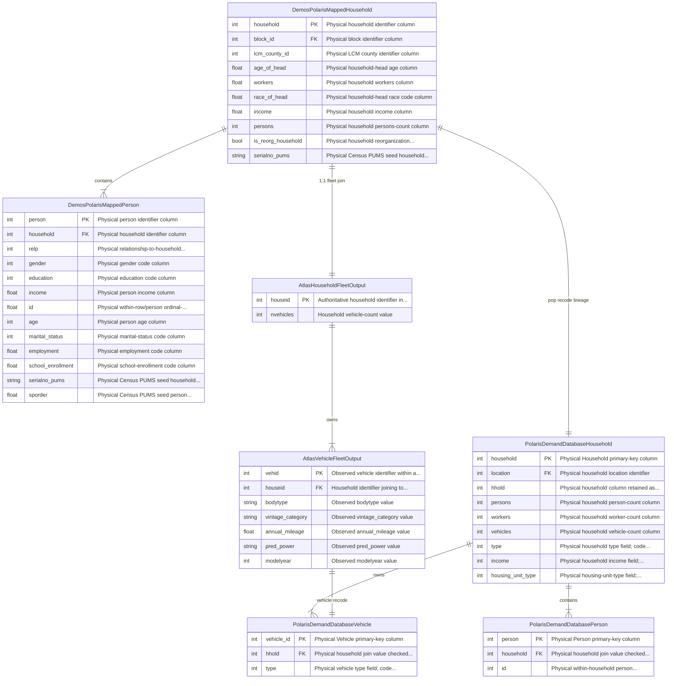

# Database Schema & Entity-Relationship Diagrams

This page presents the compiled Entity-Relationship (ER) diagrams and foreign key contracts linking the multi-model population, vehicle fleet, land-use, and network skim tables across **UrbanSim**, **DEMOS**, **ATLAS**, **POLARIS**, and **OMX Skims** for Deliverable #1.

All tables, column definitions, primary keys, foreign keys, and cross-model handoff relationships are **generated directly from the LinkML schema contracts** (`src/synergy_schema/schema/deliverable_1_static_schema.yaml`).

---

## 1. Core Population & Vehicle Fleet ERD

The diagram below isolates the synthetic agent tables across DEMOS, ATLAS, and POLARIS with explicit relational cardinalities and crow's feet notation:

---

## 2. Complete 5-Model Regional Architecture ERD

The regional architecture diagram links all 12 tables across the 5 models, including UrbanSim Census Block marginals, Block-to-TAZ aggregation tables, and Open Matrix (`.omx`) travel impedance matrices:

```mermaid
erDiagram
    DemosPolarisMappedHousehold ||--|{ DemosPolarisMappedPerson : "contains"
    AtlasHouseholdFleetOutput ||--|{ AtlasVehicleFleetOutput : "owns"
    PolarisDemandDatabaseHousehold ||--|{ PolarisDemandDatabasePerson : "contains"
    PolarisDemandDatabaseHousehold ||--|{ PolarisDemandDatabaseVehicle : "owns"
    UrbanSimBlockMarginals ||--|{ BlockToTazMapping : "maps_to"
    UrbanSimZonalTotals ||--|{ BlockToTazMapping : "aggregates"
    DemosPolarisMappedHousehold ||--|| AtlasHouseholdFleetOutput : "1:1 fleet join"
    DemosPolarisMappedHousehold ||--|| PolarisDemandDatabaseHousehold : "pop recode lineage"
    AtlasVehicleFleetOutput ||--|| PolarisDemandDatabaseVehicle : "vehicle recode"
    UrbanSimBlockMarginals ||--o{ DemosPolarisMappedHousehold : "marginal control"
    UrbanSimZonalTotals ||--o{ PolarisDemandDatabaseHousehold : "TAZ location"
    UrbanSimZonalTotals ||--o{ InputNetworkSkims : "TAZ dimension"
    UrbanSimZonalTotals ||--o{ NextYearNetworkSkims : "TAZ dimension"

    AtlasHouseholdFleetOutput {
        int houseid PK "Authoritative household identifier in..."
        int nvehicles "Household vehicle-count value"
    }

    AtlasVehicleFleetOutput {
        int vehid PK "Observed vehicle identifier within a..."
        int houseid FK "Household identifier joining to..."
        string bodytype "Observed bodytype value"
        string vintage_category "Observed vintage_category value"
        float annual_mileage "Observed annual_mileage value"
        string pred_power "Observed pred_power value"
        int modelyear "Observed modelyear value"
    }

    BlockToTazMapping {
        string block_id FK "Census block identifier referencing..."
        int zone_id FK "Macro-zone / Traffic Analysis Zone..."
        float area_share "Proportion of block area intersecting..."
        float housing_share "Proportion of block housing units..."
        float job_share "Proportion of block employment..."
    }

    DemosPolarisMappedHousehold {
        int household PK "Physical household identifier column"
        int block_id FK "Physical block identifier column"
        int lcm_county_id "Physical LCM county identifier column"
        float age_of_head "Physical household-head age column"
        float workers "Physical household workers column"
        float race_of_head "Physical household-head race code column"
        float income "Physical household income column"
        int persons "Physical household persons-count column"
        bool is_reorg_household "Physical household reorganization..."
        string serialno_pums "Physical Census PUMS seed household..."
    }

    DemosPolarisMappedPerson {
        int person PK "Physical person identifier column"
        int household FK "Physical household identifier column"
        int relp "Physical relationship-to-household..."
        int gender "Physical gender code column"
        int education "Physical education code column"
        float income "Physical person income column"
        float id "Physical within-row/person ordinal-..."
        int age "Physical person age column"
        int marital_status "Physical marital-status code column"
        float employment "Physical employment code column"
        float school_enrollment "Physical school-enrollment code column"
        string serialno_pums "Physical Census PUMS seed household..."
        float sporder "Physical Census PUMS seed person..."
    }

    InputNetworkSkims {
        string file_path PK "Relative path to the"
        int zone_count FK "Number of Traffic Analysis Zones..."
        float sov_time_am "Single-occupant auto highway travel..."
        float sov_time_pm "Single-occupant auto highway travel..."
        float sov_time_md "Single-occupant auto highway travel..."
        float sov_distance "Network highway travel distance (in..."
        float sov_toll_cost "Monetary toll cost for auto travel..."
        float transit_travel_time "Total transit travel time including..."
        float transit_accessibility_index "Composite regional accessibility..."
    }

    NextYearNetworkSkims {
        string file_path PK "Relative path to the output"
        int zone_count FK "Number of Traffic Analysis Zones..."
        int iteration_count "Number of DTA feedback iterations..."
        float gap_metric "Relative duality gap or convergence..."
        float sov_time_am "Converged morning peak (AM) auto..."
        float sov_time_pm "Converged evening peak (PM) auto..."
        float sov_time_md "Converged midday (MD) auto travel..."
        float sov_distance "Converged network highway travel..."
        float sov_toll_cost "Converged auto toll costs"
        float transit_travel_time "Simulated transit travel time"
        float congestion_index "Ratio of congested peak travel time..."
    }

    PolarisDemandDatabaseHousehold {
        int household PK "Physical Household primary-key column"
        int location FK "Physical household location identifier"
        int hhold "Physical household column retained as..."
        int persons "Physical household person-count column"
        int workers "Physical household worker-count column"
        int vehicles "Physical household vehicle-count column"
        int type "Physical household type field; code..."
        int income "Physical household income field;..."
        int housing_unit_type "Physical housing-unit-type field;..."
    }

    PolarisDemandDatabasePerson {
        int person PK "Physical Person primary-key column"
        int household FK "Physical household join value checked..."
        int id "Physical within-household person..."
    }

    PolarisDemandDatabaseVehicle {
        int vehicle_id PK "Physical Vehicle primary-key column"
        int hhold FK "Physical household join value checked..."
        int type "Physical vehicle type field; code..."
    }

    UrbanSimBlockMarginals {
        string block_id PK "15-digit Census Block FIPS identifier..."
        int county_id "5-digit State and County FIPS..."
        string tract_id "11-digit Census Tract identifier"
        int total_households "Target marginal count of occupied..."
        int total_population "Target marginal count of total..."
        int total_workers "Target marginal count of resident..."
        int residential_units "Total residential dwelling unit..."
        int single_family_units "Count of detached single-family..."
        int multi_family_units "Count of multi-family residential..."
        float commercial_sqft "Commercial real estate floor space..."
        float vacancy_rate "Residential vacancy rate in this block"
        int jobs_total "Total employment located in this block"
        int jobs_retail "Retail employment located in this block"
        int jobs_service "Service-sector employment located in..."
        int jobs_office "Office/professional employment..."
    }

    UrbanSimZonalTotals {
        int zone_id PK "Traffic Analysis Zone (TAZ)..."
        int area_type "Urban form / density classification (e"
        float residential_area "Total residential floor or lot area"
        float commercial_area "Total commercial floor or lot area"
        float office_area "Total office floor area"
        float retail_area "Total retail floor area"
        float industrial_area "Total industrial/warehouse floor area"
        float institutional_area "Institutional / medical / civic land..."
        float mixed_use_area "Mixed-use development area"
        int pop_households "Zonal total households matching..."
        int pop_persons "Zonal total persons matching POLARIS..."
        int pop_group_quarters "Group quarters population (dorms,..."
        int employment_total "Total zonal employment matching..."
        int employment_retail "Retail employment"
        int employment_services "Service industry employment"
        int employment_government "Government/civic employment"
        int employment_manufacturing "Manufacturing employment"
        int employment_industrial "Industrial employment"
        int employment_other "Other employment categories"
        float hh_inc_avg "Average household income within the zone"
        float percent_white "Proportion of Caucasian population"
        float percent_black "Proportion of African American..."
    }

```

---

## 3. Foreign Key & Pipeline Linkage Reference Table

The table below documents every intra-model foreign key and cross-model handoff contract compiled from the schema:

| Child Table | Child Column | Parent Table | Parent Column | Cardinality | Link Type | Pipeline Purpose |
| :--- | :--- | :--- | :--- | :---: | :--- | :--- |
| `BlockToTazMapping` | `block_id` `[FK]` | `UrbanSimBlockMarginals` | `block_id` `[PK]` | $N:1$ | Intra-Model FK | Associates Census Blocks with regional marginal controls |
| `BlockToTazMapping` | `zone_id` `[FK]` | `UrbanSimZonalTotals` | `zone_id` `[PK]` | $N:1$ | Intra-Model FK | Maps Census Blocks into POLARIS-compatible TAZ zones |
| `DemosPolarisMappedPerson` | `household` `[FK]` | `DemosPolarisMappedHousehold` | `household` `[PK]` | $N:1$ | Intra-Model FK | Enforces person membership in synthetic households |
| `AtlasVehicleFleetOutput` | `houseid` `[FK]` | `AtlasHouseholdFleetOutput` | `houseid` `[PK]` | $N:1$ | Intra-Model FK | Associates discrete vehicles with synthesized household fleets |
| `PolarisDemandDatabasePerson` | `household` `[FK]` | `PolarisDemandDatabaseHousehold` | `household` `[PK]` | $N:1$ | Intra-Model FK | Enforces POLARIS traveler membership in households |
| `PolarisDemandDatabaseVehicle` | `hhold` `[FK]` | `PolarisDemandDatabaseHousehold` | `household` `[PK]` | $N:1$ | Intra-Model FK | Associates POLARIS vehicles with households |
| `AtlasHouseholdFleetOutput` | `houseid` `[FK]` | `DemosPolarisMappedHousehold` | `household` `[PK]` | $1:1$ | Cross-Model Join | Joins ATLAS synthesized vehicle counts to DEMOS households |
| `PolarisDemandDatabaseHousehold` | `household` `[FK]` | `DemosPolarisMappedHousehold` | `household` `[PK]` | $1:1$ | Cross-Model Lineage | Lineage tracking from DEMOS base population to POLARIS demand |
| `PolarisDemandDatabaseVehicle` | `vehicle_id` `[FK]` | `AtlasVehicleFleetOutput` | `vehid` `[PK]` | $1:1$ | Cross-Model Lineage | Recodes ATLAS discrete vehicles to POLARIS vehicle types |
| `PolarisDemandDatabaseHousehold` | `location` `[FK]` | `UrbanSimZonalTotals` | `zone_id` `[PK]` | $N:1$ | Cross-Model Spatial | Assigns household residence to UrbanSim TAZ zones |
| `DemosPolarisMappedHousehold` | `block_id` `[FK]` | `UrbanSimBlockMarginals` | `block_id` `[PK]` | $N:1$ | Cross-Model Spatial | Controls demographic synthesis by Census Block marginals |
| `InputNetworkSkims` | `zone_count` `[FK]` | `UrbanSimZonalTotals` | `zone_id` `[PK]` | $N:1$ | Cross-Model Spatial | Confirms skim matrix dimensions match active TAZ zones |
| `NextYearNetworkSkims` | `zone_count` `[FK]` | `UrbanSimZonalTotals` | `zone_id` `[PK]` | $N:1$ | Cross-Model Spatial | Confirms iterative skim matrix dimensions match active TAZ zones |
