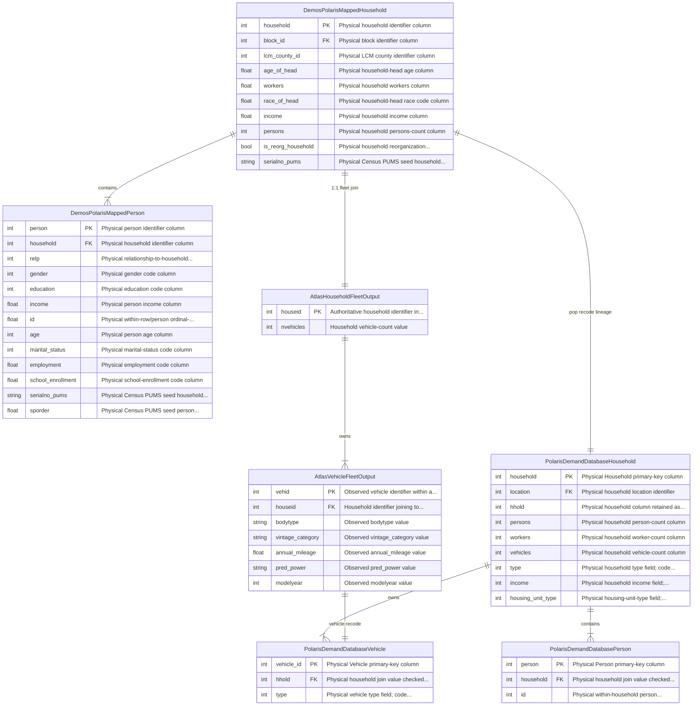

# Database Schema & Entity-Relationship Diagrams

This page presents the compiled Entity-Relationship (ER) diagrams and foreign key contracts linking the multi-model population, vehicle fleet, land-use, and network skim tables across **UrbanSim**, **DEMOS**, **ATLAS**, **POLARIS**, and **OMX Skims** for Deliverable #1.

All tables, column definitions, primary keys, foreign keys, and cross-model handoff relationships are **generated directly from the LinkML schema contracts** (`src/synergy_schema/schema/deliverable_1_static_schema.yaml`).

---

## 1. Core Population & Vehicle Fleet ERD

The diagram below isolates the synthetic agent tables across DEMOS, ATLAS, and POLARIS with explicit relational cardinalities and crow's feet notation:



---

## 2. Complete Multi-Model Regional Architecture ERD

The regional architecture diagram links all 19 tables across the modeling suite, including UrbanSim Census Block marginals, Block-to-TAZ aggregation tables, DEMOS synthetic population, ATLAS vehicle fleet, POLARIS demand/supply, ActivitySim demand inputs, BEAM dynamic simulation inputs/outputs, and travel impedance skims:

```mermaid
erDiagram
    DemosPolarisMappedHousehold ||--|{ DemosPolarisMappedPerson : "contains"
    AtlasHouseholdFleetOutput ||--|{ AtlasVehicleFleetOutput : "owns"
    PolarisDemandDatabaseHousehold ||--|{ PolarisDemandDatabasePerson : "contains"
    PolarisDemandDatabaseHousehold ||--|{ PolarisDemandDatabaseVehicle : "owns"
    UrbanSimBlockMarginals ||--|{ BlockToTazMapping : "maps_to"
    UrbanSimZonalTotals ||--|{ BlockToTazMapping : "aggregates"
    DemosPolarisMappedHousehold ||--|| AtlasHouseholdFleetOutput : "1:1 fleet join"
    DemosPolarisMappedHousehold ||--|| PolarisDemandDatabaseHousehold : "pop recode lineage"
    AtlasVehicleFleetOutput ||--|| PolarisDemandDatabaseVehicle : "vehicle recode"
    UrbanSimBlockMarginals ||--o{ DemosPolarisMappedHousehold : "marginal control"
    UrbanSimZonalTotals ||--o{ PolarisDemandDatabaseHousehold : "TAZ location"
    UrbanSimZonalTotals ||--o{ InputNetworkSkims : "TAZ dimension"
    UrbanSimZonalTotals ||--o{ NextYearNetworkSkims : "TAZ dimension"
    ActivitySimHouseholdInputRecord ||--|{ ActivitySimPersonInputRecord : "contains"
    DemosPolarisMappedHousehold ||--|| ActivitySimHouseholdInputRecord : "pop lineage"
    UrbanSimZonalTotals ||--o{ ActivitySimHouseholdInputRecord : "TAZ location"
    BeamHouseholdRecord ||--|{ BeamPersonRecord : "contains"
    BeamHouseholdRecord ||--|{ BeamVehicleRecord : "owns"
    BeamPersonRecord ||--o{ BeamVehicleRecord : "drives"
    BeamPersonRecord ||--|{ BeamPlanRecord : "executes"
    DemosPolarisMappedHousehold ||--|| BeamHouseholdRecord : "pop lineage"
    AtlasVehicleFleetOutput ||--|| BeamVehicleRecord : "vehicle staging"
    UrbanSimBlockMarginals ||--o{ BeamHouseholdRecord : "block control"
    UrbanSimZonalTotals ||--o{ BeamHouseholdRecord : "TAZ location"
    UrbanSimZonalTotals ||--o{ BeamNetworkSkims : "TAZ dimension"

    ActivitySimHouseholdInputRecord {
        int household_id PK "ActivitySim household identifier"
        string block_id "Census block identifier for the..."
        string taz "Optional household traffic-analysis-..."
    }

    ActivitySimPersonInputRecord {
        int person_id PK "ActivitySim person identifier"
        int member_id PK "Person ordinal regenerated by PILATES..."
        string household_id FK "Household identifier referencing..."
        int work_zone_id FK "Optional workplace zone alias"
        int school_zone_id FK "Optional school zone alias"
        string taz "Optional person traffic-analysis-zone..."
        int workplace_taz "Optional workplace traffic-analysis-..."
        int school_taz "Optional school traffic-analysis-zone..."
    }

    AtlasHouseholdFleetOutput {
        int houseid PK "Authoritative household identifier in..."
        int nvehicles "Household vehicle-count value"
    }

    AtlasVehicleFleetOutput {
        int vehid PK "Observed vehicle identifier within a..."
        int houseid FK "Household identifier joining to..."
        string bodytype "Observed bodytype value"
        string vintage_category "Observed vintage_category value"
        float annual_mileage "Observed annual_mileage value"
        string pred_power "Observed pred_power value"
        int modelyear "Observed modelyear value"
    }

    BeamHouseholdRecord {
        int household_id PK "Unique household identifier linking..."
        int block_id FK "Census block identifier for household..."
        int home_zone_id FK "Home Traffic Analysis Zone (TAZ) for..."
        float income "Annual household income in dollars ($)"
        float income_in_thousands "Annual household income in thousands..."
        int income_segment "Household income segmentation category"
        int hhsize "Total number of persons residing in..."
        int hht "Census HHT household family/living..."
        int cars "Total number of personal vehicles..."
        float num_workers "Number of employed workers in the..."
        float num_non_workers "Number of non-working members in the..."
        int num_drivers "Number of licensed drivers in the..."
        int num_adults "Number of adult household members..."
        int num_children "Total number of children in the..."
        int num_young_children "Number of young children in the..."
        int num_children_5_to_15 "Number of school-age children between..."
        int num_children_16_to_17 "Number of driving-eligible children..."
        int num_college_age "Number of college-age individuals in..."
        int num_young_adults "Number of young adults in the household"
        bool non_family "Indicates whether this is a non-..."
        bool family "Indicates whether this is a family..."
        bool home_is_urban "Indicates whether the household home..."
        bool home_is_rural "Indicates whether the household home..."
        float median_value_of_time "Median value of time for members of..."
        float hh_value_of_time "Aggregate household-level value of..."
        float hh_work_auto_savings_ratio "Household work auto travel savings ratio"
        int num_under16_not_at_school "Number of children under 16 not..."
        int num_travel_active "Total number of travel-active members..."
        int num_travel_active_adults "Number of travel-active adult members"
        int num_travel_active_preschoolers "Number of travel-active preschool..."
        int num_travel_active_children "Number of travel-active school-age..."
        int num_travel_active_non_preschoolers "Number of travel-active non-preschool..."
        bool participates_in_jtf_model "Indicates participation in the joint..."
        string joint_tour_frequency "Joint tour frequency pattern label"
        int num_hh_joint_tours "Total count of household joint tours"
        float sample_rate "Population expansion sample rate or..."
    }

    BeamNetworkSkims {
        string file_path PK "Relative path to the"
        int zone_count FK "Number of Traffic Analysis Zones..."
        string format "Storage format indicator ('omx' or..."
        string time_periods "Modeled time-of-day periods..."
        int iteration_number "BEAM simulation iteration count at..."
        bool converged "Indicates whether dynamic traffic..."
        float sov_time_am "Single-occupant auto highway travel..."
        float sov_time_pm "Single-occupant auto highway travel..."
        float sov_time_md "Single-occupant auto highway travel..."
        float sov_distance "Single-occupant vehicle highway..."
        float sov_toll_cost "Single-occupant vehicle highway..."
        float hov2_time_am "High-occupancy vehicle (2 person)..."
        float hov3_time_am "High-occupancy vehicle (3+ person)..."
        float hov2_distance "High-occupancy vehicle (2 person)..."
        float hov3_distance "High-occupancy vehicle (3+ person)..."
        float transit_in_vehicle_time "Total transit in-vehicle travel time..."
        float transit_initial_wait_time "Transit initial waiting time in minutes"
        float transit_transfer_wait_time "Transit transfer waiting time in minutes"
        float transit_fare "Transit monetary fare cost in dollars..."
        float transit_failures "Count or probability of transit..."
        float walk_distance "Zone-to-zone walking network distance..."
        float bike_distance "Zone-to-zone bicycling network..."
        float ridehail_solo_wait_time "Average passenger wait time for solo..."
        float ridehail_solo_cost "Average monetary fare for solo..."
        float ridehail_pooled_wait_time "Average passenger wait time for..."
        float ridehail_pooled_cost "Average monetary fare for pooled..."
        float ridehail_pooled_rejection_prob "Probability of pooled ridehail ride..."
        float ridehail_solo_trips "Total simulated solo ridehail trip..."
        float ridehail_pooled_trips "Total simulated pooled ridehail trip..."
    }

    BeamPersonRecord {
        int person_id PK "Person identifier unique across the..."
        int household_id FK "Foreign key linking person to their..."
        int home_zone_id FK "Home Traffic Analysis Zone (TAZ) for..."
        int workplace_zone_id FK "Workplace Traffic Analysis Zone (TAZ)..."
        int school_zone_id FK "School Traffic Analysis Zone (TAZ)..."
        int age "Age of the person in years"
        int pnum "Sequential person number within..."
        int sex "Biological sex code (1=Male, 2=Female)"
        bool male "Binary indicator for male gender"
        bool female "Binary indicator for female gender"
        bool adult "Indicator for adult status (age 18+)"
        bool age_16_p "Indicator for driving-eligible age (16+)"
        bool age_16_to_19 "Indicator for youth between ages 16..."
        int pemploy "Employment status code"
        int pstudent "Student enrollment status code"
        int ptype "Person type category (1=Full-time..."
        bool is_worker "Indicator for employed worker"
        bool has_full_time "Indicator for full-time employment"
        bool has_part_time "Indicator for part-time employment"
        bool has_non_worker "Indicator for non-worker status"
        bool has_retiree "Indicator for retired status"
        bool work_from_home "Indicator for telecommuting or..."
        bool is_student "General student indicator"
        bool is_gradeschool "Grade school student indicator"
        bool is_highschool "High school student indicator"
        bool is_university "University / college student indicator"
        bool has_university "Household contains a university student"
        int school_segment "School segment classification code"
        bool student_is_employed "Indicates student who is also employed"
        bool nonstudent_to_school "Indicates non-student attending..."
        bool has_preschool_kid "Household contains a preschool child"
        bool has_school_kid "Household contains a school-age child"
        bool has_driving_kid "Household contains a driving-age child"
        float home_x "Home location projected X coordinate..."
        float home_y "Home location projected Y coordinate..."
        float distance_to_work "Commute distance to workplace in miles"
        float roundtrip_auto_time_to_work "Round-trip auto commute travel time..."
        float value_of_time "Individual value of time ($/hour)"
        int transit_pass_ownership "Transit pass ownership status code"
        float transit_pass_subsidy "Employer transit pass subsidy amount ($)"
        float parking_cost "Daily or monthly parking cost at..."
        bool free_parking_at_work "Indicator for free parking..."
        bool has_electric_bike "Indicator for electric bicycle access"
        bool has_carshare "Indicator for carshare service..."
        bool has_rideshare "Indicator for rideshare/TNC app access"
    }

    BeamPlanRecord {
        int person_id FK "Foreign key linking plan element to a..."
        int tour_id FK "Tour identifier from upstream..."
        int trip_id FK "Trip identifier from upstream model..."
        int planelementindex "Sequential zero- or one-based index..."
        string activityelement "Plan element discriminator type..."
        string activitytype "Activity purpose or type (e"
        float x "Projected X coordinate or longitude..."
        float y "Projected Y coordinate or latitude of..."
        float departure_time "Departure or end time of the element,..."
        float number_of_participants "Number of participants accompanying..."
        string tour_mode "Primary mode assigned to the tour (e"
        string trip_mode "Planned mode for this specific travel..."
        float trip_dur_min "Expected trip duration in minutes..."
        float trip_cost_dollars "Expected trip monetary cost in dollars"
        int planindex "Index of the plan alternative for the..."
        bool planselected "Indicates whether this plan..."
        float planscore "Utility score assigned to this plan..."
        float legtraveltime "Scheduled or estimated travel time..."
        string legroutetype "Route representation type (e"
        int legroutestartlink "Network link identifier at the start..."
        int legrouteendlink "Network link identifier at the end of..."
        float legroutetraveltime "Route travel time computed across..."
        float legroutedistance "Route travel distance computed across..."
        string legroutelinks "Serialized space-delimited list of..."
    }

    BeamVehicleRecord {
        string vehicle_id PK "Unique vehicle identifier used by..."
        int household_id FK "Foreign key linking vehicle to owning..."
        int source_vehicle_id FK "Original ATLAS vehicle identifier..."
        int maindriver_id FK "Foreign key identifying primary..."
        string vehicletypeid "BEAM vehicle type identifier mapping..."
        string bodytype "Vehicle body type category (e"
        string pred_power "Predicted powertrain technology (ICE,..."
        string ownlease "Ownership or lease status"
        int modelyear "Vehicle model year"
        string adopt_fuel "Adopted fuel type"
        string adopt_veh "Vehicle technology adoption..."
        string acquire_year "Vehicle acquisition year"
        string vehicle_tag "Vehicle tag or identifier label"
        int year "Simulation calendar year"
        string newhhflag "New household indicator flag"
        string vintage_category "Vehicle age or vintage bracket"
    }

    BlockToTazMapping {
        string block_id FK "Census block identifier referencing..."
        int zone_id FK "Macro-zone / Traffic Analysis Zone..."
        float area_share "Proportion of block area intersecting..."
        float housing_share "Proportion of block housing units..."
        float job_share "Proportion of block employment..."
    }

    DemosPolarisMappedHousehold {
        int household PK "Physical household identifier column"
        int block_id FK "Physical block identifier column"
        int lcm_county_id "Physical LCM county identifier column"
        float age_of_head "Physical household-head age column"
        float workers "Physical household workers column"
        float race_of_head "Physical household-head race code column"
        float income "Physical household income column"
        int persons "Physical household persons-count column"
        bool is_reorg_household "Physical household reorganization..."
        string serialno_pums "Physical Census PUMS seed household..."
    }

    DemosPolarisMappedPerson {
        int person PK "Physical person identifier column"
        int household FK "Physical household identifier column"
        int relp "Physical relationship-to-household..."
        int gender "Physical gender code column"
        int education "Physical education code column"
        float income "Physical person income column"
        float id "Physical within-row/person ordinal-..."
        int age "Physical person age column"
        int marital_status "Physical marital-status code column"
        float employment "Physical employment code column"
        float school_enrollment "Physical school-enrollment code column"
        string serialno_pums "Physical Census PUMS seed household..."
        float sporder "Physical Census PUMS seed person..."
    }

    InputNetworkSkims {
        string file_path PK "Relative path to the"
        int zone_count FK "Number of Traffic Analysis Zones..."
        float sov_time_am "Single-occupant auto highway travel..."
        float sov_time_pm "Single-occupant auto highway travel..."
        float sov_time_md "Single-occupant auto highway travel..."
        float sov_distance "Network highway travel distance (in..."
        float sov_toll_cost "Monetary toll cost for auto travel..."
        float transit_travel_time "Total transit travel time including..."
        float transit_accessibility_index "Composite regional accessibility..."
    }

    NextYearNetworkSkims {
        string file_path PK "Relative path to the output"
        int zone_count FK "Number of Traffic Analysis Zones..."
        int iteration_count "Number of DTA feedback iterations..."
        float gap_metric "Relative duality gap or convergence..."
        float sov_time_am "Converged morning peak (AM) auto..."
        float sov_time_pm "Converged evening peak (PM) auto..."
        float sov_time_md "Converged midday (MD) auto travel..."
        float sov_distance "Converged network highway travel..."
        float sov_toll_cost "Converged auto toll costs"
        float transit_travel_time "Simulated transit travel time"
        float congestion_index "Ratio of congested peak travel time..."
    }

    PolarisDemandDatabaseHousehold {
        int household PK "Physical Household primary-key column"
        int location FK "Physical household location identifier"
        int hhold "Physical household column retained as..."
        int persons "Physical household person-count column"
        int workers "Physical household worker-count column"
        int vehicles "Physical household vehicle-count column"
        int type "Physical household type field; code..."
        int income "Physical household income field;..."
        int housing_unit_type "Physical housing-unit-type field;..."
    }

    PolarisDemandDatabasePerson {
        int person PK "Physical Person primary-key column"
        int household FK "Physical household join value checked..."
        int id "Physical within-household person..."
    }

    PolarisDemandDatabaseVehicle {
        int vehicle_id PK "Physical Vehicle primary-key column"
        int hhold FK "Physical household join value checked..."
        int type "Physical vehicle type field; code..."
    }

    UrbanSimBlockMarginals {
        string block_id PK "15-digit Census Block FIPS identifier..."
        int county_id "5-digit State and County FIPS..."
        string tract_id "11-digit Census Tract identifier"
        int total_households "Target marginal count of occupied..."
        int total_population "Target marginal count of total..."
        int total_workers "Target marginal count of resident..."
        int residential_units "Total residential dwelling unit..."
        int single_family_units "Count of detached single-family..."
        int multi_family_units "Count of multi-family residential..."
        float commercial_sqft "Commercial real estate floor space..."
        float vacancy_rate "Residential vacancy rate in this block"
        int jobs_total "Total employment located in this block"
        int jobs_retail "Retail employment located in this block"
        int jobs_service "Service-sector employment located in..."
        int jobs_office "Office/professional employment..."
    }

    UrbanSimZonalTotals {
        int zone_id PK "Traffic Analysis Zone (TAZ)..."
        int area_type "Urban form / density classification (e"
        float residential_area "Total residential floor or lot area"
        float commercial_area "Total commercial floor or lot area"
        float office_area "Total office floor area"
        float retail_area "Total retail floor area"
        float industrial_area "Total industrial/warehouse floor area"
        float institutional_area "Institutional / medical / civic land..."
        float mixed_use_area "Mixed-use development area"
        int pop_households "Zonal total households matching..."
        int pop_persons "Zonal total persons matching POLARIS..."
        int pop_group_quarters "Group quarters population (dorms,..."
        int employment_total "Total zonal employment matching..."
        int employment_retail "Retail employment"
        int employment_services "Service industry employment"
        int employment_government "Government/civic employment"
        int employment_manufacturing "Manufacturing employment"
        int employment_industrial "Industrial employment"
        int employment_other "Other employment categories"
        float hh_inc_avg "Average household income within the zone"
        float percent_white "Proportion of Caucasian population"
        float percent_black "Proportion of African American..."
    }

```

---

## 3. Foreign Key & Pipeline Linkage Reference Table

The table below documents every intra-model foreign key and cross-model handoff contract compiled from the schema:

| Child Table | Child Column | Parent Table | Parent Column | Cardinality | Link Type | Pipeline Purpose |
| :--- | :--- | :--- | :--- | :---: | :--- | :--- |
| `BlockToTazMapping` | `block_id` `[FK]` | `UrbanSimBlockMarginals` | `block_id` `[PK]` | $N:1$ | Intra-Model FK | Associates Census Blocks with regional marginal controls |
| `BlockToTazMapping` | `zone_id` `[FK]` | `UrbanSimZonalTotals` | `zone_id` `[PK]` | $N:1$ | Intra-Model FK | Maps Census Blocks into POLARIS-compatible TAZ zones |
| `DemosPolarisMappedPerson` | `household` `[FK]` | `DemosPolarisMappedHousehold` | `household` `[PK]` | $N:1$ | Intra-Model FK | Enforces person membership in synthetic households |
| `AtlasVehicleFleetOutput` | `houseid` `[FK]` | `AtlasHouseholdFleetOutput` | `houseid` `[PK]` | $N:1$ | Intra-Model FK | Associates discrete vehicles with synthesized household fleets |
| `PolarisDemandDatabasePerson` | `household` `[FK]` | `PolarisDemandDatabaseHousehold` | `household` `[PK]` | $N:1$ | Intra-Model FK | Enforces POLARIS traveler membership in households |
| `PolarisDemandDatabaseVehicle` | `hhold` `[FK]` | `PolarisDemandDatabaseHousehold` | `household` `[PK]` | $N:1$ | Intra-Model FK | Associates POLARIS vehicles with households |
| `AtlasHouseholdFleetOutput` | `houseid` `[FK]` | `DemosPolarisMappedHousehold` | `household` `[PK]` | $1:1$ | Cross-Model Join | Joins ATLAS synthesized vehicle counts to DEMOS households |
| `PolarisDemandDatabaseHousehold` | `household` `[FK]` | `DemosPolarisMappedHousehold` | `household` `[PK]` | $1:1$ | Cross-Model Lineage | Lineage tracking from DEMOS base population to POLARIS demand |
| `PolarisDemandDatabaseVehicle` | `vehicle_id` `[FK]` | `AtlasVehicleFleetOutput` | `vehid` `[PK]` | $1:1$ | Cross-Model Lineage | Recodes ATLAS discrete vehicles to POLARIS vehicle types |
| `PolarisDemandDatabaseHousehold` | `location` `[FK]` | `UrbanSimZonalTotals` | `zone_id` `[PK]` | $N:1$ | Cross-Model Spatial | Assigns household residence to UrbanSim TAZ zones |
| `DemosPolarisMappedHousehold` | `block_id` `[FK]` | `UrbanSimBlockMarginals` | `block_id` `[PK]` | $N:1$ | Cross-Model Spatial | Controls demographic synthesis by Census Block marginals |
| `InputNetworkSkims` | `zone_count` `[FK]` | `UrbanSimZonalTotals` | `zone_id` `[PK]` | $N:1$ | Cross-Model Spatial | Confirms skim matrix dimensions match active TAZ zones |
| `NextYearNetworkSkims` | `zone_count` `[FK]` | `UrbanSimZonalTotals` | `zone_id` `[PK]` | $N:1$ | Cross-Model Spatial | Confirms iterative skim matrix dimensions match active TAZ zones |
| `ActivitySimPersonInputRecord` | `household_id` `[FK]` | `ActivitySimHouseholdInputRecord` | `household_id` `[PK]` | $N:1$ | Intra-Model FK | Enforces person membership in ActivitySim households |
| `ActivitySimHouseholdInputRecord` | `TAZ` `[FK]` | `UrbanSimZonalTotals` | `zone_id` `[PK]` | $N:1$ | Cross-Model Spatial | Associates ActivitySim household residence with TAZ zones |
| `ActivitySimHouseholdInputRecord` | `household_id` `[FK]` | `DemosPolarisMappedHousehold` | `household` `[PK]` | $1:1$ | Cross-Model Lineage | Lineage tracking from DEMOS base population to ActivitySim |
| `BeamPersonRecord` | `household_id` `[FK]` | `BeamHouseholdRecord` | `household_id` `[PK]` | $N:1$ | Intra-Model FK | Enforces person membership in BEAM simulated households |
| `BeamVehicleRecord` | `household_id` `[FK]` | `BeamHouseholdRecord` | `household_id` `[PK]` | $N:1$ | Intra-Model FK | Associates BEAM staged vehicles with households |
| `BeamVehicleRecord` | `maindriver_id` `[FK]` | `BeamPersonRecord` | `person_id` `[PK]` | $N:1$ | Intra-Model FK | Assigns primary driver to household vehicle |
| `BeamPlanRecord` | `person_id` `[FK]` | `BeamPersonRecord` | `person_id` `[PK]` | $N:1$ | Intra-Model FK | Sequences activity elements and legs for simulated agent |
| `BeamHouseholdRecord` | `household_id` `[FK]` | `DemosPolarisMappedHousehold` | `household` `[PK]` | $1:1$ | Cross-Model Lineage | Lineage tracking from DEMOS base population to BEAM agents |
| `BeamVehicleRecord` | `vehicle_id` `[FK]` | `AtlasVehicleFleetOutput` | `vehid` `[PK]` | $1:1$ | Cross-Model Lineage | Stages ATLAS vehicle fleet with powertrains into BEAM |
| `BeamHouseholdRecord` | `home_zone_id` `[FK]` | `UrbanSimZonalTotals` | `zone_id` `[PK]` | $N:1$ | Cross-Model Spatial | Places BEAM households in regional TAZ zones |
| `BeamHouseholdRecord` | `block_id` `[FK]` | `UrbanSimBlockMarginals` | `block_id` `[PK]` | $N:1$ | Cross-Model Spatial | Anchors BEAM agents to Census Block marginals |
| `BeamNetworkSkims` | `zone_count` `[FK]` | `UrbanSimZonalTotals` | `zone_id` `[PK]` | $N:1$ | Cross-Model Spatial | Confirms BEAM multi-modal skim matrix dimensions match active TAZ zones |
