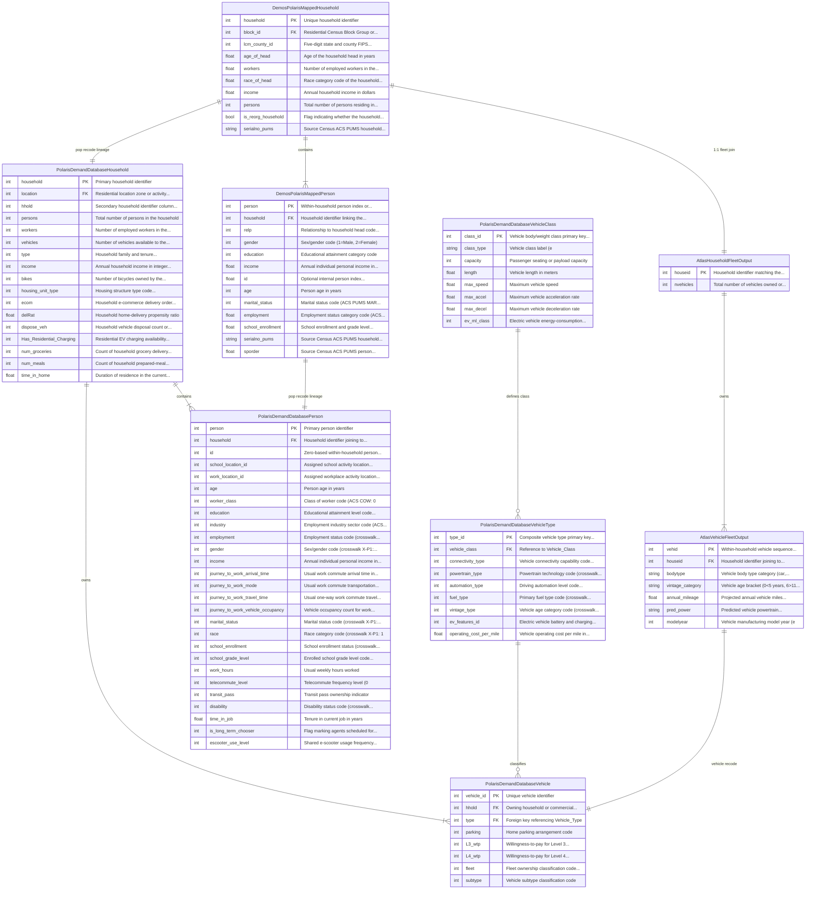

# Database Schema & Entity-Relationship Diagrams

This page renders entity-relationship (ER) diagrams and foreign-key contracts across **UrbanSim**, **DEMOS**, **ATLAS**, **POLARIS**, **ActivitySim**, **BEAM**, **SynthFirm**, and **Network Skims** (`.omx` / `.zarr`).

The generator compiles every table, column type, primary key, foreign key, and cross-model link below from [`schema/deliverable_1_static_schema.yaml`](../schema/index.md). Model teams can use these diagrams and the linkage table in Section 3 to verify join keys and cardinalities at each module entry point.

---

## 1. Core Population & Vehicle Fleet ERD

Relational cardinalities across the core demographic and household fleet tables (**DEMOS**, **ATLAS**, and **POLARIS** `Demand.sqlite`):



---

## 2. Complete Multi-Model Regional Architecture ERD

Use the tabs below to inspect either the full multi-model cascade or individual workflow subsystems:

=== "Complete Regional Architecture (Cascaded Vertical Flow)"

    ```mermaid
    erDiagram
        DemosPolarisMappedHousehold ||--|{ DemosPolarisMappedPerson : "contains"
        AtlasHouseholdFleetOutput ||--|{ AtlasVehicleFleetOutput : "owns"
        PolarisDemandDatabaseHousehold ||--|{ PolarisDemandDatabasePerson : "contains"
        PolarisDemandDatabaseHousehold ||--|{ PolarisDemandDatabaseVehicle : "owns"
        PolarisDemandDatabaseVehicleType ||--o{ PolarisDemandDatabaseVehicle : "classifies"
        PolarisDemandDatabaseVehicleClass ||--o{ PolarisDemandDatabaseVehicleType : "defines class"
        UrbanSimBlockMarginals ||--|{ BlockToTazMapping : "maps_to"
        UrbanSimZonalTotals ||--|{ BlockToTazMapping : "aggregates"
        DemosPolarisMappedHousehold ||--|| AtlasHouseholdFleetOutput : "1:1 fleet join"
        DemosPolarisMappedHousehold ||--|| PolarisDemandDatabaseHousehold : "pop recode lineage"
        DemosPolarisMappedPerson ||--|| PolarisDemandDatabasePerson : "pop recode lineage"
        AtlasVehicleFleetOutput ||--|| PolarisDemandDatabaseVehicle : "vehicle recode"
        UrbanSimBlockMarginals ||--o{ DemosPolarisMappedHousehold : "marginal control"
        UrbanSimZonalTotals ||--o{ PolarisDemandDatabaseHousehold : "TAZ location"
        UrbanSimZonalTotals ||--o{ InputNetworkSkims : "TAZ dimension"
        UrbanSimZonalTotals ||--o{ NextYearNetworkSkims : "TAZ dimension"
        ActivitySimHouseholdInputRecord ||--|{ ActivitySimPersonInputRecord : "contains"
        DemosPolarisMappedHousehold ||--|| ActivitySimHouseholdInputRecord : "pop lineage"
        DemosPolarisMappedPerson ||--|| ActivitySimPersonInputRecord : "pop lineage"
        AtlasHouseholdFleetOutput ||--|| ActivitySimHouseholdInputRecord : "updates cars"
        UrbanSimBlockMarginals ||--o{ ActivitySimHouseholdInputRecord : "block control"
        UrbanSimZonalTotals ||--o{ ActivitySimHouseholdInputRecord : "TAZ location"
        BeamHouseholdRecord ||--|{ BeamPersonRecord : "contains"
        BeamHouseholdRecord ||--|{ BeamVehicleRecord : "owns"
        BeamPersonRecord ||--o{ BeamVehicleRecord : "drives"
        BeamPersonRecord ||--|{ BeamPlanRecord : "executes"
        DemosPolarisMappedHousehold ||--|| BeamHouseholdRecord : "pop lineage"
        DemosPolarisMappedPerson ||--|| BeamPersonRecord : "pop lineage"
        AtlasVehicleFleetOutput ||--|| BeamVehicleRecord : "vehicle staging"
        UrbanSimBlockMarginals ||--o{ BeamHouseholdRecord : "block control"
        UrbanSimZonalTotals ||--o{ BeamHouseholdRecord : "TAZ location"
        UrbanSimZonalTotals ||--o{ BeamNetworkSkims : "TAZ dimension"
        ActivitySimPersonInputRecord ||--|{ BeamPlanRecord : "travel schedule"
        SynthFirmEstablishmentRecord ||--o{ SynthFirmB2BShipmentRecord : "seller / buyer"
        SynthFirmEstablishmentRecord ||--|| SynthFirmCarrierRecord : "for-hire carrier"
        SynthFirmEstablishmentRecord ||--o{ SynthFirmInternationalFreightRecord : "gateway trade"
        UrbanSimBlockMarginals ||--o{ SynthFirmEstablishmentRecord : "zonal employment"
        SynthFirmEstablishmentRecord ||--o{ PolarisDemandDatabaseVehicle : "commercial fleet"
        SynthFirmEstablishmentRecord ||--o{ BeamVehicleRecord : "freight fleet"
        InputNetworkSkims ||--o{ SynthFirmB2BShipmentRecord : "travel skims"

        ActivitySimHouseholdInputRecord {
            int household_id PK "Unique household identifier"
            string block_id FK "15-digit Census Block FIPS identifier..."
            string taz FK "Residential Traffic Analysis Zone..."
            int cars FK "Number of vehicles available to the..."
            int auto_ownership "Household auto ownership level or..."
        }

        ActivitySimPersonInputRecord {
            int person_id PK "Unique person identifier"
            string household_id FK "Household identifier referencing..."
            int work_zone_id FK "Workplace zone identifier"
            int school_zone_id FK "School zone identifier"
            int member_id "Within-household person sequence..."
            string taz "Residential Traffic Analysis Zone..."
            int workplace_taz "Workplace Traffic Analysis Zone (TAZ)..."
            int school_taz "School Traffic Analysis Zone (TAZ)..."
        }

        AtlasHouseholdFleetOutput {
            int houseid PK "Household identifier matching the..."
            int nvehicles "Total number of vehicles owned or..."
        }

        AtlasVehicleFleetOutput {
            int vehid PK "Within-household vehicle sequence..."
            int houseid FK "Household identifier joining to..."
            string bodytype "Vehicle body type category (car,..."
            string vintage_category "Vehicle age bracket (0~5 years, 6~11..."
            float annual_mileage "Projected annual vehicle miles..."
            string pred_power "Predicted vehicle powertrain..."
            int modelyear "Vehicle manufacturing model year (e"
        }

        BeamHouseholdRecord {
            int household_id PK "Unique household identifier linking..."
            int block_id FK "Census block identifier for household..."
            int home_zone_id FK "Home Traffic Analysis Zone (TAZ) for..."
            float income "Annual household income in dollars ($)"
            float income_in_thousands "Annual household income in thousands..."
            int income_segment "Household income segmentation category"
            int hhsize "Total number of persons residing in..."
            int hht "Census HHT household family/living..."
            int cars "Total number of personal vehicles..."
            float num_workers "Number of employed workers in the..."
            float num_non_workers "Number of non-working members in the..."
            int num_drivers "Number of licensed drivers in the..."
            int num_adults "Number of adult household members..."
            int num_children "Total number of children in the..."
            int num_young_children "Number of young children in the..."
            int num_children_5_to_15 "Number of school-age children between..."
            int num_children_16_to_17 "Number of driving-eligible children..."
            int num_college_age "Number of college-age individuals in..."
            int num_young_adults "Number of young adults in the household"
            bool non_family "Indicates whether this is a non-..."
            bool family "Indicates whether this is a family..."
            bool home_is_urban "Indicates whether the household home..."
            bool home_is_rural "Indicates whether the household home..."
            float median_value_of_time "Median value of time for members of..."
            float hh_value_of_time "Aggregate household-level value of..."
            float hh_work_auto_savings_ratio "Household work auto travel savings ratio"
            int num_under16_not_at_school "Number of children under 16 not..."
            int num_travel_active "Total number of travel-active members..."
            int num_travel_active_adults "Number of travel-active adult members"
            int num_travel_active_preschoolers "Number of travel-active preschool..."
            int num_travel_active_children "Number of travel-active school-age..."
            int num_travel_active_non_preschoolers "Number of travel-active non-preschool..."
            bool participates_in_jtf_model "Indicates participation in the joint..."
            string joint_tour_frequency "Joint tour frequency pattern label"
            int num_hh_joint_tours "Total count of household joint tours"
            float sample_rate "Population expansion sample rate or..."
        }

        BeamNetworkSkims {
            string file_path PK "Relative path to the"
            int zone_count FK "Number of Traffic Analysis Zones..."
            string format "Storage format indicator for the..."
            string omx_version "Open Matrix HDF5 root attribute..."
            string time_periods "Modeled time-of-day periods..."
            int_1D zone_lookup "1D zone index lookup array..."
            int iteration_number "BEAM simulation iteration count at..."
            bool converged "Indicates whether dynamic traffic..."
            float_2D DIST "2D static OD matrix [origin_zone,..."
            float_2D DISTWALK "2D static OD matrix [origin_zone,..."
            float_3D SOV_TIME "3D time-dependent OD array..."
            float_3D SOV_DIST "3D time-dependent OD array..."
            float_3D SOV_BTOLL "3D time-dependent OD array..."
            float_3D WLK_TRN_WLK_IVT "3D time-dependent OD array..."
            float_3D WLK_TRN_WLK_IWAIT "3D time-dependent OD array..."
            float_3D WLK_TRN_WLK_XWAIT "3D time-dependent OD array..."
            float_3D WLK_TRN_WLK_WACC "3D time-dependent OD array..."
            float_3D WLK_TRN_WLK_WAUX "3D time-dependent OD array..."
            float_3D WLK_TRN_WLK_WEGR "3D time-dependent OD array..."
            float_2D DISTBIKE "2D static OD matrix [origin_zone,..."
            float_3D SOVTOLL_TIME "3D time-dependent OD array..."
            float_3D SOVTOLL_DIST "3D time-dependent OD array..."
            float_3D SOVTOLL_BTOLL "3D time-dependent OD array..."
            float_3D SOVTOLL_VTOLL "3D time-dependent OD array..."
            float_3D HOV2_TIME "3D time-dependent OD array..."
            float_3D HOV2_DIST "3D time-dependent OD array..."
            float_3D HOV2_BTOLL "3D time-dependent OD array..."
            float_3D HOV2TOLL_TIME "3D time-dependent OD array..."
            float_3D HOV2TOLL_DIST "3D time-dependent OD array..."
            float_3D HOV2TOLL_BTOLL "3D time-dependent OD array..."
            float_3D HOV2TOLL_VTOLL "3D time-dependent OD array..."
            float_3D HOV3_TIME "3D time-dependent OD array..."
            float_3D HOV3_DIST "3D time-dependent OD array..."
            float_3D HOV3_BTOLL "3D time-dependent OD array..."
            float_3D HOV3TOLL_TIME "3D time-dependent OD array..."
            float_3D HOV3TOLL_DIST "3D time-dependent OD array..."
            float_3D HOV3TOLL_BTOLL "3D time-dependent OD array..."
            float_3D HOV3TOLL_VTOLL "3D time-dependent OD array..."
            float_3D WLK_SUBMODE_WLK_SKIMS "Optional 3D walk-access transit..."
            float_3D DRV_SUBMODE_WLK_SKIMS "Optional 3D drive-access/walk-egress..."
            float_3D WLK_SUBMODE_DRV_SKIMS "Optional 3D walk-access/drive-egress..."
            float_2D sov_time_am "2D OD matrix [origin_zone,..."
            float_2D sov_time_pm "2D OD matrix [origin_zone,..."
            float_2D sov_time_md "2D OD matrix [origin_zone,..."
            float_2D sov_distance "2D OD matrix [origin_zone,..."
            float_2D sov_toll_cost "2D OD matrix [origin_zone,..."
            float_2D hov2_time_am "2D OD matrix [origin_zone,..."
            float_2D hov3_time_am "2D OD matrix [origin_zone,..."
            float_2D hov2_distance "2D OD matrix [origin_zone,..."
            float_2D hov3_distance "2D OD matrix [origin_zone,..."
            float_3D transit_in_vehicle_time "3D multi-period OD array..."
            float_3D transit_initial_wait_time "3D multi-period OD array..."
            float_3D transit_transfer_wait_time "3D multi-period OD array..."
            float_3D transit_fare "3D multi-period OD array..."
            float_3D transit_failures "3D multi-period OD array..."
            float_2D walk_distance "2D OD matrix [origin_zone,..."
            float_2D bike_distance "2D OD matrix [origin_zone,..."
            float_3D ridehail_solo_wait_time "3D multi-period OD array..."
            float_3D ridehail_solo_cost "3D multi-period OD array..."
            float_3D ridehail_pooled_wait_time "3D multi-period OD array..."
            float_3D ridehail_pooled_cost "3D multi-period OD array..."
            float_3D ridehail_pooled_rejection_prob "3D multi-period OD array..."
            float_3D ridehail_solo_trips "3D multi-period OD array..."
            float_3D ridehail_pooled_trips "3D multi-period OD array..."
        }

        BeamPersonRecord {
            int person_id PK "Person identifier unique across the..."
            int household_id FK "Foreign key linking person to their..."
            int home_zone_id FK "Home Traffic Analysis Zone (TAZ) for..."
            int workplace_zone_id FK "Workplace Traffic Analysis Zone (TAZ)..."
            int school_zone_id FK "School Traffic Analysis Zone (TAZ)..."
            int age "Age of the person in years"
            int pnum "Sequential person number within..."
            int sex "Biological sex code (1=Male, 2=Female)"
            bool male "Binary indicator for male gender"
            bool female "Binary indicator for female gender"
            bool adult "Indicator for adult status (age 18+)"
            bool age_16_p "Indicator for driving-eligible age (16+)"
            bool age_16_to_19 "Indicator for youth between ages 16..."
            int pemploy "Employment status code"
            int pstudent "Student enrollment status code"
            int ptype "Person type category (1=Full-time..."
            bool is_worker "Indicator for employed worker"
            bool has_full_time "Indicator for full-time employment"
            bool has_part_time "Indicator for part-time employment"
            bool has_non_worker "Indicator for non-worker status"
            bool has_retiree "Indicator for retired status"
            bool work_from_home "Indicator for telecommuting or..."
            bool is_student "General student indicator"
            bool is_gradeschool "Grade school student indicator"
            bool is_highschool "High school student indicator"
            bool is_university "University / college student indicator"
            bool has_university "Household contains a university student"
            int school_segment "School segment classification code"
            bool student_is_employed "Indicates student who is also employed"
            bool nonstudent_to_school "Indicates non-student attending..."
            bool has_preschool_kid "Household contains a preschool child"
            bool has_school_kid "Household contains a school-age child"
            bool has_driving_kid "Household contains a driving-age child"
            float home_x "Home location projected X coordinate..."
            float home_y "Home location projected Y coordinate..."
            float distance_to_work "Commute distance to workplace in miles"
            float roundtrip_auto_time_to_work "Round-trip auto commute travel time..."
            float value_of_time "Individual value of time ($/hour)"
            int transit_pass_ownership "Transit pass ownership status code"
            float transit_pass_subsidy "Employer transit pass subsidy amount ($)"
            float parking_cost "Daily or monthly parking cost at..."
            bool free_parking_at_work "Indicator for free parking..."
            bool has_electric_bike "Indicator for electric bicycle access"
            bool has_carshare "Indicator for carshare service..."
            bool has_rideshare "Indicator for rideshare/TNC app access"
        }

        BeamPlanRecord {
            int person_id FK "Foreign key linking plan element to a..."
            int tour_id FK "Tour identifier from upstream..."
            int trip_id FK "Trip identifier from upstream model..."
            int planelementindex "Sequential zero- or one-based index..."
            string activityelement "Plan element type ('activity' or 'leg')"
            string activitytype "Activity purpose or type (e"
            float x "Projected X coordinate or longitude..."
            float y "Projected Y coordinate or latitude of..."
            float departure_time "Departure or end time of the element,..."
            float number_of_participants "Number of participants accompanying..."
            string tour_mode "Primary mode assigned to the tour (e"
            string trip_mode "Planned mode for this specific travel..."
            float trip_dur_min "Expected trip duration in minutes..."
            float trip_cost_dollars "Expected trip monetary cost in dollars"
            int planindex "Index of the plan alternative for the..."
            bool planselected "Indicates whether this plan..."
            float planscore "Utility score assigned to this plan..."
            float legtraveltime "Scheduled or estimated travel time..."
            string legroutetype "Route representation type (e"
            int legroutestartlink "Network link identifier at the start..."
            int legrouteendlink "Network link identifier at the end of..."
            float legroutetraveltime "Route travel time computed across..."
            float legroutedistance "Route travel distance computed across..."
            string legroutelinks "Serialized space-delimited list of..."
        }

        BeamVehicleRecord {
            string vehicle_id PK "Unique vehicle identifier used by..."
            int household_id FK "Foreign key linking vehicle to owning..."
            int source_vehicle_id FK "Original ATLAS vehicle identifier..."
            int maindriver_id FK "Foreign key identifying primary..."
            string vehicletypeid "BEAM vehicle type identifier mapping..."
            string bodytype "Vehicle body type category (e"
            string pred_power "Predicted powertrain technology (ICE,..."
            string ownlease "Ownership or lease status"
            int modelyear "Vehicle model year"
            string adopt_fuel "Adopted fuel type"
            string adopt_veh "Vehicle technology adoption..."
            string acquire_year "Vehicle acquisition year"
            string vehicle_tag "Vehicle tag or identifier label"
            int year "Simulation calendar year"
            string newhhflag "New household indicator flag"
            string vintage_category "Vehicle age or vintage bracket"
        }

        BlockToTazMapping {
            string block_id FK "Census block identifier referencing..."
            int zone_id FK "Macro-zone / Traffic Analysis Zone..."
            float area_share "Proportion of block area intersecting..."
            float housing_share "Proportion of block housing units..."
            float job_share "Proportion of block employment..."
        }

        DemosPolarisMappedHousehold {
            int household PK "Unique household identifier"
            int block_id FK "Residential Census Block Group or..."
            int lcm_county_id "Five-digit state and county FIPS..."
            float age_of_head "Age of the household head in years"
            float workers "Number of employed workers in the..."
            float race_of_head "Race category code of the household..."
            float income "Annual household income in dollars"
            int persons "Total number of persons residing in..."
            bool is_reorg_household "Flag indicating whether the household..."
            string serialno_pums "Source Census ACS PUMS household..."
        }

        DemosPolarisMappedPerson {
            int person PK "Within-household person index or..."
            int household FK "Household identifier linking the..."
            int relp "Relationship to household head code..."
            int gender "Sex/gender code (1=Male, 2=Female)"
            int education "Educational attainment category code"
            float income "Annual individual personal income in..."
            float id "Optional internal person index..."
            int age "Person age in years"
            int marital_status "Marital status code (ACS PUMS MAR..."
            float employment "Employment status category code (ACS..."
            float school_enrollment "School enrollment and grade level..."
            string serialno_pums "Source Census ACS PUMS household..."
            float sporder "Source Census ACS PUMS person..."
        }

        InputNetworkSkims {
            string file_path PK "Relative path to the"
            int zone_count FK "Number of Traffic Analysis Zones..."
            string omx_version "Open Matrix HDF5 root attribute..."
            int_1D zone_lookup "1D zone index lookup array..."
            float_2D sov_time_am "2D OD matrix [origin_zone,..."
            float_2D sov_time_pm "2D OD matrix [origin_zone,..."
            float_2D sov_time_md "2D OD matrix [origin_zone,..."
            float_2D sov_distance "2D OD matrix [origin_zone,..."
            float_2D sov_toll_cost "2D OD matrix [origin_zone,..."
            float_2D transit_travel_time "2D OD matrix [origin_zone,..."
            float_1D transit_accessibility_index "1D zonal vector [origin_zone] of..."
        }

        NextYearNetworkSkims {
            string file_path PK "Relative path to the output"
            int zone_count FK "Number of Traffic Analysis Zones..."
            string omx_version "Open Matrix HDF5 root attribute..."
            int_1D zone_lookup "1D zone index lookup array..."
            int iteration_count "Number of DTA feedback iterations..."
            float gap_metric "Relative convergence gap metric..."
            float_2D sov_time_am "2D OD matrix [origin_zone,..."
            float_2D sov_time_pm "2D OD matrix [origin_zone,..."
            float_2D sov_time_md "2D OD matrix [origin_zone,..."
            float_2D sov_distance "2D OD matrix [origin_zone,..."
            float_2D sov_toll_cost "2D OD matrix [origin_zone,..."
            float_2D transit_travel_time "2D OD matrix [origin_zone,..."
            float_2D congestion_index "2D OD matrix [origin_zone,..."
        }

        PolarisDemandDatabaseHousehold {
            int household PK "Primary household identifier"
            int location FK "Residential location zone or activity..."
            int hhold "Secondary household identifier column..."
            int persons "Total number of persons in the household"
            int workers "Number of employed workers in the..."
            int vehicles "Number of vehicles available to the..."
            int type "Household family and tenure..."
            int income "Annual household income in integer..."
            int bikes "Number of bicycles owned by the..."
            int housing_unit_type "Housing structure type code..."
            int ecom "Household e-commerce delivery order..."
            float delRat "Household home-delivery propensity ratio"
            int dispose_veh "Household vehicle disposal count or..."
            int Has_Residential_Charging "Residential EV charging availability..."
            int num_groceries "Count of household grocery delivery..."
            int num_meals "Count of household prepared-meal..."
            float time_in_home "Duration of residence in the current..."
        }

        PolarisDemandDatabasePerson {
            int person PK "Primary person identifier"
            int household FK "Household identifier joining to..."
            int id "Zero-based within-household person..."
            int school_location_id "Assigned school activity location..."
            int work_location_id "Assigned workplace activity location..."
            int age "Person age in years"
            int worker_class "Class of worker code (ACS COW: 0"
            int education "Educational attainment level code..."
            int industry "Employment industry sector code (ACS..."
            int employment "Employment status code (crosswalk..."
            int gender "Sex/gender code (crosswalk X-P1:..."
            int income "Annual individual personal income in..."
            int journey_to_work_arrival_time "Usual work commute arrival time in..."
            int journey_to_work_mode "Usual work commute transportation..."
            int journey_to_work_travel_time "Usual one-way work commute travel..."
            int journey_to_work_vehicle_occupancy "Vehicle occupancy count for work..."
            int marital_status "Marital status code (crosswalk X-P1:..."
            int race "Race category code (crosswalk X-P1: 1"
            int school_enrollment "School enrollment status (crosswalk..."
            int school_grade_level "Enrolled school grade level code..."
            int work_hours "Usual weekly hours worked"
            int telecommute_level "Telecommute frequency level (0"
            int transit_pass "Transit pass ownership indicator"
            int disability "Disability status code (crosswalk..."
            float time_in_job "Tenure in current job in years"
            int is_long_term_chooser "Flag marking agents scheduled for..."
            int escooter_use_level "Shared e-scooter usage frequency..."
        }

        PolarisDemandDatabaseVehicle {
            int vehicle_id PK "Unique vehicle identifier"
            int hhold FK "Owning household or commercial..."
            int type FK "Foreign key referencing Vehicle_Type"
            int parking "Home parking arrangement code"
            int L3_wtp "Willingness-to-pay for Level 3..."
            int L4_wtp "Willingness-to-pay for Level 4..."
            int fleet "Fleet ownership classification code..."
            int subtype "Vehicle subtype classification code"
        }

        PolarisDemandDatabaseVehicleClass {
            int class_id PK "Vehicle body/weight class primary key..."
            string class_type "Vehicle class label (e"
            int capacity "Passenger seating or payload capacity"
            float length "Vehicle length in meters"
            float max_speed "Maximum vehicle speed"
            float max_accel "Maximum vehicle acceleration rate"
            float max_decel "Maximum vehicle deceleration rate"
            int ev_ml_class "Electric vehicle energy-consumption..."
        }

        PolarisDemandDatabaseVehicleType {
            int type_id PK "Composite vehicle type primary key..."
            int vehicle_class FK "Reference to Vehicle_Class"
            int connectivity_type "Vehicle connectivity capability code..."
            int powertrain_type "Powertrain technology code (crosswalk..."
            int automation_type "Driving automation level code..."
            int fuel_type "Primary fuel type code (crosswalk..."
            int vintage_type "Vehicle age category code (crosswalk..."
            int ev_features_id "Electric vehicle battery and charging..."
            float operating_cost_per_mile "Vehicle operating cost per mile in..."
        }

        SynthFirmB2BShipmentRecord {
            int shipment_id PK "Unique freight shipment identifier"
            int BuyerID FK "Unique business identifier of the..."
            int SellerID FK "Unique business identifier of the..."
            int orig_FAFID FK "Federal Freight Analysis Framework..."
            int dest_FAFID FK "Federal Freight Analysis Framework..."
            int fleet_id FK "Optional sub-fleet index for private..."
            string BuyerZone "Census Block Group FIPS or external..."
            string BuyerNAICS "NAICS industry classification code of..."
            string SellerZone "Census Block Group FIPS or external..."
            string SellerNAICS "NAICS industry classification code of..."
            float TruckLoad "Total freight shipment payload weight..."
            int Commodity_SCTG "2-digit Standard Classification of..."
            int SCTG_Group "Aggregated commodity group category..."
            float UnitCost "Commodity unit value / cost in..."
            string mode_choice "Chosen transportation mode (For-hire..."
            float probability "Mode choice model probability of..."
            float Distance "Highway network routing distance in..."
            float Travel_time "Highway network travel time impedance"
        }

        SynthFirmCarrierRecord {
            int BusID PK "Unique synthetic business..."
            int CBPZONE FK "County Business Patterns zone..."
            int FAFZONE FK "Federal Freight Analysis Framework..."
            string MESOZONE FK "Micro-zone spatial identifier..."
            int SCTG1 "Binary flag indicating..."
            int SCTG2 "Binary flag indicating..."
            int SCTG3 "Binary flag indicating..."
            int SCTG4 "Binary flag indicating..."
            int SCTG5 "Binary flag indicating..."
            int fleet_id "Sub-fleet category index within the..."
            int esizecat "Establishment employment size..."
            string Industry_NAICS6_Make "6-digit NAICS industry classification..."
            int Commodity_SCTG "Primary 2-digit Standard..."
            float Emp "Total employment count (number of..."
            float lat "Centroid latitude coordinate (WGS84)"
            float lon "Centroid longitude coordinate (WGS84)"
            string state_abbr "Two-letter US state abbreviation (e"
            string EV_powertrain "Alternative fuel powertrain assigned..."
            float diesel_class_1_2a "Count of Diesel Class 1 & 2A..."
            float diesel_class_2b_3 "Count of Diesel Class 2B & 3..."
            float diesel_class_4_6 "Count of Diesel Class 4-6 vocational..."
            float diesel_class_7_8_tractor "Count of Diesel Class 7 & 8 tractor-..."
            float diesel_class_7_8_vocational "Count of Diesel Class 7 & 8..."
            float gasoline_class_1_2a "Count of Gasoline Class 1 & 2A..."
            float gasoline_class_2b_3 "Count of Gasoline Class 2B & 3..."
            float gasoline_class_4_6 "Count of Gasoline Class 4-6..."
            float electric_class_1_2a "Count of Electric Class 1 & 2A..."
            float electric_class_2b_3 "Count of Electric Class 2B & 3..."
            float electric_class_4_6 "Count of Electric Class 4-6..."
            float electric_class_7_8_tractor "Count of Electric Class 7 & 8 tractor..."
            float electric_class_7_8_vocational "Count of Electric Class 7 & 8..."
            float n_trucks "Total count of commercial vehicles..."
        }

        SynthFirmEstablishmentRecord {
            int BusID PK "Unique synthetic business..."
            int CBPZONE FK "County Business Patterns zone..."
            int FAFZONE FK "Federal Freight Analysis Framework..."
            string MESOZONE FK "Micro-zone spatial identifier..."
            int fleet_id "Sub-fleet category index within the..."
            int esizecat "Establishment employment size..."
            string Industry_NAICS6_Make "6-digit NAICS industry classification..."
            int Commodity_SCTG "Primary 2-digit Standard..."
            float Emp "Total employment count (number of..."
            float lat "Centroid latitude coordinate (WGS84)"
            float lon "Centroid longitude coordinate (WGS84)"
            string state_abbr "Two-letter US state abbreviation (e"
            string EV_powertrain "Alternative fuel powertrain assigned..."
            float diesel_class_1_2a "Count of Diesel Class 1 & 2A..."
            float diesel_class_2b_3 "Count of Diesel Class 2B & 3..."
            float diesel_class_4_6 "Count of Diesel Class 4-6 vocational..."
            float diesel_class_7_8_tractor "Count of Diesel Class 7 & 8 tractor-..."
            float diesel_class_7_8_vocational "Count of Diesel Class 7 & 8..."
            float gasoline_class_1_2a "Count of Gasoline Class 1 & 2A..."
            float gasoline_class_2b_3 "Count of Gasoline Class 2B & 3..."
            float gasoline_class_4_6 "Count of Gasoline Class 4-6..."
            float electric_class_1_2a "Count of Electric Class 1 & 2A..."
            float electric_class_2b_3 "Count of Electric Class 2B & 3..."
            float electric_class_4_6 "Count of Electric Class 4-6..."
            float electric_class_7_8_tractor "Count of Electric Class 7 & 8 tractor..."
            float electric_class_7_8_vocational "Count of Electric Class 7 & 8..."
            float n_trucks "Total count of commercial vehicles..."
        }

        SynthFirmInternationalFreightRecord {
            int bundle_id PK "Unique international freight shipment..."
            int PORTID FK "Unique federal port of entry or..."
            string PORTZONE FK "Census Block Group FIPS of the..."
            int BuyerID FK "Domestic purchasing establishment..."
            int SellerID FK "Domestic shipping establishment..."
            string port_location "Human-readable port or airport name..."
            int FAF "FAF5 zone of the port facility"
            int CBPZONE "County Business Patterns zone of the..."
            string port_type "Gateway facility classification..."
            int is_airport "Binary flag indicating airport..."
            string CFS_CODE "Commodity Flow Survey international..."
            string CFS_NAME "Commodity Flow Survey international..."
            int dms_orig "Domestic origin zone for export..."
            int dms_dest "Domestic destination zone for import..."
            int Commodity_SCTG "SCTG commodity code (1-43)"
            int SCTG_Group "SCTG commodity group category (1-5)"
            float TruckLoad "Payload weight in short tons"
            string mode_choice "Freight transport mode (e"
            int shipments "Annualized count of truck shipments..."
            float Distance "Highway drayage distance between port..."
            float tmiles "Total ton-miles of freight movement"
            string BuyerZone "Domestic buyer Census Block Group..."
            string BuyerNAICS "Domestic buyer NAICS industry code..."
            string SellerZone "Domestic seller Census Block Group..."
            string SellerNAICS "Domestic seller NAICS industry code..."
        }

        UrbanSimBlockMarginals {
            string block_id PK "15-digit Census Block FIPS identifier..."
            int county_id "5-digit State and County FIPS..."
            string tract_id "11-digit Census Tract identifier"
            int total_households "Target marginal count of occupied..."
            int total_population "Target marginal count of total..."
            int total_workers "Target marginal count of resident..."
            int residential_units "Total residential dwelling unit..."
            int single_family_units "Count of detached single-family..."
            int multi_family_units "Count of multi-family residential..."
            float commercial_sqft "Commercial real estate floor space..."
            float vacancy_rate "Residential vacancy rate in this block"
            int jobs_total "Total employment located in this block"
            int jobs_retail "Retail employment located in this block"
            int jobs_service "Service-sector employment located in..."
            int jobs_office "Office/professional employment..."
        }

        UrbanSimZonalTotals {
            int zone_id PK "Traffic Analysis Zone (TAZ)..."
            int area_type "Urban form / density classification (e"
            float residential_area "Total residential floor or lot area"
            float commercial_area "Total commercial floor or lot area"
            float office_area "Total office floor area"
            float retail_area "Total retail floor area"
            float industrial_area "Total industrial/warehouse floor area"
            float institutional_area "Institutional / medical / civic land..."
            float mixed_use_area "Mixed-use development area"
            int pop_households "Zonal total households matching..."
            int pop_persons "Zonal total persons matching POLARIS..."
            int pop_group_quarters "Group quarters population (dorms,..."
            int employment_total "Total zonal employment matching..."
            int employment_retail "Retail employment"
            int employment_services "Service industry employment"
            int employment_government "Government/civic employment"
            int employment_manufacturing "Manufacturing employment"
            int employment_industrial "Industrial employment"
            int employment_other "Other employment categories"
            float hh_inc_avg "Average household income within the zone"
            float percent_white "Proportion of Caucasian population"
            float percent_black "Proportion of African American..."
        }
    ```

=== "Primary POLARIS Regional Flow"

    ```mermaid
    erDiagram
        DemosPolarisMappedHousehold ||--|{ DemosPolarisMappedPerson : "contains"
        AtlasHouseholdFleetOutput ||--|{ AtlasVehicleFleetOutput : "owns"
        PolarisDemandDatabaseHousehold ||--|{ PolarisDemandDatabasePerson : "contains"
        PolarisDemandDatabaseHousehold ||--|{ PolarisDemandDatabaseVehicle : "owns"
        PolarisDemandDatabaseVehicleType ||--o{ PolarisDemandDatabaseVehicle : "classifies"
        PolarisDemandDatabaseVehicleClass ||--o{ PolarisDemandDatabaseVehicleType : "defines class"
        UrbanSimBlockMarginals ||--|{ BlockToTazMapping : "maps_to"
        UrbanSimZonalTotals ||--|{ BlockToTazMapping : "aggregates"
        DemosPolarisMappedHousehold ||--|| AtlasHouseholdFleetOutput : "1:1 fleet join"
        DemosPolarisMappedHousehold ||--|| PolarisDemandDatabaseHousehold : "pop recode lineage"
        DemosPolarisMappedPerson ||--|| PolarisDemandDatabasePerson : "pop recode lineage"
        AtlasVehicleFleetOutput ||--|| PolarisDemandDatabaseVehicle : "vehicle recode"
        UrbanSimBlockMarginals ||--o{ DemosPolarisMappedHousehold : "marginal control"
        UrbanSimZonalTotals ||--o{ PolarisDemandDatabaseHousehold : "TAZ location"
        UrbanSimZonalTotals ||--o{ InputNetworkSkims : "TAZ dimension"
        UrbanSimZonalTotals ||--o{ NextYearNetworkSkims : "TAZ dimension"

        AtlasHouseholdFleetOutput {
            int houseid PK "Household identifier matching the..."
            int nvehicles "Total number of vehicles owned or..."
        }

        AtlasVehicleFleetOutput {
            int vehid PK "Within-household vehicle sequence..."
            int houseid FK "Household identifier joining to..."
            string bodytype "Vehicle body type category (car,..."
            string vintage_category "Vehicle age bracket (0~5 years, 6~11..."
            float annual_mileage "Projected annual vehicle miles..."
            string pred_power "Predicted vehicle powertrain..."
            int modelyear "Vehicle manufacturing model year (e"
        }

        BlockToTazMapping {
            string block_id FK "Census block identifier referencing..."
            int zone_id FK "Macro-zone / Traffic Analysis Zone..."
            float area_share "Proportion of block area intersecting..."
            float housing_share "Proportion of block housing units..."
            float job_share "Proportion of block employment..."
        }

        DemosPolarisMappedHousehold {
            int household PK "Unique household identifier"
            int block_id FK "Residential Census Block Group or..."
            int lcm_county_id "Five-digit state and county FIPS..."
            float age_of_head "Age of the household head in years"
            float workers "Number of employed workers in the..."
            float race_of_head "Race category code of the household..."
            float income "Annual household income in dollars"
            int persons "Total number of persons residing in..."
            bool is_reorg_household "Flag indicating whether the household..."
            string serialno_pums "Source Census ACS PUMS household..."
        }

        DemosPolarisMappedPerson {
            int person PK "Within-household person index or..."
            int household FK "Household identifier linking the..."
            int relp "Relationship to household head code..."
            int gender "Sex/gender code (1=Male, 2=Female)"
            int education "Educational attainment category code"
            float income "Annual individual personal income in..."
            float id "Optional internal person index..."
            int age "Person age in years"
            int marital_status "Marital status code (ACS PUMS MAR..."
            float employment "Employment status category code (ACS..."
            float school_enrollment "School enrollment and grade level..."
            string serialno_pums "Source Census ACS PUMS household..."
            float sporder "Source Census ACS PUMS person..."
        }

        InputNetworkSkims {
            string file_path PK "Relative path to the"
            int zone_count FK "Number of Traffic Analysis Zones..."
            string omx_version "Open Matrix HDF5 root attribute..."
            int_1D zone_lookup "1D zone index lookup array..."
            float_2D sov_time_am "2D OD matrix [origin_zone,..."
            float_2D sov_time_pm "2D OD matrix [origin_zone,..."
            float_2D sov_time_md "2D OD matrix [origin_zone,..."
            float_2D sov_distance "2D OD matrix [origin_zone,..."
            float_2D sov_toll_cost "2D OD matrix [origin_zone,..."
            float_2D transit_travel_time "2D OD matrix [origin_zone,..."
            float_1D transit_accessibility_index "1D zonal vector [origin_zone] of..."
        }

        NextYearNetworkSkims {
            string file_path PK "Relative path to the output"
            int zone_count FK "Number of Traffic Analysis Zones..."
            string omx_version "Open Matrix HDF5 root attribute..."
            int_1D zone_lookup "1D zone index lookup array..."
            int iteration_count "Number of DTA feedback iterations..."
            float gap_metric "Relative convergence gap metric..."
            float_2D sov_time_am "2D OD matrix [origin_zone,..."
            float_2D sov_time_pm "2D OD matrix [origin_zone,..."
            float_2D sov_time_md "2D OD matrix [origin_zone,..."
            float_2D sov_distance "2D OD matrix [origin_zone,..."
            float_2D sov_toll_cost "2D OD matrix [origin_zone,..."
            float_2D transit_travel_time "2D OD matrix [origin_zone,..."
            float_2D congestion_index "2D OD matrix [origin_zone,..."
        }

        PolarisDemandDatabaseHousehold {
            int household PK "Primary household identifier"
            int location FK "Residential location zone or activity..."
            int hhold "Secondary household identifier column..."
            int persons "Total number of persons in the household"
            int workers "Number of employed workers in the..."
            int vehicles "Number of vehicles available to the..."
            int type "Household family and tenure..."
            int income "Annual household income in integer..."
            int bikes "Number of bicycles owned by the..."
            int housing_unit_type "Housing structure type code..."
            int ecom "Household e-commerce delivery order..."
            float delRat "Household home-delivery propensity ratio"
            int dispose_veh "Household vehicle disposal count or..."
            int Has_Residential_Charging "Residential EV charging availability..."
            int num_groceries "Count of household grocery delivery..."
            int num_meals "Count of household prepared-meal..."
            float time_in_home "Duration of residence in the current..."
        }

        PolarisDemandDatabasePerson {
            int person PK "Primary person identifier"
            int household FK "Household identifier joining to..."
            int id "Zero-based within-household person..."
            int school_location_id "Assigned school activity location..."
            int work_location_id "Assigned workplace activity location..."
            int age "Person age in years"
            int worker_class "Class of worker code (ACS COW: 0"
            int education "Educational attainment level code..."
            int industry "Employment industry sector code (ACS..."
            int employment "Employment status code (crosswalk..."
            int gender "Sex/gender code (crosswalk X-P1:..."
            int income "Annual individual personal income in..."
            int journey_to_work_arrival_time "Usual work commute arrival time in..."
            int journey_to_work_mode "Usual work commute transportation..."
            int journey_to_work_travel_time "Usual one-way work commute travel..."
            int journey_to_work_vehicle_occupancy "Vehicle occupancy count for work..."
            int marital_status "Marital status code (crosswalk X-P1:..."
            int race "Race category code (crosswalk X-P1: 1"
            int school_enrollment "School enrollment status (crosswalk..."
            int school_grade_level "Enrolled school grade level code..."
            int work_hours "Usual weekly hours worked"
            int telecommute_level "Telecommute frequency level (0"
            int transit_pass "Transit pass ownership indicator"
            int disability "Disability status code (crosswalk..."
            float time_in_job "Tenure in current job in years"
            int is_long_term_chooser "Flag marking agents scheduled for..."
            int escooter_use_level "Shared e-scooter usage frequency..."
        }

        PolarisDemandDatabaseVehicle {
            int vehicle_id PK "Unique vehicle identifier"
            int hhold FK "Owning household or commercial..."
            int type FK "Foreign key referencing Vehicle_Type"
            int parking "Home parking arrangement code"
            int L3_wtp "Willingness-to-pay for Level 3..."
            int L4_wtp "Willingness-to-pay for Level 4..."
            int fleet "Fleet ownership classification code..."
            int subtype "Vehicle subtype classification code"
        }

        PolarisDemandDatabaseVehicleClass {
            int class_id PK "Vehicle body/weight class primary key..."
            string class_type "Vehicle class label (e"
            int capacity "Passenger seating or payload capacity"
            float length "Vehicle length in meters"
            float max_speed "Maximum vehicle speed"
            float max_accel "Maximum vehicle acceleration rate"
            float max_decel "Maximum vehicle deceleration rate"
            int ev_ml_class "Electric vehicle energy-consumption..."
        }

        PolarisDemandDatabaseVehicleType {
            int type_id PK "Composite vehicle type primary key..."
            int vehicle_class FK "Reference to Vehicle_Class"
            int connectivity_type "Vehicle connectivity capability code..."
            int powertrain_type "Powertrain technology code (crosswalk..."
            int automation_type "Driving automation level code..."
            int fuel_type "Primary fuel type code (crosswalk..."
            int vintage_type "Vehicle age category code (crosswalk..."
            int ev_features_id "Electric vehicle battery and charging..."
            float operating_cost_per_mile "Vehicle operating cost per mile in..."
        }

        UrbanSimBlockMarginals {
            string block_id PK "15-digit Census Block FIPS identifier..."
            int county_id "5-digit State and County FIPS..."
            string tract_id "11-digit Census Tract identifier"
            int total_households "Target marginal count of occupied..."
            int total_population "Target marginal count of total..."
            int total_workers "Target marginal count of resident..."
            int residential_units "Total residential dwelling unit..."
            int single_family_units "Count of detached single-family..."
            int multi_family_units "Count of multi-family residential..."
            float commercial_sqft "Commercial real estate floor space..."
            float vacancy_rate "Residential vacancy rate in this block"
            int jobs_total "Total employment located in this block"
            int jobs_retail "Retail employment located in this block"
            int jobs_service "Service-sector employment located in..."
            int jobs_office "Office/professional employment..."
        }

        UrbanSimZonalTotals {
            int zone_id PK "Traffic Analysis Zone (TAZ)..."
            int area_type "Urban form / density classification (e"
            float residential_area "Total residential floor or lot area"
            float commercial_area "Total commercial floor or lot area"
            float office_area "Total office floor area"
            float retail_area "Total retail floor area"
            float industrial_area "Total industrial/warehouse floor area"
            float institutional_area "Institutional / medical / civic land..."
            float mixed_use_area "Mixed-use development area"
            int pop_households "Zonal total households matching..."
            int pop_persons "Zonal total persons matching POLARIS..."
            int pop_group_quarters "Group quarters population (dorms,..."
            int employment_total "Total zonal employment matching..."
            int employment_retail "Retail employment"
            int employment_services "Service industry employment"
            int employment_government "Government/civic employment"
            int employment_manufacturing "Manufacturing employment"
            int employment_industrial "Industrial employment"
            int employment_other "Other employment categories"
            float hh_inc_avg "Average household income within the zone"
            float percent_white "Proportion of Caucasian population"
            float percent_black "Proportion of African American..."
        }
    ```

=== "ActivitySim & BEAM Multi-Agent Flow"

    ```mermaid
    erDiagram
        DemosPolarisMappedHousehold ||--|{ DemosPolarisMappedPerson : "contains"
        AtlasHouseholdFleetOutput ||--|{ AtlasVehicleFleetOutput : "owns"
        DemosPolarisMappedHousehold ||--|| AtlasHouseholdFleetOutput : "1:1 fleet join"
        UrbanSimBlockMarginals ||--o{ DemosPolarisMappedHousehold : "marginal control"
        UrbanSimZonalTotals ||--o{ InputNetworkSkims : "TAZ dimension"
        ActivitySimHouseholdInputRecord ||--|{ ActivitySimPersonInputRecord : "contains"
        DemosPolarisMappedHousehold ||--|| ActivitySimHouseholdInputRecord : "pop lineage"
        DemosPolarisMappedPerson ||--|| ActivitySimPersonInputRecord : "pop lineage"
        AtlasHouseholdFleetOutput ||--|| ActivitySimHouseholdInputRecord : "updates cars"
        UrbanSimBlockMarginals ||--o{ ActivitySimHouseholdInputRecord : "block control"
        UrbanSimZonalTotals ||--o{ ActivitySimHouseholdInputRecord : "TAZ location"
        BeamHouseholdRecord ||--|{ BeamPersonRecord : "contains"
        BeamHouseholdRecord ||--|{ BeamVehicleRecord : "owns"
        BeamPersonRecord ||--o{ BeamVehicleRecord : "drives"
        BeamPersonRecord ||--|{ BeamPlanRecord : "executes"
        DemosPolarisMappedHousehold ||--|| BeamHouseholdRecord : "pop lineage"
        DemosPolarisMappedPerson ||--|| BeamPersonRecord : "pop lineage"
        AtlasVehicleFleetOutput ||--|| BeamVehicleRecord : "vehicle staging"
        UrbanSimBlockMarginals ||--o{ BeamHouseholdRecord : "block control"
        UrbanSimZonalTotals ||--o{ BeamHouseholdRecord : "TAZ location"
        UrbanSimZonalTotals ||--o{ BeamNetworkSkims : "TAZ dimension"
        ActivitySimPersonInputRecord ||--|{ BeamPlanRecord : "travel schedule"

        ActivitySimHouseholdInputRecord {
            int household_id PK "Unique household identifier"
            string block_id FK "15-digit Census Block FIPS identifier..."
            string taz FK "Residential Traffic Analysis Zone..."
            int cars FK "Number of vehicles available to the..."
            int auto_ownership "Household auto ownership level or..."
        }

        ActivitySimPersonInputRecord {
            int person_id PK "Unique person identifier"
            string household_id FK "Household identifier referencing..."
            int work_zone_id FK "Workplace zone identifier"
            int school_zone_id FK "School zone identifier"
            int member_id "Within-household person sequence..."
            string taz "Residential Traffic Analysis Zone..."
            int workplace_taz "Workplace Traffic Analysis Zone (TAZ)..."
            int school_taz "School Traffic Analysis Zone (TAZ)..."
        }

        AtlasHouseholdFleetOutput {
            int houseid PK "Household identifier matching the..."
            int nvehicles "Total number of vehicles owned or..."
        }

        AtlasVehicleFleetOutput {
            int vehid PK "Within-household vehicle sequence..."
            int houseid FK "Household identifier joining to..."
            string bodytype "Vehicle body type category (car,..."
            string vintage_category "Vehicle age bracket (0~5 years, 6~11..."
            float annual_mileage "Projected annual vehicle miles..."
            string pred_power "Predicted vehicle powertrain..."
            int modelyear "Vehicle manufacturing model year (e"
        }

        BeamHouseholdRecord {
            int household_id PK "Unique household identifier linking..."
            int block_id FK "Census block identifier for household..."
            int home_zone_id FK "Home Traffic Analysis Zone (TAZ) for..."
            float income "Annual household income in dollars ($)"
            float income_in_thousands "Annual household income in thousands..."
            int income_segment "Household income segmentation category"
            int hhsize "Total number of persons residing in..."
            int hht "Census HHT household family/living..."
            int cars "Total number of personal vehicles..."
            float num_workers "Number of employed workers in the..."
            float num_non_workers "Number of non-working members in the..."
            int num_drivers "Number of licensed drivers in the..."
            int num_adults "Number of adult household members..."
            int num_children "Total number of children in the..."
            int num_young_children "Number of young children in the..."
            int num_children_5_to_15 "Number of school-age children between..."
            int num_children_16_to_17 "Number of driving-eligible children..."
            int num_college_age "Number of college-age individuals in..."
            int num_young_adults "Number of young adults in the household"
            bool non_family "Indicates whether this is a non-..."
            bool family "Indicates whether this is a family..."
            bool home_is_urban "Indicates whether the household home..."
            bool home_is_rural "Indicates whether the household home..."
            float median_value_of_time "Median value of time for members of..."
            float hh_value_of_time "Aggregate household-level value of..."
            float hh_work_auto_savings_ratio "Household work auto travel savings ratio"
            int num_under16_not_at_school "Number of children under 16 not..."
            int num_travel_active "Total number of travel-active members..."
            int num_travel_active_adults "Number of travel-active adult members"
            int num_travel_active_preschoolers "Number of travel-active preschool..."
            int num_travel_active_children "Number of travel-active school-age..."
            int num_travel_active_non_preschoolers "Number of travel-active non-preschool..."
            bool participates_in_jtf_model "Indicates participation in the joint..."
            string joint_tour_frequency "Joint tour frequency pattern label"
            int num_hh_joint_tours "Total count of household joint tours"
            float sample_rate "Population expansion sample rate or..."
        }

        BeamNetworkSkims {
            string file_path PK "Relative path to the"
            int zone_count FK "Number of Traffic Analysis Zones..."
            string format "Storage format indicator for the..."
            string omx_version "Open Matrix HDF5 root attribute..."
            string time_periods "Modeled time-of-day periods..."
            int_1D zone_lookup "1D zone index lookup array..."
            int iteration_number "BEAM simulation iteration count at..."
            bool converged "Indicates whether dynamic traffic..."
            float_2D DIST "2D static OD matrix [origin_zone,..."
            float_2D DISTWALK "2D static OD matrix [origin_zone,..."
            float_3D SOV_TIME "3D time-dependent OD array..."
            float_3D SOV_DIST "3D time-dependent OD array..."
            float_3D SOV_BTOLL "3D time-dependent OD array..."
            float_3D WLK_TRN_WLK_IVT "3D time-dependent OD array..."
            float_3D WLK_TRN_WLK_IWAIT "3D time-dependent OD array..."
            float_3D WLK_TRN_WLK_XWAIT "3D time-dependent OD array..."
            float_3D WLK_TRN_WLK_WACC "3D time-dependent OD array..."
            float_3D WLK_TRN_WLK_WAUX "3D time-dependent OD array..."
            float_3D WLK_TRN_WLK_WEGR "3D time-dependent OD array..."
            float_2D DISTBIKE "2D static OD matrix [origin_zone,..."
            float_3D SOVTOLL_TIME "3D time-dependent OD array..."
            float_3D SOVTOLL_DIST "3D time-dependent OD array..."
            float_3D SOVTOLL_BTOLL "3D time-dependent OD array..."
            float_3D SOVTOLL_VTOLL "3D time-dependent OD array..."
            float_3D HOV2_TIME "3D time-dependent OD array..."
            float_3D HOV2_DIST "3D time-dependent OD array..."
            float_3D HOV2_BTOLL "3D time-dependent OD array..."
            float_3D HOV2TOLL_TIME "3D time-dependent OD array..."
            float_3D HOV2TOLL_DIST "3D time-dependent OD array..."
            float_3D HOV2TOLL_BTOLL "3D time-dependent OD array..."
            float_3D HOV2TOLL_VTOLL "3D time-dependent OD array..."
            float_3D HOV3_TIME "3D time-dependent OD array..."
            float_3D HOV3_DIST "3D time-dependent OD array..."
            float_3D HOV3_BTOLL "3D time-dependent OD array..."
            float_3D HOV3TOLL_TIME "3D time-dependent OD array..."
            float_3D HOV3TOLL_DIST "3D time-dependent OD array..."
            float_3D HOV3TOLL_BTOLL "3D time-dependent OD array..."
            float_3D HOV3TOLL_VTOLL "3D time-dependent OD array..."
            float_3D WLK_SUBMODE_WLK_SKIMS "Optional 3D walk-access transit..."
            float_3D DRV_SUBMODE_WLK_SKIMS "Optional 3D drive-access/walk-egress..."
            float_3D WLK_SUBMODE_DRV_SKIMS "Optional 3D walk-access/drive-egress..."
            float_2D sov_time_am "2D OD matrix [origin_zone,..."
            float_2D sov_time_pm "2D OD matrix [origin_zone,..."
            float_2D sov_time_md "2D OD matrix [origin_zone,..."
            float_2D sov_distance "2D OD matrix [origin_zone,..."
            float_2D sov_toll_cost "2D OD matrix [origin_zone,..."
            float_2D hov2_time_am "2D OD matrix [origin_zone,..."
            float_2D hov3_time_am "2D OD matrix [origin_zone,..."
            float_2D hov2_distance "2D OD matrix [origin_zone,..."
            float_2D hov3_distance "2D OD matrix [origin_zone,..."
            float_3D transit_in_vehicle_time "3D multi-period OD array..."
            float_3D transit_initial_wait_time "3D multi-period OD array..."
            float_3D transit_transfer_wait_time "3D multi-period OD array..."
            float_3D transit_fare "3D multi-period OD array..."
            float_3D transit_failures "3D multi-period OD array..."
            float_2D walk_distance "2D OD matrix [origin_zone,..."
            float_2D bike_distance "2D OD matrix [origin_zone,..."
            float_3D ridehail_solo_wait_time "3D multi-period OD array..."
            float_3D ridehail_solo_cost "3D multi-period OD array..."
            float_3D ridehail_pooled_wait_time "3D multi-period OD array..."
            float_3D ridehail_pooled_cost "3D multi-period OD array..."
            float_3D ridehail_pooled_rejection_prob "3D multi-period OD array..."
            float_3D ridehail_solo_trips "3D multi-period OD array..."
            float_3D ridehail_pooled_trips "3D multi-period OD array..."
        }

        BeamPersonRecord {
            int person_id PK "Person identifier unique across the..."
            int household_id FK "Foreign key linking person to their..."
            int home_zone_id FK "Home Traffic Analysis Zone (TAZ) for..."
            int workplace_zone_id FK "Workplace Traffic Analysis Zone (TAZ)..."
            int school_zone_id FK "School Traffic Analysis Zone (TAZ)..."
            int age "Age of the person in years"
            int pnum "Sequential person number within..."
            int sex "Biological sex code (1=Male, 2=Female)"
            bool male "Binary indicator for male gender"
            bool female "Binary indicator for female gender"
            bool adult "Indicator for adult status (age 18+)"
            bool age_16_p "Indicator for driving-eligible age (16+)"
            bool age_16_to_19 "Indicator for youth between ages 16..."
            int pemploy "Employment status code"
            int pstudent "Student enrollment status code"
            int ptype "Person type category (1=Full-time..."
            bool is_worker "Indicator for employed worker"
            bool has_full_time "Indicator for full-time employment"
            bool has_part_time "Indicator for part-time employment"
            bool has_non_worker "Indicator for non-worker status"
            bool has_retiree "Indicator for retired status"
            bool work_from_home "Indicator for telecommuting or..."
            bool is_student "General student indicator"
            bool is_gradeschool "Grade school student indicator"
            bool is_highschool "High school student indicator"
            bool is_university "University / college student indicator"
            bool has_university "Household contains a university student"
            int school_segment "School segment classification code"
            bool student_is_employed "Indicates student who is also employed"
            bool nonstudent_to_school "Indicates non-student attending..."
            bool has_preschool_kid "Household contains a preschool child"
            bool has_school_kid "Household contains a school-age child"
            bool has_driving_kid "Household contains a driving-age child"
            float home_x "Home location projected X coordinate..."
            float home_y "Home location projected Y coordinate..."
            float distance_to_work "Commute distance to workplace in miles"
            float roundtrip_auto_time_to_work "Round-trip auto commute travel time..."
            float value_of_time "Individual value of time ($/hour)"
            int transit_pass_ownership "Transit pass ownership status code"
            float transit_pass_subsidy "Employer transit pass subsidy amount ($)"
            float parking_cost "Daily or monthly parking cost at..."
            bool free_parking_at_work "Indicator for free parking..."
            bool has_electric_bike "Indicator for electric bicycle access"
            bool has_carshare "Indicator for carshare service..."
            bool has_rideshare "Indicator for rideshare/TNC app access"
        }

        BeamPlanRecord {
            int person_id FK "Foreign key linking plan element to a..."
            int tour_id FK "Tour identifier from upstream..."
            int trip_id FK "Trip identifier from upstream model..."
            int planelementindex "Sequential zero- or one-based index..."
            string activityelement "Plan element type ('activity' or 'leg')"
            string activitytype "Activity purpose or type (e"
            float x "Projected X coordinate or longitude..."
            float y "Projected Y coordinate or latitude of..."
            float departure_time "Departure or end time of the element,..."
            float number_of_participants "Number of participants accompanying..."
            string tour_mode "Primary mode assigned to the tour (e"
            string trip_mode "Planned mode for this specific travel..."
            float trip_dur_min "Expected trip duration in minutes..."
            float trip_cost_dollars "Expected trip monetary cost in dollars"
            int planindex "Index of the plan alternative for the..."
            bool planselected "Indicates whether this plan..."
            float planscore "Utility score assigned to this plan..."
            float legtraveltime "Scheduled or estimated travel time..."
            string legroutetype "Route representation type (e"
            int legroutestartlink "Network link identifier at the start..."
            int legrouteendlink "Network link identifier at the end of..."
            float legroutetraveltime "Route travel time computed across..."
            float legroutedistance "Route travel distance computed across..."
            string legroutelinks "Serialized space-delimited list of..."
        }

        BeamVehicleRecord {
            string vehicle_id PK "Unique vehicle identifier used by..."
            int household_id FK "Foreign key linking vehicle to owning..."
            int source_vehicle_id FK "Original ATLAS vehicle identifier..."
            int maindriver_id FK "Foreign key identifying primary..."
            string vehicletypeid "BEAM vehicle type identifier mapping..."
            string bodytype "Vehicle body type category (e"
            string pred_power "Predicted powertrain technology (ICE,..."
            string ownlease "Ownership or lease status"
            int modelyear "Vehicle model year"
            string adopt_fuel "Adopted fuel type"
            string adopt_veh "Vehicle technology adoption..."
            string acquire_year "Vehicle acquisition year"
            string vehicle_tag "Vehicle tag or identifier label"
            int year "Simulation calendar year"
            string newhhflag "New household indicator flag"
            string vintage_category "Vehicle age or vintage bracket"
        }

        DemosPolarisMappedHousehold {
            int household PK "Unique household identifier"
            int block_id FK "Residential Census Block Group or..."
            int lcm_county_id "Five-digit state and county FIPS..."
            float age_of_head "Age of the household head in years"
            float workers "Number of employed workers in the..."
            float race_of_head "Race category code of the household..."
            float income "Annual household income in dollars"
            int persons "Total number of persons residing in..."
            bool is_reorg_household "Flag indicating whether the household..."
            string serialno_pums "Source Census ACS PUMS household..."
        }

        DemosPolarisMappedPerson {
            int person PK "Within-household person index or..."
            int household FK "Household identifier linking the..."
            int relp "Relationship to household head code..."
            int gender "Sex/gender code (1=Male, 2=Female)"
            int education "Educational attainment category code"
            float income "Annual individual personal income in..."
            float id "Optional internal person index..."
            int age "Person age in years"
            int marital_status "Marital status code (ACS PUMS MAR..."
            float employment "Employment status category code (ACS..."
            float school_enrollment "School enrollment and grade level..."
            string serialno_pums "Source Census ACS PUMS household..."
            float sporder "Source Census ACS PUMS person..."
        }

        InputNetworkSkims {
            string file_path PK "Relative path to the"
            int zone_count FK "Number of Traffic Analysis Zones..."
            string omx_version "Open Matrix HDF5 root attribute..."
            int_1D zone_lookup "1D zone index lookup array..."
            float_2D sov_time_am "2D OD matrix [origin_zone,..."
            float_2D sov_time_pm "2D OD matrix [origin_zone,..."
            float_2D sov_time_md "2D OD matrix [origin_zone,..."
            float_2D sov_distance "2D OD matrix [origin_zone,..."
            float_2D sov_toll_cost "2D OD matrix [origin_zone,..."
            float_2D transit_travel_time "2D OD matrix [origin_zone,..."
            float_1D transit_accessibility_index "1D zonal vector [origin_zone] of..."
        }

        UrbanSimBlockMarginals {
            string block_id PK "15-digit Census Block FIPS identifier..."
            int county_id "5-digit State and County FIPS..."
            string tract_id "11-digit Census Tract identifier"
            int total_households "Target marginal count of occupied..."
            int total_population "Target marginal count of total..."
            int total_workers "Target marginal count of resident..."
            int residential_units "Total residential dwelling unit..."
            int single_family_units "Count of detached single-family..."
            int multi_family_units "Count of multi-family residential..."
            float commercial_sqft "Commercial real estate floor space..."
            float vacancy_rate "Residential vacancy rate in this block"
            int jobs_total "Total employment located in this block"
            int jobs_retail "Retail employment located in this block"
            int jobs_service "Service-sector employment located in..."
            int jobs_office "Office/professional employment..."
        }

        UrbanSimZonalTotals {
            int zone_id PK "Traffic Analysis Zone (TAZ)..."
            int area_type "Urban form / density classification (e"
            float residential_area "Total residential floor or lot area"
            float commercial_area "Total commercial floor or lot area"
            float office_area "Total office floor area"
            float retail_area "Total retail floor area"
            float industrial_area "Total industrial/warehouse floor area"
            float institutional_area "Institutional / medical / civic land..."
            float mixed_use_area "Mixed-use development area"
            int pop_households "Zonal total households matching..."
            int pop_persons "Zonal total persons matching POLARIS..."
            int pop_group_quarters "Group quarters population (dorms,..."
            int employment_total "Total zonal employment matching..."
            int employment_retail "Retail employment"
            int employment_services "Service industry employment"
            int employment_government "Government/civic employment"
            int employment_manufacturing "Manufacturing employment"
            int employment_industrial "Industrial employment"
            int employment_other "Other employment categories"
            float hh_inc_avg "Average household income within the zone"
            float percent_white "Proportion of Caucasian population"
            float percent_black "Proportion of African American..."
        }
    ```

=== "Spatial Aggregation & Skim Feedback"

    ```mermaid
    erDiagram
        UrbanSimBlockMarginals ||--|{ BlockToTazMapping : "maps_to"
        UrbanSimZonalTotals ||--|{ BlockToTazMapping : "aggregates"
        UrbanSimZonalTotals ||--o{ InputNetworkSkims : "TAZ dimension"
        UrbanSimZonalTotals ||--o{ NextYearNetworkSkims : "TAZ dimension"
        UrbanSimZonalTotals ||--o{ BeamNetworkSkims : "TAZ dimension"

        BeamNetworkSkims {
            string file_path PK "Relative path to the"
            int zone_count FK "Number of Traffic Analysis Zones..."
            string format "Storage format indicator for the..."
            string omx_version "Open Matrix HDF5 root attribute..."
            string time_periods "Modeled time-of-day periods..."
            int_1D zone_lookup "1D zone index lookup array..."
            int iteration_number "BEAM simulation iteration count at..."
            bool converged "Indicates whether dynamic traffic..."
            float_2D DIST "2D static OD matrix [origin_zone,..."
            float_2D DISTWALK "2D static OD matrix [origin_zone,..."
            float_3D SOV_TIME "3D time-dependent OD array..."
            float_3D SOV_DIST "3D time-dependent OD array..."
            float_3D SOV_BTOLL "3D time-dependent OD array..."
            float_3D WLK_TRN_WLK_IVT "3D time-dependent OD array..."
            float_3D WLK_TRN_WLK_IWAIT "3D time-dependent OD array..."
            float_3D WLK_TRN_WLK_XWAIT "3D time-dependent OD array..."
            float_3D WLK_TRN_WLK_WACC "3D time-dependent OD array..."
            float_3D WLK_TRN_WLK_WAUX "3D time-dependent OD array..."
            float_3D WLK_TRN_WLK_WEGR "3D time-dependent OD array..."
            float_2D DISTBIKE "2D static OD matrix [origin_zone,..."
            float_3D SOVTOLL_TIME "3D time-dependent OD array..."
            float_3D SOVTOLL_DIST "3D time-dependent OD array..."
            float_3D SOVTOLL_BTOLL "3D time-dependent OD array..."
            float_3D SOVTOLL_VTOLL "3D time-dependent OD array..."
            float_3D HOV2_TIME "3D time-dependent OD array..."
            float_3D HOV2_DIST "3D time-dependent OD array..."
            float_3D HOV2_BTOLL "3D time-dependent OD array..."
            float_3D HOV2TOLL_TIME "3D time-dependent OD array..."
            float_3D HOV2TOLL_DIST "3D time-dependent OD array..."
            float_3D HOV2TOLL_BTOLL "3D time-dependent OD array..."
            float_3D HOV2TOLL_VTOLL "3D time-dependent OD array..."
            float_3D HOV3_TIME "3D time-dependent OD array..."
            float_3D HOV3_DIST "3D time-dependent OD array..."
            float_3D HOV3_BTOLL "3D time-dependent OD array..."
            float_3D HOV3TOLL_TIME "3D time-dependent OD array..."
            float_3D HOV3TOLL_DIST "3D time-dependent OD array..."
            float_3D HOV3TOLL_BTOLL "3D time-dependent OD array..."
            float_3D HOV3TOLL_VTOLL "3D time-dependent OD array..."
            float_3D WLK_SUBMODE_WLK_SKIMS "Optional 3D walk-access transit..."
            float_3D DRV_SUBMODE_WLK_SKIMS "Optional 3D drive-access/walk-egress..."
            float_3D WLK_SUBMODE_DRV_SKIMS "Optional 3D walk-access/drive-egress..."
            float_2D sov_time_am "2D OD matrix [origin_zone,..."
            float_2D sov_time_pm "2D OD matrix [origin_zone,..."
            float_2D sov_time_md "2D OD matrix [origin_zone,..."
            float_2D sov_distance "2D OD matrix [origin_zone,..."
            float_2D sov_toll_cost "2D OD matrix [origin_zone,..."
            float_2D hov2_time_am "2D OD matrix [origin_zone,..."
            float_2D hov3_time_am "2D OD matrix [origin_zone,..."
            float_2D hov2_distance "2D OD matrix [origin_zone,..."
            float_2D hov3_distance "2D OD matrix [origin_zone,..."
            float_3D transit_in_vehicle_time "3D multi-period OD array..."
            float_3D transit_initial_wait_time "3D multi-period OD array..."
            float_3D transit_transfer_wait_time "3D multi-period OD array..."
            float_3D transit_fare "3D multi-period OD array..."
            float_3D transit_failures "3D multi-period OD array..."
            float_2D walk_distance "2D OD matrix [origin_zone,..."
            float_2D bike_distance "2D OD matrix [origin_zone,..."
            float_3D ridehail_solo_wait_time "3D multi-period OD array..."
            float_3D ridehail_solo_cost "3D multi-period OD array..."
            float_3D ridehail_pooled_wait_time "3D multi-period OD array..."
            float_3D ridehail_pooled_cost "3D multi-period OD array..."
            float_3D ridehail_pooled_rejection_prob "3D multi-period OD array..."
            float_3D ridehail_solo_trips "3D multi-period OD array..."
            float_3D ridehail_pooled_trips "3D multi-period OD array..."
        }

        BlockToTazMapping {
            string block_id FK "Census block identifier referencing..."
            int zone_id FK "Macro-zone / Traffic Analysis Zone..."
            float area_share "Proportion of block area intersecting..."
            float housing_share "Proportion of block housing units..."
            float job_share "Proportion of block employment..."
        }

        InputNetworkSkims {
            string file_path PK "Relative path to the"
            int zone_count FK "Number of Traffic Analysis Zones..."
            string omx_version "Open Matrix HDF5 root attribute..."
            int_1D zone_lookup "1D zone index lookup array..."
            float_2D sov_time_am "2D OD matrix [origin_zone,..."
            float_2D sov_time_pm "2D OD matrix [origin_zone,..."
            float_2D sov_time_md "2D OD matrix [origin_zone,..."
            float_2D sov_distance "2D OD matrix [origin_zone,..."
            float_2D sov_toll_cost "2D OD matrix [origin_zone,..."
            float_2D transit_travel_time "2D OD matrix [origin_zone,..."
            float_1D transit_accessibility_index "1D zonal vector [origin_zone] of..."
        }

        NextYearNetworkSkims {
            string file_path PK "Relative path to the output"
            int zone_count FK "Number of Traffic Analysis Zones..."
            string omx_version "Open Matrix HDF5 root attribute..."
            int_1D zone_lookup "1D zone index lookup array..."
            int iteration_count "Number of DTA feedback iterations..."
            float gap_metric "Relative convergence gap metric..."
            float_2D sov_time_am "2D OD matrix [origin_zone,..."
            float_2D sov_time_pm "2D OD matrix [origin_zone,..."
            float_2D sov_time_md "2D OD matrix [origin_zone,..."
            float_2D sov_distance "2D OD matrix [origin_zone,..."
            float_2D sov_toll_cost "2D OD matrix [origin_zone,..."
            float_2D transit_travel_time "2D OD matrix [origin_zone,..."
            float_2D congestion_index "2D OD matrix [origin_zone,..."
        }

        UrbanSimBlockMarginals {
            string block_id PK "15-digit Census Block FIPS identifier..."
            int county_id "5-digit State and County FIPS..."
            string tract_id "11-digit Census Tract identifier"
            int total_households "Target marginal count of occupied..."
            int total_population "Target marginal count of total..."
            int total_workers "Target marginal count of resident..."
            int residential_units "Total residential dwelling unit..."
            int single_family_units "Count of detached single-family..."
            int multi_family_units "Count of multi-family residential..."
            float commercial_sqft "Commercial real estate floor space..."
            float vacancy_rate "Residential vacancy rate in this block"
            int jobs_total "Total employment located in this block"
            int jobs_retail "Retail employment located in this block"
            int jobs_service "Service-sector employment located in..."
            int jobs_office "Office/professional employment..."
        }

        UrbanSimZonalTotals {
            int zone_id PK "Traffic Analysis Zone (TAZ)..."
            int area_type "Urban form / density classification (e"
            float residential_area "Total residential floor or lot area"
            float commercial_area "Total commercial floor or lot area"
            float office_area "Total office floor area"
            float retail_area "Total retail floor area"
            float industrial_area "Total industrial/warehouse floor area"
            float institutional_area "Institutional / medical / civic land..."
            float mixed_use_area "Mixed-use development area"
            int pop_households "Zonal total households matching..."
            int pop_persons "Zonal total persons matching POLARIS..."
            int pop_group_quarters "Group quarters population (dorms,..."
            int employment_total "Total zonal employment matching..."
            int employment_retail "Retail employment"
            int employment_services "Service industry employment"
            int employment_government "Government/civic employment"
            int employment_manufacturing "Manufacturing employment"
            int employment_industrial "Industrial employment"
            int employment_other "Other employment categories"
            float hh_inc_avg "Average household income within the zone"
            float percent_white "Proportion of Caucasian population"
            float percent_black "Proportion of African American..."
        }
    ```

=== "SynthFirm Freight & Commercial Flow"

    ```mermaid
    erDiagram
        PolarisDemandDatabaseVehicleType ||--o{ PolarisDemandDatabaseVehicle : "classifies"
        PolarisDemandDatabaseVehicleClass ||--o{ PolarisDemandDatabaseVehicleType : "defines class"
        UrbanSimZonalTotals ||--o{ InputNetworkSkims : "TAZ dimension"
        SynthFirmEstablishmentRecord ||--o{ SynthFirmB2BShipmentRecord : "seller / buyer"
        SynthFirmEstablishmentRecord ||--|| SynthFirmCarrierRecord : "for-hire carrier"
        SynthFirmEstablishmentRecord ||--o{ SynthFirmInternationalFreightRecord : "gateway trade"
        UrbanSimBlockMarginals ||--o{ SynthFirmEstablishmentRecord : "zonal employment"
        SynthFirmEstablishmentRecord ||--o{ PolarisDemandDatabaseVehicle : "commercial fleet"
        SynthFirmEstablishmentRecord ||--o{ BeamVehicleRecord : "freight fleet"
        InputNetworkSkims ||--o{ SynthFirmB2BShipmentRecord : "travel skims"

        BeamVehicleRecord {
            string vehicle_id PK "Unique vehicle identifier used by..."
            int household_id FK "Foreign key linking vehicle to owning..."
            int source_vehicle_id FK "Original ATLAS vehicle identifier..."
            int maindriver_id FK "Foreign key identifying primary..."
            string vehicletypeid "BEAM vehicle type identifier mapping..."
            string bodytype "Vehicle body type category (e"
            string pred_power "Predicted powertrain technology (ICE,..."
            string ownlease "Ownership or lease status"
            int modelyear "Vehicle model year"
            string adopt_fuel "Adopted fuel type"
            string adopt_veh "Vehicle technology adoption..."
            string acquire_year "Vehicle acquisition year"
            string vehicle_tag "Vehicle tag or identifier label"
            int year "Simulation calendar year"
            string newhhflag "New household indicator flag"
            string vintage_category "Vehicle age or vintage bracket"
        }

        InputNetworkSkims {
            string file_path PK "Relative path to the"
            int zone_count FK "Number of Traffic Analysis Zones..."
            string omx_version "Open Matrix HDF5 root attribute..."
            int_1D zone_lookup "1D zone index lookup array..."
            float_2D sov_time_am "2D OD matrix [origin_zone,..."
            float_2D sov_time_pm "2D OD matrix [origin_zone,..."
            float_2D sov_time_md "2D OD matrix [origin_zone,..."
            float_2D sov_distance "2D OD matrix [origin_zone,..."
            float_2D sov_toll_cost "2D OD matrix [origin_zone,..."
            float_2D transit_travel_time "2D OD matrix [origin_zone,..."
            float_1D transit_accessibility_index "1D zonal vector [origin_zone] of..."
        }

        PolarisDemandDatabaseVehicle {
            int vehicle_id PK "Unique vehicle identifier"
            int hhold FK "Owning household or commercial..."
            int type FK "Foreign key referencing Vehicle_Type"
            int parking "Home parking arrangement code"
            int L3_wtp "Willingness-to-pay for Level 3..."
            int L4_wtp "Willingness-to-pay for Level 4..."
            int fleet "Fleet ownership classification code..."
            int subtype "Vehicle subtype classification code"
        }

        PolarisDemandDatabaseVehicleClass {
            int class_id PK "Vehicle body/weight class primary key..."
            string class_type "Vehicle class label (e"
            int capacity "Passenger seating or payload capacity"
            float length "Vehicle length in meters"
            float max_speed "Maximum vehicle speed"
            float max_accel "Maximum vehicle acceleration rate"
            float max_decel "Maximum vehicle deceleration rate"
            int ev_ml_class "Electric vehicle energy-consumption..."
        }

        PolarisDemandDatabaseVehicleType {
            int type_id PK "Composite vehicle type primary key..."
            int vehicle_class FK "Reference to Vehicle_Class"
            int connectivity_type "Vehicle connectivity capability code..."
            int powertrain_type "Powertrain technology code (crosswalk..."
            int automation_type "Driving automation level code..."
            int fuel_type "Primary fuel type code (crosswalk..."
            int vintage_type "Vehicle age category code (crosswalk..."
            int ev_features_id "Electric vehicle battery and charging..."
            float operating_cost_per_mile "Vehicle operating cost per mile in..."
        }

        SynthFirmB2BShipmentRecord {
            int shipment_id PK "Unique freight shipment identifier"
            int BuyerID FK "Unique business identifier of the..."
            int SellerID FK "Unique business identifier of the..."
            int orig_FAFID FK "Federal Freight Analysis Framework..."
            int dest_FAFID FK "Federal Freight Analysis Framework..."
            int fleet_id FK "Optional sub-fleet index for private..."
            string BuyerZone "Census Block Group FIPS or external..."
            string BuyerNAICS "NAICS industry classification code of..."
            string SellerZone "Census Block Group FIPS or external..."
            string SellerNAICS "NAICS industry classification code of..."
            float TruckLoad "Total freight shipment payload weight..."
            int Commodity_SCTG "2-digit Standard Classification of..."
            int SCTG_Group "Aggregated commodity group category..."
            float UnitCost "Commodity unit value / cost in..."
            string mode_choice "Chosen transportation mode (For-hire..."
            float probability "Mode choice model probability of..."
            float Distance "Highway network routing distance in..."
            float Travel_time "Highway network travel time impedance"
        }

        SynthFirmCarrierRecord {
            int BusID PK "Unique synthetic business..."
            int CBPZONE FK "County Business Patterns zone..."
            int FAFZONE FK "Federal Freight Analysis Framework..."
            string MESOZONE FK "Micro-zone spatial identifier..."
            int SCTG1 "Binary flag indicating..."
            int SCTG2 "Binary flag indicating..."
            int SCTG3 "Binary flag indicating..."
            int SCTG4 "Binary flag indicating..."
            int SCTG5 "Binary flag indicating..."
            int fleet_id "Sub-fleet category index within the..."
            int esizecat "Establishment employment size..."
            string Industry_NAICS6_Make "6-digit NAICS industry classification..."
            int Commodity_SCTG "Primary 2-digit Standard..."
            float Emp "Total employment count (number of..."
            float lat "Centroid latitude coordinate (WGS84)"
            float lon "Centroid longitude coordinate (WGS84)"
            string state_abbr "Two-letter US state abbreviation (e"
            string EV_powertrain "Alternative fuel powertrain assigned..."
            float diesel_class_1_2a "Count of Diesel Class 1 & 2A..."
            float diesel_class_2b_3 "Count of Diesel Class 2B & 3..."
            float diesel_class_4_6 "Count of Diesel Class 4-6 vocational..."
            float diesel_class_7_8_tractor "Count of Diesel Class 7 & 8 tractor-..."
            float diesel_class_7_8_vocational "Count of Diesel Class 7 & 8..."
            float gasoline_class_1_2a "Count of Gasoline Class 1 & 2A..."
            float gasoline_class_2b_3 "Count of Gasoline Class 2B & 3..."
            float gasoline_class_4_6 "Count of Gasoline Class 4-6..."
            float electric_class_1_2a "Count of Electric Class 1 & 2A..."
            float electric_class_2b_3 "Count of Electric Class 2B & 3..."
            float electric_class_4_6 "Count of Electric Class 4-6..."
            float electric_class_7_8_tractor "Count of Electric Class 7 & 8 tractor..."
            float electric_class_7_8_vocational "Count of Electric Class 7 & 8..."
            float n_trucks "Total count of commercial vehicles..."
        }

        SynthFirmEstablishmentRecord {
            int BusID PK "Unique synthetic business..."
            int CBPZONE FK "County Business Patterns zone..."
            int FAFZONE FK "Federal Freight Analysis Framework..."
            string MESOZONE FK "Micro-zone spatial identifier..."
            int fleet_id "Sub-fleet category index within the..."
            int esizecat "Establishment employment size..."
            string Industry_NAICS6_Make "6-digit NAICS industry classification..."
            int Commodity_SCTG "Primary 2-digit Standard..."
            float Emp "Total employment count (number of..."
            float lat "Centroid latitude coordinate (WGS84)"
            float lon "Centroid longitude coordinate (WGS84)"
            string state_abbr "Two-letter US state abbreviation (e"
            string EV_powertrain "Alternative fuel powertrain assigned..."
            float diesel_class_1_2a "Count of Diesel Class 1 & 2A..."
            float diesel_class_2b_3 "Count of Diesel Class 2B & 3..."
            float diesel_class_4_6 "Count of Diesel Class 4-6 vocational..."
            float diesel_class_7_8_tractor "Count of Diesel Class 7 & 8 tractor-..."
            float diesel_class_7_8_vocational "Count of Diesel Class 7 & 8..."
            float gasoline_class_1_2a "Count of Gasoline Class 1 & 2A..."
            float gasoline_class_2b_3 "Count of Gasoline Class 2B & 3..."
            float gasoline_class_4_6 "Count of Gasoline Class 4-6..."
            float electric_class_1_2a "Count of Electric Class 1 & 2A..."
            float electric_class_2b_3 "Count of Electric Class 2B & 3..."
            float electric_class_4_6 "Count of Electric Class 4-6..."
            float electric_class_7_8_tractor "Count of Electric Class 7 & 8 tractor..."
            float electric_class_7_8_vocational "Count of Electric Class 7 & 8..."
            float n_trucks "Total count of commercial vehicles..."
        }

        SynthFirmInternationalFreightRecord {
            int bundle_id PK "Unique international freight shipment..."
            int PORTID FK "Unique federal port of entry or..."
            string PORTZONE FK "Census Block Group FIPS of the..."
            int BuyerID FK "Domestic purchasing establishment..."
            int SellerID FK "Domestic shipping establishment..."
            string port_location "Human-readable port or airport name..."
            int FAF "FAF5 zone of the port facility"
            int CBPZONE "County Business Patterns zone of the..."
            string port_type "Gateway facility classification..."
            int is_airport "Binary flag indicating airport..."
            string CFS_CODE "Commodity Flow Survey international..."
            string CFS_NAME "Commodity Flow Survey international..."
            int dms_orig "Domestic origin zone for export..."
            int dms_dest "Domestic destination zone for import..."
            int Commodity_SCTG "SCTG commodity code (1-43)"
            int SCTG_Group "SCTG commodity group category (1-5)"
            float TruckLoad "Payload weight in short tons"
            string mode_choice "Freight transport mode (e"
            int shipments "Annualized count of truck shipments..."
            float Distance "Highway drayage distance between port..."
            float tmiles "Total ton-miles of freight movement"
            string BuyerZone "Domestic buyer Census Block Group..."
            string BuyerNAICS "Domestic buyer NAICS industry code..."
            string SellerZone "Domestic seller Census Block Group..."
            string SellerNAICS "Domestic seller NAICS industry code..."
        }

        UrbanSimBlockMarginals {
            string block_id PK "15-digit Census Block FIPS identifier..."
            int county_id "5-digit State and County FIPS..."
            string tract_id "11-digit Census Tract identifier"
            int total_households "Target marginal count of occupied..."
            int total_population "Target marginal count of total..."
            int total_workers "Target marginal count of resident..."
            int residential_units "Total residential dwelling unit..."
            int single_family_units "Count of detached single-family..."
            int multi_family_units "Count of multi-family residential..."
            float commercial_sqft "Commercial real estate floor space..."
            float vacancy_rate "Residential vacancy rate in this block"
            int jobs_total "Total employment located in this block"
            int jobs_retail "Retail employment located in this block"
            int jobs_service "Service-sector employment located in..."
            int jobs_office "Office/professional employment..."
        }

        UrbanSimZonalTotals {
            int zone_id PK "Traffic Analysis Zone (TAZ)..."
            int area_type "Urban form / density classification (e"
            float residential_area "Total residential floor or lot area"
            float commercial_area "Total commercial floor or lot area"
            float office_area "Total office floor area"
            float retail_area "Total retail floor area"
            float industrial_area "Total industrial/warehouse floor area"
            float institutional_area "Institutional / medical / civic land..."
            float mixed_use_area "Mixed-use development area"
            int pop_households "Zonal total households matching..."
            int pop_persons "Zonal total persons matching POLARIS..."
            int pop_group_quarters "Group quarters population (dorms,..."
            int employment_total "Total zonal employment matching..."
            int employment_retail "Retail employment"
            int employment_services "Service industry employment"
            int employment_government "Government/civic employment"
            int employment_manufacturing "Manufacturing employment"
            int employment_industrial "Industrial employment"
            int employment_other "Other employment categories"
            float hh_inc_avg "Average household income within the zone"
            float percent_white "Proportion of Caucasian population"
            float percent_black "Proportion of African American..."
        }
    ```


---

## 3. Foreign Key & Pipeline Linkage Reference Table

Intra-model foreign keys and cross-model join contracts compiled from the LinkML schema:

| Child Table | Child Column | Parent Table | Parent Column | Cardinality | Link Type | Pipeline Purpose |
| :--- | :--- | :--- | :--- | :---: | :--- | :--- |
| [`BlockToTazMapping`](../schema/BlockToTazMapping.md) | `block_id` `[FK]` | [`UrbanSimBlockMarginals`](../schema/UrbanSimBlockMarginals.md) | `block_id` `[PK]` | `N:1` | Intra-Model FK | Associates Census Blocks with regional marginal controls |
| [`BlockToTazMapping`](../schema/BlockToTazMapping.md) | `zone_id` `[FK]` | [`UrbanSimZonalTotals`](../schema/UrbanSimZonalTotals.md) | `zone_id` `[PK]` | `N:1` | Intra-Model FK | Maps Census Blocks into POLARIS-compatible TAZ zones |
| [`DemosPolarisMappedPerson`](../schema/DemosPolarisMappedPerson.md) | `household` `[FK]` | [`DemosPolarisMappedHousehold`](../schema/DemosPolarisMappedHousehold.md) | `household` `[PK]` | `N:1` | Intra-Model FK | Enforces person membership in synthetic households |
| [`AtlasVehicleFleetOutput`](../schema/AtlasVehicleFleetOutput.md) | `houseid` `[FK]` | [`AtlasHouseholdFleetOutput`](../schema/AtlasHouseholdFleetOutput.md) | `houseid` `[PK]` | `N:1` | Intra-Model FK | Associates discrete vehicles with synthesized household fleets |
| [`PolarisDemandDatabasePerson`](../schema/PolarisDemandDatabasePerson.md) | `household` `[FK]` | [`PolarisDemandDatabaseHousehold`](../schema/PolarisDemandDatabaseHousehold.md) | `household` `[PK]` | `N:1` | Intra-Model FK | Enforces POLARIS traveler membership in households |
| [`PolarisDemandDatabaseVehicle`](../schema/PolarisDemandDatabaseVehicle.md) | `hhold` `[FK]` | [`PolarisDemandDatabaseHousehold`](../schema/PolarisDemandDatabaseHousehold.md) | `household` `[PK]` | `N:1` | Intra-Model FK | Associates POLARIS vehicles with households |
| [`PolarisDemandDatabaseVehicle`](../schema/PolarisDemandDatabaseVehicle.md) | `type` `[FK]` | [`PolarisDemandDatabaseVehicleType`](../schema/PolarisDemandDatabaseVehicleType.md) | `type_id` `[PK]` | `N:1` | Intra-Model FK | Resolves vehicle composite powertrain/fuel/vintage type (`X-V5`) |
| [`PolarisDemandDatabaseVehicleType`](../schema/PolarisDemandDatabaseVehicleType.md) | `vehicle_class` `[FK]` | [`PolarisDemandDatabaseVehicleClass`](../schema/PolarisDemandDatabaseVehicleClass.md) | `class_id` `[PK]` | `N:1` | Intra-Model FK | Links composite vehicle type to physical vehicle size/body class (`X-V1`) |
| [`AtlasHouseholdFleetOutput`](../schema/AtlasHouseholdFleetOutput.md) | `houseid` `[FK]` | [`DemosPolarisMappedHousehold`](../schema/DemosPolarisMappedHousehold.md) | `household` `[PK]` | `1:1` | Cross-Model Join | Joins ATLAS synthesized vehicle counts to DEMOS households |
| [`PolarisDemandDatabaseHousehold`](../schema/PolarisDemandDatabaseHousehold.md) | `household` `[FK]` | [`DemosPolarisMappedHousehold`](../schema/DemosPolarisMappedHousehold.md) | `household` `[PK]` | `1:1` | Cross-Model Lineage | Lineage tracking from DEMOS base population to POLARIS demand |
| [`PolarisDemandDatabasePerson`](../schema/PolarisDemandDatabasePerson.md) | `person` `[FK]` | [`DemosPolarisMappedPerson`](../schema/DemosPolarisMappedPerson.md) | `person` `[PK]` | `1:1` | Cross-Model Lineage | Lineage tracking & direct attribute translation from DEMOS synthetic persons to POLARIS demand persons |
| [`PolarisDemandDatabaseVehicle`](../schema/PolarisDemandDatabaseVehicle.md) | `vehicle_id` `[FK]` | [`AtlasVehicleFleetOutput`](../schema/AtlasVehicleFleetOutput.md) | `vehid` `[PK]` | `1:1` | Cross-Model Lineage | Recodes ATLAS discrete vehicles to POLARIS vehicle types |
| [`PolarisDemandDatabaseHousehold`](../schema/PolarisDemandDatabaseHousehold.md) | `location` `[FK]` | [`UrbanSimZonalTotals`](../schema/UrbanSimZonalTotals.md) | `zone_id` `[PK]` | `N:1` | Cross-Model Spatial | Assigns household residence to UrbanSim TAZ zones |
| [`DemosPolarisMappedHousehold`](../schema/DemosPolarisMappedHousehold.md) | `block_id` `[FK]` | [`UrbanSimBlockMarginals`](../schema/UrbanSimBlockMarginals.md) | `block_id` `[PK]` | `N:1` | Cross-Model Spatial | Controls demographic synthesis by Census Block marginals |
| [`InputNetworkSkims`](../schema/InputNetworkSkims.md) | `zone_count` `[FK]` | [`UrbanSimZonalTotals`](../schema/UrbanSimZonalTotals.md) | `zone_id` `[PK]` | `N:1` | Cross-Model Spatial | Confirms skim matrix dimensions match active TAZ zones |
| [`NextYearNetworkSkims`](../schema/NextYearNetworkSkims.md) | `zone_count` `[FK]` | [`UrbanSimZonalTotals`](../schema/UrbanSimZonalTotals.md) | `zone_id` `[PK]` | `N:1` | Cross-Model Spatial | Confirms iterative skim matrix dimensions match active TAZ zones |
| [`ActivitySimPersonInputRecord`](../schema/ActivitySimPersonInputRecord.md) | `household_id` `[FK]` | [`ActivitySimHouseholdInputRecord`](../schema/ActivitySimHouseholdInputRecord.md) | `household_id` `[PK]` | `N:1` | Intra-Model FK | Enforces person membership in ActivitySim households |
| [`ActivitySimHouseholdInputRecord`](../schema/ActivitySimHouseholdInputRecord.md) | `TAZ` `[FK]` | [`UrbanSimZonalTotals`](../schema/UrbanSimZonalTotals.md) | `zone_id` `[PK]` | `N:1` | Cross-Model Spatial | Associates ActivitySim household residence with TAZ zones |
| [`ActivitySimHouseholdInputRecord`](../schema/ActivitySimHouseholdInputRecord.md) | `block_id` `[FK]` | [`UrbanSimBlockMarginals`](../schema/UrbanSimBlockMarginals.md) | `block_id` `[PK]` | `N:1` | Cross-Model Spatial | Anchors ActivitySim households to Census Block marginals |
| [`ActivitySimHouseholdInputRecord`](../schema/ActivitySimHouseholdInputRecord.md) | `cars` `[FK]` | [`AtlasHouseholdFleetOutput`](../schema/AtlasHouseholdFleetOutput.md) | `houseid` `[PK]` | `1:1` | Cross-Model Update | Updates household car count (`cars`) from ATLAS vehicle ownership (`nvehicles`) for mode choice |
| [`ActivitySimHouseholdInputRecord`](../schema/ActivitySimHouseholdInputRecord.md) | `household_id` `[FK]` | [`DemosPolarisMappedHousehold`](../schema/DemosPolarisMappedHousehold.md) | `household` `[PK]` | `1:1` | Cross-Model Lineage | Lineage tracking from DEMOS base population to ActivitySim |
| [`ActivitySimPersonInputRecord`](../schema/ActivitySimPersonInputRecord.md) | `person_id` `[FK]` | [`DemosPolarisMappedPerson`](../schema/DemosPolarisMappedPerson.md) | `person` `[PK]` | `1:1` | Cross-Model Lineage | Lineage tracking from DEMOS synthetic persons to ActivitySim |
| [`BeamPersonRecord`](../schema/BeamPersonRecord.md) | `household_id` `[FK]` | [`BeamHouseholdRecord`](../schema/BeamHouseholdRecord.md) | `household_id` `[PK]` | `N:1` | Intra-Model FK | Enforces person membership in BEAM simulated households |
| [`BeamVehicleRecord`](../schema/BeamVehicleRecord.md) | `household_id` `[FK]` | [`BeamHouseholdRecord`](../schema/BeamHouseholdRecord.md) | `household_id` `[PK]` | `N:1` | Intra-Model FK | Associates BEAM staged vehicles with households |
| [`BeamVehicleRecord`](../schema/BeamVehicleRecord.md) | `maindriver_id` `[FK]` | [`BeamPersonRecord`](../schema/BeamPersonRecord.md) | `person_id` `[PK]` | `N:1` | Intra-Model FK | Assigns primary driver to household vehicle |
| [`BeamPlanRecord`](../schema/BeamPlanRecord.md) | `person_id` `[FK]` | [`BeamPersonRecord`](../schema/BeamPersonRecord.md) | `person_id` `[PK]` | `N:1` | Intra-Model FK | Sequences activity elements and legs for simulated agent |
| [`BeamPlanRecord`](../schema/BeamPlanRecord.md) | `person_id` `[FK]` | [`ActivitySimPersonInputRecord`](../schema/ActivitySimPersonInputRecord.md) | `person_id` `[PK]` | `N:1` | Cross-Model Schedule | Populates BEAM agent travel plans from ActivitySim schedule |
| [`BeamHouseholdRecord`](../schema/BeamHouseholdRecord.md) | `household_id` `[FK]` | [`DemosPolarisMappedHousehold`](../schema/DemosPolarisMappedHousehold.md) | `household` `[PK]` | `1:1` | Cross-Model Lineage | Lineage tracking from DEMOS base population to BEAM agents |
| [`BeamPersonRecord`](../schema/BeamPersonRecord.md) | `person_id` `[FK]` | [`DemosPolarisMappedPerson`](../schema/DemosPolarisMappedPerson.md) | `person` `[PK]` | `1:1` | Cross-Model Lineage | Lineage tracking from DEMOS synthetic persons to BEAM agents |
| [`BeamVehicleRecord`](../schema/BeamVehicleRecord.md) | `vehicle_id` `[FK]` | [`AtlasVehicleFleetOutput`](../schema/AtlasVehicleFleetOutput.md) | `vehid` `[PK]` | `1:1` | Cross-Model Lineage | Stages ATLAS vehicle fleet with powertrains into BEAM |
| [`BeamHouseholdRecord`](../schema/BeamHouseholdRecord.md) | `home_zone_id` `[FK]` | [`UrbanSimZonalTotals`](../schema/UrbanSimZonalTotals.md) | `zone_id` `[PK]` | `N:1` | Cross-Model Spatial | Places BEAM households in regional TAZ zones |
| [`BeamHouseholdRecord`](../schema/BeamHouseholdRecord.md) | `block_id` `[FK]` | [`UrbanSimBlockMarginals`](../schema/UrbanSimBlockMarginals.md) | `block_id` `[PK]` | `N:1` | Cross-Model Spatial | Anchors BEAM agents to Census Block marginals |
| [`BeamNetworkSkims`](../schema/BeamNetworkSkims.md) | `zone_count` `[FK]` | [`UrbanSimZonalTotals`](../schema/UrbanSimZonalTotals.md) | `zone_id` `[PK]` | `N:1` | Cross-Model Spatial | Confirms BEAM multi-modal skim matrix dimensions match active TAZ zones |
| [`SynthFirmEstablishmentRecord`](../schema/SynthFirmEstablishmentRecord.md) | `MESOZONE` `[FK]` | [`UrbanSimBlockMarginals`](../schema/UrbanSimBlockMarginals.md) | `block_id` `[PK]` | `N:1` | Cross-Model Spatial | Anchors synthetic establishment to Census Block Group / marginal employment |
| [`SynthFirmCarrierRecord`](../schema/SynthFirmCarrierRecord.md) | `BusID` `[PK, FK]` | [`SynthFirmEstablishmentRecord`](../schema/SynthFirmEstablishmentRecord.md) | `BusID` `[PK]` | `1:1` | Subtype Specialization | Specializes business establishment as for-hire commercial trucking carrier |
| [`SynthFirmB2BShipmentRecord`](../schema/SynthFirmB2BShipmentRecord.md) | `BuyerID` `[FK]` | [`SynthFirmEstablishmentRecord`](../schema/SynthFirmEstablishmentRecord.md) | `BusID` `[PK]` | `N:1` | Intra-Model FK | Identifies buyer establishment for B2B commodity shipment |
| [`SynthFirmB2BShipmentRecord`](../schema/SynthFirmB2BShipmentRecord.md) | `SellerID` `[FK]` | [`SynthFirmEstablishmentRecord`](../schema/SynthFirmEstablishmentRecord.md) | `BusID` `[PK]` | `N:1` | Intra-Model FK | Identifies origin shipper establishment for B2B commodity shipment |
| [`SynthFirmB2BShipmentRecord`](../schema/SynthFirmB2BShipmentRecord.md) | `fleet_id` `[FK]` | [`SynthFirmEstablishmentRecord`](../schema/SynthFirmEstablishmentRecord.md) | `fleet_id` `[FK]` | `N:1` | Intra-Model FK | Associates private truck shipment with seller's private fleet allocation |
| [`SynthFirmInternationalFreightRecord`](../schema/SynthFirmInternationalFreightRecord.md) | `BuyerID` `[FK]` | [`SynthFirmEstablishmentRecord`](../schema/SynthFirmEstablishmentRecord.md) | `BusID` `[PK]` | `N:1` | Intra-Model FK | Connects port/airport import drayage flow to domestic buyer |
| [`SynthFirmInternationalFreightRecord`](../schema/SynthFirmInternationalFreightRecord.md) | `SellerID` `[FK]` | [`SynthFirmEstablishmentRecord`](../schema/SynthFirmEstablishmentRecord.md) | `BusID` `[PK]` | `N:1` | Intra-Model FK | Connects domestic seller to port/airport export drayage flow |
| [`PolarisDemandDatabaseVehicle`](../schema/PolarisDemandDatabaseVehicle.md) | `vehicle_id` `[FK]` | [`SynthFirmEstablishmentRecord`](../schema/SynthFirmEstablishmentRecord.md) | `BusID` `[PK]` | `N:1` | Cross-Model Fleet | Stages SynthFirm commercial vehicle fleet into POLARIS commercial vehicle demand |
| [`BeamVehicleRecord`](../schema/BeamVehicleRecord.md) | `vehicle_id` `[FK]` | [`SynthFirmEstablishmentRecord`](../schema/SynthFirmEstablishmentRecord.md) | `BusID` `[PK]` | `N:1` | Cross-Model Fleet | Stages SynthFirm commercial trucks into BEAM freight agent fleet |
