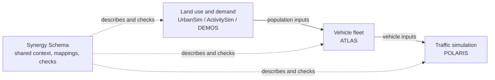

# Synergy Schema

A transportation modeling workflow can pass perfectly readable files from one
model to the next and still leave a basic question open: were all the models
working on the same scenario, the same population, and the same year? Synergy
Schema gives independently maintained models a shared way to answer that
question.

## The short version

Synergy sits alongside the models. It does not replace their tables or their
code. It writes down the few things the models need to agree on (the scenario,
the population, how fields map between models, and exactly which files were
exchanged) so that anyone can later see what crossed each boundary.

**Start here:** the [one-year mapping handshake](bring-an-existing-mapping/one-year-mapping-handshake.md)
follows a runnable example connecting ATLAS, DEMOS, and POLARIS.

## The coordination problem

Integrated studies often chain together land-use, travel-demand, vehicle, and
traffic models. Each one has its own settings, tables, IDs, release schedule,
and team. That leads to familiar problems:

- A policy called `zev_mandate` in one model is a database value in another.
- A household ID stays the same across years in one file, but is just a row
  number in the next.
- A file path still exists, but the file's contents have changed.

Passing files around doesn't answer questions like:

- Which scenario assumptions did each model actually use?
- Which population, random draw, and year does this file describe?
- Which IDs are stable across models or years, and which are just row numbers?
- Which mapping rules and which code produced the translated rows?
- Did the model teams sign off on those rules?
- Exactly which input and output files did this run use?

When the answers live only in filenames, meeting notes, or someone's memory,
two workflows can look aligned while quietly modeling different worlds.

## One shared universe, several modeling systems

Synergy treats a study as one shared world seen through several models. The
models only need to agree on a small set of facts: the scenario version, the
random draw, the year, who is in the population, how those people relate to
each other, and which files were exchanged. Beyond that, the
PILATES modeling pipeline and POLARIS, along with ATLAS and other models,
keep their own schemas, settings, and results.

So different predictions are not automatically a problem. Models can
legitimately produce different model-specific results. There is a conflict
only when two authoritative records disagree about a fact the workflows have
agreed to share. If a model simply can't represent a shared assumption, that is
recorded as a visible gap rather than a conflict.

## What Synergy records, and why

Each kind of record exists to head off a specific coordination problem.

| Record | Why it exists |
| --- | --- |
| Interface descriptions | Point to where a shared idea lives inside a model (a setting, a file key, a table column) without taking over that model's schema. |
| Mapping descriptions | Spell out how source values become target values, including defaults, lookups, dropped rows, and anything that gets lost along the way. |
| Review records | Capture who signed off on which exact version of the rules. "We agreed in a meeting" stops being useful once the mapping changes. |
| Implementation links | Name the SQL or script that is supposed to apply the reviewed rules. The rules and the code can drift apart. |
| Receipts and evidence | Tie a scenario and year to the run, code, inputs, and outputs actually used. Evidence backs up a specific claim about an exchange; it doesn't prove a model is scientifically right. |
| Content digests | Fingerprint files and definitions so a check can tell an edited file from one that was merely moved or renamed. |

Together these let the checker test declared consistency: whether the records
agree with each other. Showing that the models actually used those files still
takes evidence from the runs that produced and consumed them.

## Scope and limits

Synergy does not build one universal population table, rename native fields,
or require models to predict the same things. It records only the shared facts
needed for coordination and leaves everything else with the model that owns
it.

The POLARIS material describes a proposed exchange that has been tested with
examples. It is not a finished POLARIS integration. The guides say which parts
are current, proposed, or out of scope wherever that matters.

## How the documentation builds

Each section stands on its own, but they build on each other in roughly this
order.

| Documentation area | Question it answers |
| --- | --- |
| [Shared structure](shared-structure/index.md) | What do the models share, and what stays with each model? |
| [Cross-model mappings](cross-model-mappings/index.md) | How do IDs, assumptions, and fields line up across models? |
| [Workflow structures](workflow-structures/index.md) | How do the pieces fit together at real handoffs (PILATES, proposed POLARIS, staged populations)? |
| [Bring an existing mapping](bring-an-existing-mapping/index.md) | How can an existing spreadsheet, SQL script, or column list become something reviewable? |
| [Design rationale](design-rationale/index.md) | Why is it split up this way, and when is something simpler enough? |
| [Glossary](shared-structure/glossary.md) | What do the recurring terms mean in plain language? |
| [Generated schema reference](schema/index.md) | What are the exact fields, types, and required values? |

The generated reference is the authority on field-level details. The guides
explain the problem, the boundaries, and why the fields exist.
