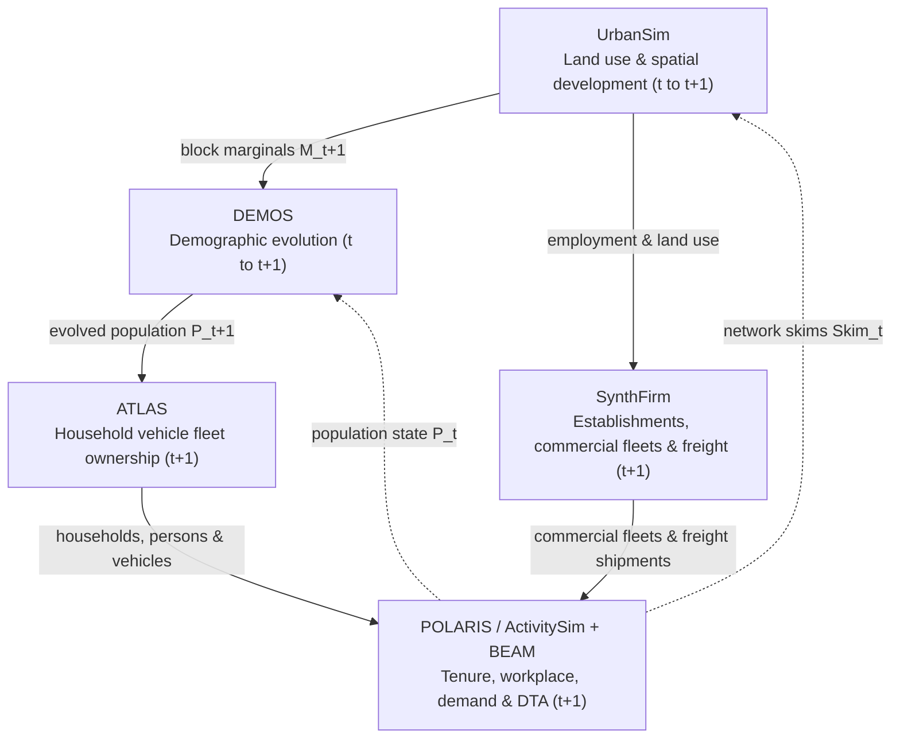

# Synergy Schema

Synergy Schema defines the LinkML data schemas and cross-model field mappings that connect the BEAM CORE modeling suite (**UrbanSim**, **DEMOS**, **ATLAS**, **SynthFirm**, **ActivitySim**, **BEAM**) and **POLARIS**. The schemas document the tables, keys, value codes, and matrix dimensions exchanged at each model handoff so tools can run alone or in coordinated workflows while keeping their native file formats.

## What this specification contains

| Section | Contents |
| --- | --- |
| [Schema reference](schema/index.md) | LinkML schemas for land use, demographic evolution, household and commercial vehicle fleets, travel demand, traffic simulation, and travel skims. |
| [Field Mappings](cross-model-mappings/contract-at-a-glance.md) | Field mappings, category recodes, survey imputation rules for missing downstream attributes, and the step-by-step staging pipeline. |
| [Database ER Diagrams](cross-model-mappings/interactive-schema.md) | Entity-relationship diagrams showing tables, primary keys, and foreign keys within and across models. |
| [Architecture & UML](cross-model-mappings/deliverable_1_uml.md) | Workflow diagrams and per-model class diagrams comparing the POLARIS, ActivitySim + BEAM, and SynthFirm pathways. |
| [Shared structure](shared-structure/index.md) | Scenario definitions, multi-year population tracking, file checksums, review records, and run logs. |

For a step-by-step example on Austin pilot data, see the [one-year mapping handshake](bring-an-existing-mapping/one-year-mapping-handshake.md).

## How the models connect

The schemas separate upstream population and fleet generation from downstream travel simulation so teams can run three workflow patterns from the same regional inputs:

1. **Land use, demographics, and household fleets**: **UrbanSim** outputs Census Block household and employment totals alongside a Block-to-TAZ geographic lookup. **DEMOS** evolves household and person tables from year `t` to `t+1`, and **ATLAS** assigns vehicles, body types, ages, and powertrains (`ICE`, `Hybrid`, `PHEV`, `AEV`) to those households.
2. **Passenger travel demand and network assignment**: Using the same upstream **UrbanSim**, **DEMOS**, and **ATLAS** tables, the workflow feeds either **POLARIS** (`Demand.sqlite` and `Supply.sqlite` for activity scheduling and dynamic traffic assignment) or **ActivitySim** and **BEAM** (tour generation followed by multi-agent traffic, transit, and charging simulation).
3. **Commercial freight and next-year feedback**: **SynthFirm** generates business establishments, truck fleets, and freight shipments for commercial tour simulation in POLARIS and BEAM. At the end of the simulation year, travel time skims flow back to **UrbanSim** and updated population records flow back to **DEMOS** for the next iteration.

## One shared universe, several modeling systems

Participating models share a small set of common facts: the scenario, random seed, simulation year, household and person IDs, geographic lookups, and the files passed at each step. Outside of those handoff files, the PILATES modeling pipeline and POLARIS, along with ATLAS, DEMOS, and SynthFirm, keep their own schemas and internal tables.

Because each model represents travel and network behavior at a different level of detail, models can produce different model-specific results. A conflict happens only when two models disagree on a shared input or handoff file. When a downstream model needs a column that an upstream model does not produce, the mapping rules fill the gap using documented defaults or Census and travel survey draws rather than undocumented script assumptions.

## What Synergy records, and why

In addition to the LinkML table schemas, the repository defines six record types for tracking mappings and model runs across multi-year studies:

| Record | Role in workflow checks |
| --- | --- |
| Interface descriptions | List the files, tables, and columns that a model reads or writes at a handoff. |
| Mapping descriptions | Specify how source columns translate into target columns, including category recodes, survey draws, unit conversions, and unused fields. |
| Review records | Record model-owner sign-off on a mapping version and its assumptions. |
| Implementation links | Point each mapping rule to the SQL query or Python function that runs it. |
| Receipts and evidence | Log the run parameters, code version, and input/output files for a simulation year. |
| Content digests | Checksum tables and schema files so automated checks can tell whether data values changed. |

Together these records let automated checks verify declared consistency across a workflow and pair mapping rules with evidence from the runs that produced and read the handoff files.

## Scope and limits

Synergy does not merge models into a single database or rename native model columns. It documents the files and columns exchanged between models while leaving internal model parameters and solver tables untouched.

## Where to go next

| Documentation area | Question it answers |
| --- | --- |
| [Shared structure](shared-structure/index.md) | How are scenarios, multi-year populations, snapshots, and table checksums organized? |
| [Cross-model mappings](cross-model-mappings/index.md) | How do column mappings, survey draws, ER diagrams, and workflow diagrams connect the models? |
| [Workflow structures](workflow-structures/index.md) | How are staged population handoffs organized for the PILATES and POLARIS pipelines? |
| [Bring an existing mapping](bring-an-existing-mapping/index.md) | How does an existing interface spreadsheet or SQL script become a checked mapping? |
| [Design rationale](design-rationale/index.md) | Why is the design split between model schemas, handoff mappings, and multi-year tracking? |
| [Model contract review](model-contracts/index.md) | Which tables and columns belong to each participating model? |
| [Glossary](shared-structure/glossary.md) | What do terms used across the documentation mean? |
| [Generated schema reference](schema/index.md) | What are the exact LinkML classes, slots, types, and enumerations? |
