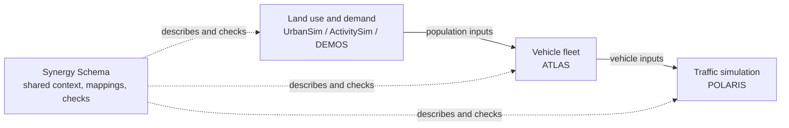

# Synergy Schema

A transportation modeling workflow can exchange perfectly readable files and
still leave a basic question unanswered: did every model represent the same
scenario, population, and point in time? Synergy Schema supplies a shared
language for answering that question across independently maintained systems.

## A one-minute mental model

Synergy is the coordination layer around independent transportation models. It
does not replace their native tables or runtime code. Instead, it records the
shared scenario, population state, mappings, and exact exchanged artifacts so
that a workflow can show what crossed each boundary.

**Start here:** the [three-year proof](proof-of-concept/index.md) follows a
changing population through an executable example. For one snapshot built in
stages by different models, see the
[core-population assembly guide](workflow-structures/core-population-assembly.md).

## The coordination problem

Integrated studies often connect land-use, travel-demand, vehicle, and
traffic-simulation models. Each system has its own settings, tables, identifiers,
release cycle, and technical owners. A policy called `zev_mandate` in one model
might appear as a database value in another. A household identifier may persist
across years in one file and identify only a row in another. A path may still
exist after its contents have changed.

Ordinary file exchange does not settle questions such as:

- Which exact scenario assumptions were represented?
- Which population realization and simulation year does a file describe?
- Which identities persist across models or years, and which are local row IDs?
- Which mapping rules and executable code produced the translated rows?
- Which model owners reviewed those rules?
- Which exact input and output bytes were used in one run?

When those answers live only in filenames, meeting notes, or memory, two
workflows can appear aligned while quietly describing different worlds.

## One shared universe, several modeling systems

Synergy treats a study as one shared universe with several model-specific
views. Agreement concerns the facts that must be common: the scenario revision,
stochastic realization, simulation year, population identity, declared
relationships, and identity of exchanged files. The PILATES modeling pipeline
and POLARIS, along with ATLAS and other systems, can keep their own schemas,
settings, and model-specific results.

Different predictions are therefore not automatically conflicts. The systems
may legitimately produce different model-specific results. A conflict exists
when authoritative records disagree about a fact that the workflows explicitly
share. A model may also record a visible gap when it cannot represent one
shared assumption.

## Why the difficult records matter

Each record resolves a distinct coordination risk.

| Record | Why it exists |
| --- | --- |
| Interface descriptions | Locate a shared idea in a model-owned setting, artifact key, or table column without taking ownership of that model's schema. |
| Mapping descriptions | Record how source values become target values, including defaults, lookups, filtered rows, and information that cannot be carried forward. |
| Review records | Preserve the decision made by a person or team acting in a named authority role for one exact version of the rules. General agreement in a meeting is not enough when the mapping later changes. |
| Implementation links | Identify the SQL or code that claims to apply the reviewed rules. Meaning and executable behavior can change independently. |
| Receipts and evidence | Connect one scenario and year to the run, implementation, inputs, and outputs actually used. Evidence supports a bounded claim about an exchange; it does not prove that a model is scientifically correct. |
| Content digests | Give changing definitions and files stable fingerprints, allowing checks to distinguish an edited file from a moved or renamed one. |

Together they let the checker test declared consistency; evidence from the
producing and consuming runtimes is still required to establish actual use.

## Scope and limits

Synergy does not create one universal population table, rename native fields,
or require model-specific predictions to agree. It records the narrow shared
facts needed for coordination and leaves model-owned detail with the model that
produces or consumes it.

The current POLARIS material describes a proposed and tested exchange boundary,
not a completed POLARIS runtime integration. Public guides distinguish current,
proposed, and out-of-scope behavior where that boundary matters.

## How the documentation builds

The documentation forms a progression, while each section remains useful on
its own.

| Documentation area | Question it answers |
| --- | --- |
| [Shared structure](shared-structure/index.md) | Which facts belong to the shared universe, and which remain model-owned? |
| [Three-year proof](proof-of-concept/index.md) | What do those distinctions look like in a small, executable example? |
| [Cross-model mappings](cross-model-mappings/index.md) | How do identities, assumptions, and fields connect across models? |
| [Workflow structures](workflow-structures/index.md) | How are shared definitions combined at the PILATES, proposed POLARIS, and staged-population boundaries? |
| [Bring an existing mapping](bring-an-existing-mapping/index.md) | How can an existing spreadsheet, SQL script, or column mapping become a durable, reviewable exchange description? |
| [Design rationale](design-rationale/index.md) | Why are the definitions separated this way, and when is a simpler approach enough? |
| [Glossary](shared-structure/glossary.md) | What do the recurring formal terms mean in plain language? |
| [Generated schema reference](schema/index.md) | What are the exact fields, types, required values, and relationships? |

The generated reference is the precise field-level source. The maintained
guides explain the problem, the boundaries, and the reasons those fields exist.
