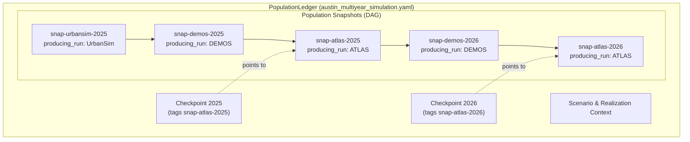

# Population snapshots and artifact identity

A population snapshot is a commit in the population ledger. It describes the
state of the population after a specific model step executes: it records the
model step that produced it, the parent snapshot(s) it was built from, the
model views read and written, and the resulting core state.

## The population ledger architecture

In Synergy's ledger architecture:

- A `PopulationLedger` is the top-level ledger document. It specifies the shared
  scenario definition, the stochastic realization, yearly checkpoints, and a
  directed acyclic graph (DAG) of snapshots.
- A `PopulationSnapshot` is a commit naming its producing model step, its parent
  snapshots, its model-specific input/output views, and its core state.
- A `CoreState` is the commit's state tree: a map from each established core
  attribute facet to a canonical tabular content digest, sealed by an authoritative
  Merkle tree `state_digest`.
- A `PopulationCheckpoint` is an official tag designating a specific snapshot as
  the definitive population state for a given simulation year.



## Core entities and attribute facets

The [core schema UML](../schema/core-schema-uml.md#core-entity-tables) shows how core entity tables
define key-only identities for households, persons, and vehicles, with explicit
membership relationships:

- `CoreHousehold`: identifies the household unit (`household_id`).
- `CorePerson`: identifies the person unit (`person_id`).
- `CoreHouseholdMembership`: links each person to their household.
- `CoreVehicle`: identifies vehicles owned by households (`[household_id, vehicle_id]`).

Attribute facets (such as location, demographics, schooling, employment, and dwelling)
attach detailed properties to those entities. Each facet is stored in an independent
Parquet file and fingerprinted using `core_facet_table/v1`.

## Artifact identity and provenance

Artifact identity answers a different question from population identity: which
exact physical file carried the records?

- **Content digest**: A canonical tabular digest stays identical when a file moves,
  changes compression codecs, or reorders rows, but changes if underlying logical
  data changes.
- **File byte digest**: A raw SHA-256 byte hash tracks exact on-disk physical files.
- **Provenance record**: Records which model run produced each file. In Synergy,
  runs link to the Consist execution engine (`provider: consist`), recording
  exact run IDs (`producing_run.run_id`).

Keeping population identity, facet content identity, physical file hashes, and
run provenance separate means no single row ID, filename, or run record is asked
to prove more than it can.

## Conformance verification

The `synergy-conformance` CLI verifies ledger consistency and provenance across
all these layers:

```sh
synergy-conformance check-ledger \
  --ledger examples/ledger/austin_multiyear_simulation.yaml \
  --data-root examples/ledger \
  --verify-consist-provenance \
  --consist-db examples/ledger/austin_multiyear/provenance.duckdb \
  --verify-state-digest
```

The checker confirms that:
1. The ledger satisfies the `PopulationLedger` LinkML schema.
2. Parent snapshot references and checkpoint references exist in the snapshot list.
3. Physical files on disk match the declared SHA-256 byte digests.
4. Consist run records in the provenance database confirm the execution of each step.
5. Merkle tree state digests match the recomputed SHA-256 hash of the sorted facet digests.
