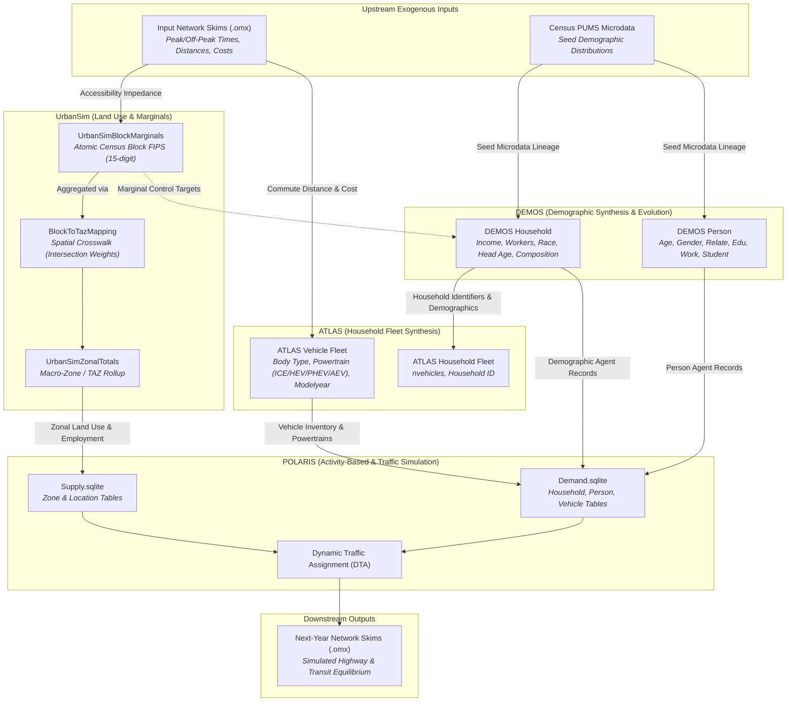
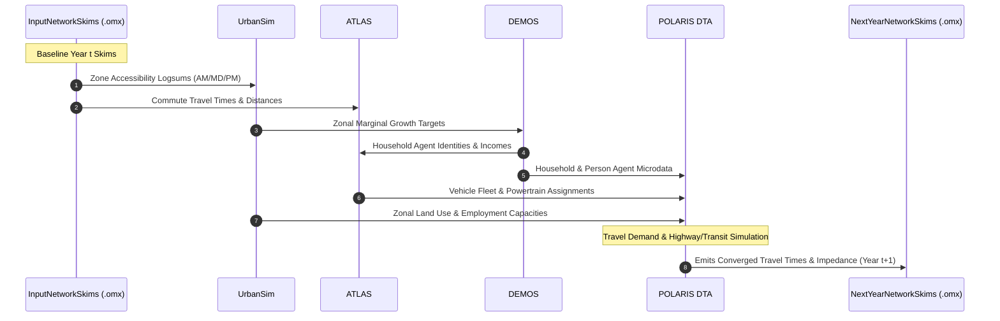

# Cross-Model Data Contract at a Glance

This document summarizes the static single-year data exchange relationships, identifier bindings, categorical crosswalks, donor draw algorithms, and residue boundaries across **UrbanSim**, **DEMOS**, **ATLAS**, **POLARIS**, and **Network Skims** (`.omx`).

It reflects the authoritative specification established in the multi-agency interface agreement (`DEMOS_and_ATLAS_to_POLARIS_interface.xlsx`), co-located in this repository under `docs/resources/`.

---

## 1. Multi-Model Data Flow Architecture

---

## 2. Table-to-Table Exchange Summary Matrix

| Source Model & Artifact | Target Model & Artifact | Exchange Type | Join / Reference Key | Core Attributes Transferred |
| :--- | :--- | :--- | :--- | :--- |
| `InputNetworkSkims` (.omx) | **UrbanSim** (`input_skims`) | Matrix Skims | Zone (i, j) | `sov_time_am`, `sov_distance`, transit accessibility |
| `InputNetworkSkims` (.omx) | **ATLAS** (`input_skims`) | Matrix Skims | Zone (i, j) | `sov_time_am`, `sov_time_md`, `sov_distance` |
| `UrbanSimZonalTotals` | **POLARIS** `Supply.sqlite/Zone` | Zonal Aggregation | `zone_id` ↔ `zone` | `residential_area`, `commercial_area`, `pop_households`, `employment_*` |
| `UrbanSimBlockMarginals` | **DEMOS** (`marginal_targets`) | Control Totals | `block_id` | `total_households`, `total_population`, `total_workers` |
| `DEMOS` Household | **POLARIS** `Demand.sqlite/Household` | Tabular Microdata | `household` | `income`, `workers`, `persons`, `age_of_head`, `race_of_head`, `type`, `location` |
| `DEMOS` Person | **POLARIS** `Demand.sqlite/Person` | Tabular Microdata | `(household, id)` | `age`, `gender`, `relp`, `education`, `employment`, `school_enrollment` |
| `DEMOS` Household | **ATLAS** `atlas_hh` | Tabular Microdata | `household` ↔ `HOUSEID` | Household identity, composition, and income |
| `ATLAS` Vehicle | **POLARIS** `Demand.sqlite/Vehicle` | Tabular Microdata | `(HOUSEID, VEHID)` ↔ `(household, id)` | `bodytype`, `pred_power`, `modelyear`, `annual_mileage` |
| **POLARIS** DTA Solver | `NextYearNetworkSkims` (.omx) | Matrix Skims | Zone (i, j) | `sov_time_am`, `sov_time_pm`, `congestion_index` |
| `UrbanSimBlockMarginals` | **SynthFirm** `SynthFirmEstablishmentRecord` | Zonal Control | `block_id` ↔ `MESOZONE` | Zonal employment by NAICS industry, commercial/industrial floor space |
| **SynthFirm** Establishments | **SynthFirm** `SynthFirmB2BShipmentRecord` | Freight Contracts | `BusID` ↔ `SellerID`/`BuyerID` | Commodity SCTG 1–5, shipment tonnage, truckload, private/for-hire carrier |
| **SynthFirm** Fleets | **POLARIS** `Demand.sqlite/Vehicle` | Commercial Fleets | `BusID` ↔ `location` | Commercial truck fleet inventory, class, and depot locations |
| **SynthFirm** Shipments | **BEAM** `freight-plans.xml` | Freight Tours | `BusID` ↔ `depot_id` | Commercial multi-stop tours, payload, and depot charging profiles |

---

## 3. Detailed Column-Level Mapping Specifications

### 3.1 DEMOS Household → POLARIS `Household`

| DEMOS Column | POLARIS Column | Mode | Rule / Crosswalk | Description & Residue Handling |
| :--- | :--- | :--- | :--- | :--- |
| `household` | `household` | `direct` | — | Integer household primary key (identifies surviving vs. new households). |
| `income` | `income` | `derived` | Deflated & Rounded | Deflated to base-year USD and rounded to nearest integer dollar. |
| `persons` | `size` | `renamed` | Count | Total count of individuals in household. |
| `workers` | `workers` | `derived` | **X-P2** | Count of persons with ESR 1 or 4 (employed and at work). |
| `age_of_head` | `age_of_head` | `direct` | — | Age of reference person (`relp = 0`). |
| `race_of_head`| `race` | `enum_crosswalk`| **X-P1** / **D-P3b** | Census PUMS race code to POLARIS race (1–9). |
| `lcm_county_id`| `county` | `direct` | — | 5-digit State/County FIPS (e.g. 48453). |
| `block_id` | `location` | `derived` | **D-H1** | 11-digit Census tract GEOID (`popsyn_region`). New households draw dwelling location via **D-H1**. Surviving households retain location. |
| *(Composition)*| `type` | `derived` | **X-H1**, **X-H2** | Recomputed from composition: HHT × tenure → POLARIS `HHTYPE` (1..11). |
| *(D-H1)* | `housing_unit_type`| `derived` | **X-H3** / **D-H1** | Carried for surviving households; drawn with dwelling for new households. |
| *(D-H1)* | `Has_Residential_Charging`| `derived` | **D-H1** | Drawn jointly with dwelling; preserved for surviving households. |
| `SERIALNO_PUMS`| — | *Residue* | Lineage Trace | Census PUMS seed record identifier; retained for auditability, not stored in POLARIS. |
| `is_reorg_household`| — | *Residue* | Internal State | DEMOS demographic restructuring flag; unmapped in POLARIS. |
| *(Aggregated)* | `vehicles` | `aggregated`| **X-V1..X-V5** | Count of associated vehicle records from ATLAS fleet output (or **D-H2** interim). |

---

### 3.2 DEMOS Person → POLARIS `Person`

| DEMOS Column | POLARIS Column | Mode | Rule / Crosswalk | Description & Residue Handling |
| :--- | :--- | :--- | :--- | :--- |
| `household` | `household` | `direct` | — | Foreign key to Household table. |
| `id` | `id` | `derived` | 0..n-1 Ordinal | Regenerated within-household ordinal index (0, 1, ..., n-1). |
| `person` | — | *Residue* | Lineage Trace | Global synthetic person identifier; preserved in DEMOS outputs. |
| `age` | `age` | `direct` | — | Person chronological age in years. |
| `gender` | `gender` | `direct` | **X-P1** | 1 = Male, 2 = Female. |
| `relp` | `relp` | `direct` | **X-P1** | PUMS relationship code (0..15) mapped to POLARIS RELP (0..17). |
| `education` | `education` | `direct` | **X-P1**, **X-P6** | 0..24 ACS SCHL code; K-12 consistency enforced via **X-P6**. |
| `employment` | `employment` | `direct` | **X-P1**, **X-P2** | ACS ESR code (0..6). Workers are ESR 1 and 4. |
| `school_enrollment`| `school_enrollment`| `direct`| **X-P1** | 0 NA, 1 none, 2 public, 3 private. Public/private continuity maintained. |
| `marital_status`| `marital_status`| `direct` | **X-P1** / **D-P3a** | 1 Married, 2 Widowed, 3 Divorced, 4 Separated, 5 Never married. 0 resolved via **D-P3a**. |
| `income` | `income` | `derived` | Deflated | Individual personal earned income (deflated to base year). |
| *(Derived)* | `school_grade_level`| `derived` | **X-P3..X-P5** | Continuing students advance via **X-P4**; entrants draw via **X-P5**. |
| *(D-P1)* | `worker_class`, `industry`, `work_hours` | `derived` | **D-P1**, **X-P7** | Donor draw conditioned on county × sex × age group × education group. |
| *(D-P2)* | Commute attributes | `derived` | **D-P2** | Mode, travel time, occupancy, arrival time drawn for at-work persons. |
| `SERIALNO_PUMS`| — | *Residue* | Lineage Trace | Census PUMS household seed identifier. |
| `SPORDER` | — | *Residue* | Lineage Trace | Census PUMS person seed sequence ordinal. |

---

### 3.3 ATLAS Vehicle → POLARIS `Vehicle`

| ATLAS Column | POLARIS Column | Mode | Rule / Crosswalk | Description & Residue Handling |
| :--- | :--- | :--- | :--- | :--- |
| `HOUSEID` | `hhold` | `renamed` | — | Owning household ID. Must exist in POLARIS population. |
| `VEHID` | `vehicle_id` | `derived` | Sequence | Retained vehicles keep previous ID; new vehicles take next available ID. |
| `bodytype` | `vehicle_class` | `derived` | **X-V1**, **D-V1** | Retained keep size; new vehicles draw size class within body type via **D-V1**. |
| `pred_power` | `powertrain_type`| `enum_crosswalk`| **X-V2** | ICE → Conventional (0), Hybrid → HEV (1), PHEV → PHEV (2), AEV → BEV_long (3). |
| *(Derived)* | `fuel_type` | `derived` | **X-V3**, **D-V2** | BEV → Elec (4); HEV/PHEV → Gas (0); Conventional draws Gas (0) or Diesel (1) via **D-V2**. |
| `modelyear` | `vintage_type` | `derived` | **X-V4** | Recomputed yearly from age = SimulationYear - modelyear (0 = 0–5y, 1 = 6–10y, 2 = 10+y). |
| *(Composite)* | `type` | `derived` | **X-V5** | Looked up in POLARIS `Vehicle_Type` on `(class, connectivity, powertrain, automation, fuel, vintage)`. |
| `annual_mileage`| — | *Residue* | Behavioral Model | Estimated annual VMT; used for activity allocation. |
| `vintage_category`| — | *Residue* | Validation | Categorical vintage cross-checked against `modelyear`. |

---

### 3.4 UrbanSim Zonal Totals → POLARIS `Supply.sqlite/Zone`

| UrbanSim Column | POLARIS Column | Mode | Description |
| :--- | :--- | :--- | :--- |
| `zone_id` | `zone` | `direct` | Traffic Analysis Zone (TAZ) integer primary key. |
| `residential_area` | `residential_area` | `direct` | Total residential floor/lot area. |
| `commercial_area` | `commercial_area` | `direct` | Total commercial development area. |
| `office_area` | `office_area` | `direct` | Total office floor area. |
| `retail_area` | `retail_area` | `direct` | Total retail shopping area. |
| `industrial_area` | `industrial_area` | `direct` | Industrial/warehouse space. |
| `institutional_area`| `institutional_area`| `direct`| Civic, institutional, and medical land area. |
| `pop_households` | `pop_households` | `direct` | Marginal control total of households residing in zone. |
| `pop_persons` | `pop_persons` | `direct` | Marginal control total of persons residing in zone. |
| `employment_total` | `employment_total` | `direct` | Total employment count located in zone. |
| `employment_retail`| `employment_retail`| `direct` | Retail sector employment. |
| `employment_services`| `employment_services`| `direct`| Service sector employment. |
| `employment_government`| `employment_government`| `direct`| Public administration & government employment. |
| `employment_manufacturing`| `employment_manufacturing`| `direct`| Manufacturing sector employment. |
| `hh_inc_avg` | `hh_inc_avg` | `direct` | Mean household income within zone. |

---

## 4. Authoritative Categorical Crosswalks

### Crosswalk X-H1: Household Type (HHT) from Composition

Evaluated in strict order using the household's final person composition:

1. If any member has `relp = 1` (spouse) → **Married-couple family**
2. Else if any member has `relp = 2..10` (relative) and head `gender = 1` → **Other family, male head**
3. Else if any member has `relp = 2..10` (relative) and head `gender = 2` → **Other family, female head**
4. Else if `persons = 1` → **Nonfamily, living alone**
5. Otherwise → **Nonfamily, not living alone**

*(Nonrelatives with `relp` 11–15 do not constitute a family).*

### Crosswalk X-H2: Tenure × HHT → POLARIS Type (`HHTYPE`)

| HHT | Own (`tenure = 1`) | Rent (`tenure = 2`) |
| :--- | :--- | :--- |
| Married-couple family | `1` (`HHT_OWN_FAMILY_MARRIED`) | `6` (`HHT_RENT_FAMILY_MARRIED`) |
| Other family, male head | `2` (`HHT_OWN_FAMILY_MALE`) | `7` (`HHT_RENT_FAMILY_MALE`) |
| Other family, female head | `3` (`HHT_OWN_FAMILY_FEMALE`) | `8` (`HHT_RENT_FAMILY_FEMALE`) |
| Nonfamily, living alone | `4` (`HHT_OWN_NONFAMILY_SINGLE`) | `9` (`HHT_RENT_NONFAMILY_SINGLE`) |
| Nonfamily, not living alone | `5` (`HHT_OWN_NONFAMILY_OTHER`) | `10` (`HHT_RENT_NONFAMILY_OTHER`) |
| Group quarters | `11` (`HHT_GQ`) | `11` (`HHT_GQ`) |

### Crosswalk X-H3: Housing Unit Type (`HU_TYPE`)

- `1` → `HU_SINGLE_FAMILY` (Single Family Detached)
- `2` → `HU_SMALL_APT_BLD` (2–9 units)
- `3` → `HU_LARGE_APT_BLD` (10+ units)
- `4` → `HU_OTHER` (Mobile home, RV, boat)
- `5` → `HU_GROUP_QUARTERS` (GQ institutional / non-institutional)

### Crosswalk X-P1: DEMOS Person Variables → POLARIS

- `relp`: 0–15 → 0–17 (RELP; 16 and 17 reserved for Group Quarters).
- `gender`: 1 Male, 2 Female.
- `age`: Integer → Integer.
- `education`: 0–24 (ACS SCHL code).
- `employment`: 0–6 (ACS ESR code).
- `school_enrollment`: 0 NA, 1 None, 2 Public, 3 Private.
- `marital_status`: 1 Married, 2 Widowed, 3 Divorced, 4 Separated, 5 Never married. Code `0` resolved via fallback **D-P3a**.
- `income`: Deflated and rounded to integer dollars.
- `id`: Within-household index renumbered `0..n-1`.

### Crosswalk X-P2: Employment (ESR) Groups & Worker Identification

| ESR | Label | Employed? | At Work? | Drives POLARIS Worker? |
| :--- | :--- | :--- | :--- | :--- |
| `0` | Under 16 | No | No | No |
| `1` | Civilian, at work | Yes | Yes | **Yes** (`Household.workers += 1`) |
| `2` | Civilian, job but not at work | Yes | No | No |
| `3` | Unemployed | No | No | No |
| `4` | Armed forces, at work | Yes | Yes | **Yes** (`Household.workers += 1`) |
| `5` | Armed forces, job but not at work | Yes | No | No |
| `6` | Not in labor force | No | No | No |

### Crosswalk X-P3: School Grade Level & School Type

- `0` (GRADE_NA) → None
- `1` (Preschool) → `PREK`
- `2` (Kindergarten) → `K-8`
- `3–10` (Grades 1–8) → `K-8`
- `11–14` (Grades 9–12) → `9-12`
- `15` (Undergraduate) → `Higher education`
- `16` (Graduate) → `Higher education`

### Crosswalk X-P4: Grade Progression for Continuing Students

- Grade `1` (Preschool) → `2` if age ≥ 5, else `1`.
- Grades `2–13` → Previous grade + 1.
- Grade `14` (Grade 12) → `15` (Undergraduate).
- Grade `15` (Undergraduate) → `16` (Graduate) if DEMOS education rose to ≥ 21, else `15`.
- Grade `16` (Graduate) → `16`.

### Crosswalk X-P5: Entry Grade for School Entrants

- **Ages 3–17**: Draw from reference distribution of grades among enrolled persons of same age.
- **Ages 18+**: Draw conditioned on educational attainment:
  - ≤ 15: Mostly Grade 14.
  - 16–20: Mostly Undergraduate (Grade 15).
  - ≥ 21: Graduate (Grade 16) or Undergraduate (Grade 15).

### Crosswalk X-P6: K-12 Education Consistency

For grade code g ∈ [1, 14]:

- Allowed education: `g` or `g + 1`.
- If DEMOS education is outside this range: Set `education = g`.

### Crosswalk X-P7: Industry Groups & Simple INDP Mapping

Maps Census ACS INDP codes to POLARIS `EMPLOYMENT_INDUSTRY_SIMPLE`:

- **INDUSTRIAL**: INDP ≤ 770 or 6070–6390.
- **MANUFACTURING**: INDP 771–3990.
- **RETAIL**: INDP 3991–5790.
- **SERVICE**: INDP 5791–7790 (except 6070–6390) or 8660–9290.
- **GOVERNMENT**: INDP 7860–7890 or 9370–9870.
- **OTHER**: All remaining codes.

### Crosswalk X-V1: ATLAS Body Type → POLARIS Vehicle Class Candidates

| ATLAS `bodytype` | POLARIS `vehicle_class` Candidates | Base Market Share |
| :--- | :--- | :--- |
| `car` | `1` CAR_COMPACT `2` CAR_MID_SIZE `3` CAR_FULL_SIZE | 46.9% 43.9% 9.2% |
| `suv` | `4` SUV_COMPACT `5` SUV_MID_SIZE `6` SUV_FULL_SIZE | 36.4% 47.5% 16.2% |
| `pickup` | `7` PICKUP_MID_SIZE `8` PICKUP_FULL_SIZE | 19.5% 80.5% |
| `van` | `6` SUV_FULL_SIZE | 100.0% (Fixed; seats 7, 5.5m long) |

### Crosswalk X-V2: ATLAS Predicted Powertrain → Powertrain Type

| ATLAS `pred_power` | POLARIS `powertrain_type` | Description |
| :--- | :--- | :--- |
| `ICE` | `0` (`Conventional`) | Standard internal combustion engine (gasoline/diesel). |
| `Hybrid` | `1` (`HEV`) | Non-plug-in Hybrid Electric Vehicle. |
| `PHEV` | `2` (`PHEV`) | Plug-in Hybrid Electric Vehicle. |
| `AEV` | `3` (`BEV_long`) | All-Electric Battery Electric Vehicle (long range). |

### Crosswalk X-V3: Powertrain Type → Fuel Type

- `Conventional` → Gas (`0`) or Diesel (`1`) via draw **D-V2**.
- `HEV` → Gas (`0`).
- `PHEV` → Gas (`0`).
- `BEV_long` → Electricity (`4`).

### Crosswalk X-V4: Vehicle Modelyear → Vintage Type

Recomputed yearly from vehicle age (`age = SimulationYear - modelyear`):

- age ≤ 5 → `0` (0–5 years)
- 6 ≤ age ≤ 10 → `1` (6–10 years)
- age ≥ 11 → `2` (10+ years)

### Crosswalk X-V5: POLARIS `Vehicle_Type` Composite Key Reference

Every valid vehicle row must resolve to an existing composite key in POLARIS `Vehicle_Type`:
`(vehicle_class, connectivity_type, powertrain_type, automation_type, fuel_type, vintage_type)`.
Connectivity is initialized to `0` (No) and automation to `0` (Level 0 / Human driven).

---

## 5. Donor Draws Specification Register

When attributes are not directly modeled by upstream demographic engines, they are drawn from the fixed base-year reference population using stratified donor pools:

| Draw ID | Target Entity | Donor Attributes Copied | Stratification / Segmentation | Fallback / Collapse Order |
| :--- | :--- | :--- | :--- | :--- |
| **D-H1** | New Households | `location`, `tenure`, `housing_unit_type`, `Has_Residential_Charging` | Census tract × head age × size × income | Income → size → head age → tract alone → county |
| **D-H2** | New Households (Interim) | Complete vehicle fleet rows | Tract × adults × workers × income | Income → workers → adults → county |
| **D-P1** | Persons ≥ 16 | `worker_class`, `industry`, `work_hours` | County × sex × work age group × education | Education → age → sex → region |
| **D-P2** | At-work Persons | `journey_to_work_*` (mode, travel time, occupancy, arrival) | Home tract × industry group × full-time flag | Full-time → county × industry → county |
| **D-P3a**| Persons | `marital_status` (fallback for DEMOS code 0) | Sex × work age × relp group | Regional sex × age pool |
| **D-P3b**| Persons (`relp > 0`) | `race` (non-head household members) | Head's race × relp group | Head's race alone |
| **D-P4** | Persons | `disability` status | Sex × disability age group | Disability age group alone |
| **D-V1** | New Vehicles | `vehicle_class` within ATLAS body type | County × income class × powertrain group | Powertrain → income → county |
| **D-V2** | Conventional Vehicles| `fuel_type` (Gasoline vs. Diesel) | `vehicle_class` × owner's county | `vehicle_class` regional pool |

---

## 6. Process & Settings Pipeline (13 Steps)

1. **Step 1 (Inputs & Classification)**: Read DEMOS year t, POLARIS year t-1, and reference population. Classify records into Surviving, New, Removed, and Group Quarters (GQ).
2. **Step 2 (Direct Person Values)**: Apply deflated income, gender, age, relp, employment, and marital status.
3. **Step 3 (Household Composition)**: Calculate persons, workers (ESR 1/4), income quintiles, and HHT (**X-H1**).
4. **Step 4 (Dwelling Assignment)**: Carry dwellings for surviving; execute **D-H1** for new households. Compute POLARIS `type` (**X-H2**).
5. **Step 5 (Home Change Events)**: Evaluate person home-change events against final locations.
6. **Step 6 (Education & School)**: Assign `school_grade_level` (**X-P3..X-P5**), enforce K-12 consistency (**X-P6**), evaluate school change events.
7. **Step 7 (Race)**: Assign heads of new households, then apply **D-P3b** for non-heads.
8. **Step 8 (Job Attributes)**: Execute **D-P1** for workers needing employment details.
9. **Step 9 (Commute Attributes)**: Execute **D-P2** for at-work commuters.
10. **Step 10 (Locations & Models)**: Set `work_location_id`, `school_location_id`, disability (**D-P4**), and POLARIS runtime flags.
11. **Step 11 (Vehicles)**: Map ATLAS fleet outputs via **X-V1..X-V5** (or **D-H2** interim); verify composite keys in `Vehicle_Type`.
12. **Step 12 (Household Wrap-up)**: Update `time_in_home` and vehicle counts.
13. **Step 13 (Output & Validation)**: Append unchanged Group Quarters, run integrity assertions, and emit final `Demand.sqlite`.

---

## 7. Network Skims Boundary (`.omx`)

---

## 8. Authoritative Interface Specification Workbook

The complete tabular specifications, field-by-field formulas, donor distributions, and assumption logs are maintained in the official multi-agency interface agreement:

- **File**: `docs/resources/DEMOS_and_ATLAS_to_POLARIS_interface.xlsx`
- **Source**: Joint specification agreement across DEMOS, ATLAS, and POLARIS modeling teams.
- **Included Sheets**: `Overview`, `Households`, `Persons`, `Vehicles`, `Draws`, `Crosswalks`, `Assumptions`, `Open questions`, `Inputs`, `Record classes & events`, and `Process & settings`.
