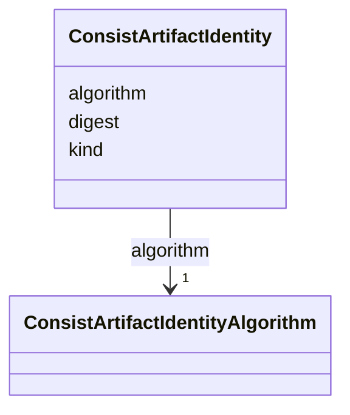

---
search:
  boost: 10.0
---

# Class: ConsistArtifactIdentity 


_A trusted, typed immutable identity that Consist can attest for a strict bound artifact. It is stronger and narrower than Artifact.hash._


<div data-search-exclude markdown="1">


URI: [https://w3id.org/consist/binding/ConsistArtifactIdentity](https://w3id.org/consist/binding/ConsistArtifactIdentity)





<!-- no inheritance hierarchy -->

## Slots

| Name | Cardinality and Range | Description | Inheritance |
| ---  | --- | --- | --- |
| [algorithm](algorithm.md) | 1 <br/> [ConsistArtifactIdentityAlgorithm](ConsistArtifactIdentityAlgorithm.md) | The attested immutable identity algorithm | direct |
| [kind](kind.md) | 1 <br/> [ConsistArtifactIdentityKind](ConsistArtifactIdentityKind.md) | The attested immutable identity contract | direct |
| [digest](digest.md) | 1 <br/> [SHA256Digest](SHA256Digest.md) | The immutable identity digest | direct |


## Usages

| used by | used in | type | used |
| ---  | --- | --- | --- |
| [ConsistArtifactReference](ConsistArtifactReference.md) | [immutable_identity](immutable_identity.md) | range | [ConsistArtifactIdentity](ConsistArtifactIdentity.md) |


## Identifier and Mapping Information


### Schema Source


* from schema: https://w3id.org/consist/binding


## Mappings

| Mapping Type | Mapped Value |
| ---  | ---  |
| self | https://w3id.org/consist/binding/ConsistArtifactIdentity |
| native | https://w3id.org/consist/binding/ConsistArtifactIdentity |


## LinkML Source

<!-- TODO: investigate https://stackoverflow.com/questions/37606292/how-to-create-tabbed-code-blocks-in-mkdocs-or-sphinx -->

### Direct

<details>
```yaml
name: ConsistArtifactIdentity
description: A trusted, typed immutable identity that Consist can attest for a strict
  bound artifact. It is stronger and narrower than Artifact.hash.
from_schema: https://w3id.org/consist/binding
rank: 1000
attributes:
  algorithm:
    name: algorithm
    description: The attested immutable identity algorithm.
    from_schema: https://w3id.org/consist/provenance
    rank: 1000
    domain_of:
    - ConsistArtifactIdentity
    range: ConsistArtifactIdentityAlgorithm
    required: true
  kind:
    name: kind
    description: The attested immutable identity contract.
    from_schema: https://w3id.org/consist/provenance
    rank: 1000
    domain_of:
    - ConsistArtifactIdentity
    range: ConsistArtifactIdentityKind
    required: true
  digest:
    name: digest
    description: The immutable identity digest.
    from_schema: https://w3id.org/consist/provenance
    rank: 1000
    domain_of:
    - ConsistArtifactIdentity
    range: SHA256Digest
    required: true

```
</details>

### Induced

<details>
```yaml
name: ConsistArtifactIdentity
description: A trusted, typed immutable identity that Consist can attest for a strict
  bound artifact. It is stronger and narrower than Artifact.hash.
from_schema: https://w3id.org/consist/binding
rank: 1000
attributes:
  algorithm:
    name: algorithm
    description: The attested immutable identity algorithm.
    from_schema: https://w3id.org/consist/provenance
    rank: 1000
    owner: ConsistArtifactIdentity
    domain_of:
    - ConsistArtifactIdentity
    range: ConsistArtifactIdentityAlgorithm
    required: true
  kind:
    name: kind
    description: The attested immutable identity contract.
    from_schema: https://w3id.org/consist/provenance
    rank: 1000
    owner: ConsistArtifactIdentity
    domain_of:
    - ConsistArtifactIdentity
    range: ConsistArtifactIdentityKind
    required: true
  digest:
    name: digest
    description: The immutable identity digest.
    from_schema: https://w3id.org/consist/provenance
    rank: 1000
    owner: ConsistArtifactIdentity
    domain_of:
    - ConsistArtifactIdentity
    range: SHA256Digest
    required: true

```
</details></div>