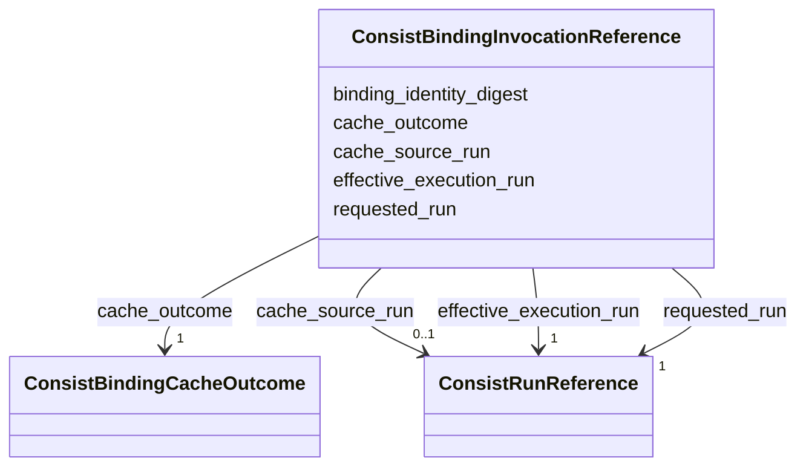

---
search:
  boost: 10.0
---

# Class: ConsistBindingInvocationReference 


_One resolved binding invocation. On a miss, requested_run and effective_execution_run resolve to the same new run and cache_source_run is absent. On a hit, effective_execution_run and cache_source_run resolve to the same historical producer, distinct from the current requested run._


<div data-search-exclude markdown="1">


URI: [https://w3id.org/consist/binding/ConsistBindingInvocationReference](https://w3id.org/consist/binding/ConsistBindingInvocationReference)





<!-- no inheritance hierarchy -->

## Slots

| Name | Cardinality and Range | Description | Inheritance |
| ---  | --- | --- | --- |
| [requested_run](requested_run.md) | 1 <br/> [ConsistRunReference](ConsistRunReference.md) | The run created for the current invocation | direct |
| [effective_execution_run](effective_execution_run.md) | 1 <br/> [ConsistRunReference](ConsistRunReference.md) | The run that supplied the execution result | direct |
| [cache_source_run](cache_source_run.md) | 0..1 <br/> [ConsistRunReference](ConsistRunReference.md) | The historical producer reused for a cache hit | direct |
| [cache_outcome](cache_outcome.md) | 1 <br/> [ConsistBindingCacheOutcome](ConsistBindingCacheOutcome.md) | The cache outcome for this invocation | direct |
| [binding_identity_digest](binding_identity_digest.md) | 0..1 <br/> [SHA256Digest](SHA256Digest.md) | The optional SHA-256 digest of Consist's strict resolved-binding identity | direct |


## Identifier and Mapping Information


### Schema Source


* from schema: https://w3id.org/consist/binding


## Mappings

| Mapping Type | Mapped Value |
| ---  | ---  |
| self | https://w3id.org/consist/binding/ConsistBindingInvocationReference |
| native | https://w3id.org/consist/binding/ConsistBindingInvocationReference |


## LinkML Source

<!-- TODO: investigate https://stackoverflow.com/questions/37606292/how-to-create-tabbed-code-blocks-in-mkdocs-or-sphinx -->

### Direct

<details>
```yaml
name: ConsistBindingInvocationReference
description: One resolved binding invocation. On a miss, requested_run and effective_execution_run
  resolve to the same new run and cache_source_run is absent. On a hit, effective_execution_run
  and cache_source_run resolve to the same historical producer, distinct from the
  current requested run.
from_schema: https://w3id.org/consist/binding
rank: 1000
attributes:
  requested_run:
    name: requested_run
    description: The run created for the current invocation.
    from_schema: https://w3id.org/consist/binding
    rank: 1000
    domain_of:
    - ConsistBindingInvocationReference
    range: ConsistRunReference
    required: true
    inlined: true
  effective_execution_run:
    name: effective_execution_run
    description: The run that supplied the execution result.
    from_schema: https://w3id.org/consist/binding
    rank: 1000
    domain_of:
    - ConsistBindingInvocationReference
    range: ConsistRunReference
    required: true
    inlined: true
  cache_source_run:
    name: cache_source_run
    description: The historical producer reused for a cache hit. It is absent for
      a cache miss and resolves to effective_execution_run for a cache hit.
    from_schema: https://w3id.org/consist/binding
    rank: 1000
    domain_of:
    - ConsistBindingInvocationReference
    range: ConsistRunReference
    inlined: true
  cache_outcome:
    name: cache_outcome
    description: The cache outcome for this invocation.
    from_schema: https://w3id.org/consist/binding
    rank: 1000
    domain_of:
    - ConsistBindingInvocationReference
    range: ConsistBindingCacheOutcome
    required: true
  binding_identity_digest:
    name: binding_identity_digest
    description: The optional SHA-256 digest of Consist's strict resolved-binding
      identity. It identifies a binding contract, not opaque evidence JSON.
    from_schema: https://w3id.org/consist/binding
    rank: 1000
    domain_of:
    - ConsistBindingInvocationReference
    range: SHA256Digest

```
</details>

### Induced

<details>
```yaml
name: ConsistBindingInvocationReference
description: One resolved binding invocation. On a miss, requested_run and effective_execution_run
  resolve to the same new run and cache_source_run is absent. On a hit, effective_execution_run
  and cache_source_run resolve to the same historical producer, distinct from the
  current requested run.
from_schema: https://w3id.org/consist/binding
rank: 1000
attributes:
  requested_run:
    name: requested_run
    description: The run created for the current invocation.
    from_schema: https://w3id.org/consist/binding
    rank: 1000
    owner: ConsistBindingInvocationReference
    domain_of:
    - ConsistBindingInvocationReference
    range: ConsistRunReference
    required: true
    inlined: true
  effective_execution_run:
    name: effective_execution_run
    description: The run that supplied the execution result.
    from_schema: https://w3id.org/consist/binding
    rank: 1000
    owner: ConsistBindingInvocationReference
    domain_of:
    - ConsistBindingInvocationReference
    range: ConsistRunReference
    required: true
    inlined: true
  cache_source_run:
    name: cache_source_run
    description: The historical producer reused for a cache hit. It is absent for
      a cache miss and resolves to effective_execution_run for a cache hit.
    from_schema: https://w3id.org/consist/binding
    rank: 1000
    owner: ConsistBindingInvocationReference
    domain_of:
    - ConsistBindingInvocationReference
    range: ConsistRunReference
    inlined: true
  cache_outcome:
    name: cache_outcome
    description: The cache outcome for this invocation.
    from_schema: https://w3id.org/consist/binding
    rank: 1000
    owner: ConsistBindingInvocationReference
    domain_of:
    - ConsistBindingInvocationReference
    range: ConsistBindingCacheOutcome
    required: true
  binding_identity_digest:
    name: binding_identity_digest
    description: The optional SHA-256 digest of Consist's strict resolved-binding
      identity. It identifies a binding contract, not opaque evidence JSON.
    from_schema: https://w3id.org/consist/binding
    rank: 1000
    owner: ConsistBindingInvocationReference
    domain_of:
    - ConsistBindingInvocationReference
    range: SHA256Digest

```
</details></div>