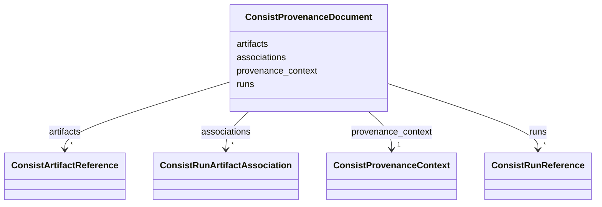

---
search:
  boost: 10.0
---

# Class: ConsistProvenanceDocument 


_A portable provenance handoff with one enclosing ledger context and graph facts. A record that omits provenance_context inherits this context._


<div data-search-exclude markdown="1">


URI: [https://w3id.org/consist/binding/ConsistProvenanceDocument](https://w3id.org/consist/binding/ConsistProvenanceDocument)





<!-- no inheritance hierarchy -->

## Slots

| Name | Cardinality and Range | Description | Inheritance |
| ---  | --- | --- | --- |
| [provenance_context](provenance_context.md) | 1 <br/> [ConsistProvenanceContext](ConsistProvenanceContext.md) | The enclosing context inherited by any contained run or artifact reference th... | direct |
| [runs](runs.md) | * <br/> [ConsistRunReference](ConsistRunReference.md) | Run references carried by this provenance handoff | direct |
| [artifacts](artifacts.md) | * <br/> [ConsistArtifactReference](ConsistArtifactReference.md) | Artifact references carried by this provenance handoff | direct |
| [associations](associations.md) | * <br/> [ConsistRunArtifactAssociation](ConsistRunArtifactAssociation.md) | Consumption and production graph edges carried by this handoff | direct |


## Identifier and Mapping Information


### Schema Source


* from schema: https://w3id.org/consist/binding


## Mappings

| Mapping Type | Mapped Value |
| ---  | ---  |
| self | https://w3id.org/consist/binding/ConsistProvenanceDocument |
| native | https://w3id.org/consist/binding/ConsistProvenanceDocument |


## LinkML Source

<!-- TODO: investigate https://stackoverflow.com/questions/37606292/how-to-create-tabbed-code-blocks-in-mkdocs-or-sphinx -->

### Direct

<details>
```yaml
name: ConsistProvenanceDocument
description: A portable provenance handoff with one enclosing ledger context and graph
  facts. A record that omits provenance_context inherits this context.
from_schema: https://w3id.org/consist/binding
rank: 1000
attributes:
  provenance_context:
    name: provenance_context
    description: The enclosing context inherited by any contained run or artifact
      reference that omits provenance_context.
    from_schema: https://w3id.org/consist/provenance
    rank: 1000
    domain_of:
    - ConsistProvenanceDocument
    - ConsistRunReference
    - ConsistArtifactReference
    range: ConsistProvenanceContext
    required: true
    inlined: true
  runs:
    name: runs
    description: Run references carried by this provenance handoff.
    from_schema: https://w3id.org/consist/provenance
    rank: 1000
    domain_of:
    - ConsistProvenanceDocument
    range: ConsistRunReference
    multivalued: true
    inlined_as_list: true
  artifacts:
    name: artifacts
    description: Artifact references carried by this provenance handoff.
    from_schema: https://w3id.org/consist/provenance
    rank: 1000
    domain_of:
    - ConsistProvenanceDocument
    range: ConsistArtifactReference
    multivalued: true
    inlined_as_list: true
  associations:
    name: associations
    description: Consumption and production graph edges carried by this handoff.
    from_schema: https://w3id.org/consist/provenance
    rank: 1000
    domain_of:
    - ConsistProvenanceDocument
    range: ConsistRunArtifactAssociation
    multivalued: true
    inlined_as_list: true

```
</details>

### Induced

<details>
```yaml
name: ConsistProvenanceDocument
description: A portable provenance handoff with one enclosing ledger context and graph
  facts. A record that omits provenance_context inherits this context.
from_schema: https://w3id.org/consist/binding
rank: 1000
attributes:
  provenance_context:
    name: provenance_context
    description: The enclosing context inherited by any contained run or artifact
      reference that omits provenance_context.
    from_schema: https://w3id.org/consist/provenance
    rank: 1000
    owner: ConsistProvenanceDocument
    domain_of:
    - ConsistProvenanceDocument
    - ConsistRunReference
    - ConsistArtifactReference
    range: ConsistProvenanceContext
    required: true
    inlined: true
  runs:
    name: runs
    description: Run references carried by this provenance handoff.
    from_schema: https://w3id.org/consist/provenance
    rank: 1000
    owner: ConsistProvenanceDocument
    domain_of:
    - ConsistProvenanceDocument
    range: ConsistRunReference
    multivalued: true
    inlined: true
    inlined_as_list: true
  artifacts:
    name: artifacts
    description: Artifact references carried by this provenance handoff.
    from_schema: https://w3id.org/consist/provenance
    rank: 1000
    owner: ConsistProvenanceDocument
    domain_of:
    - ConsistProvenanceDocument
    range: ConsistArtifactReference
    multivalued: true
    inlined: true
    inlined_as_list: true
  associations:
    name: associations
    description: Consumption and production graph edges carried by this handoff.
    from_schema: https://w3id.org/consist/provenance
    rank: 1000
    owner: ConsistProvenanceDocument
    domain_of:
    - ConsistProvenanceDocument
    range: ConsistRunArtifactAssociation
    multivalued: true
    inlined: true
    inlined_as_list: true

```
</details></div>