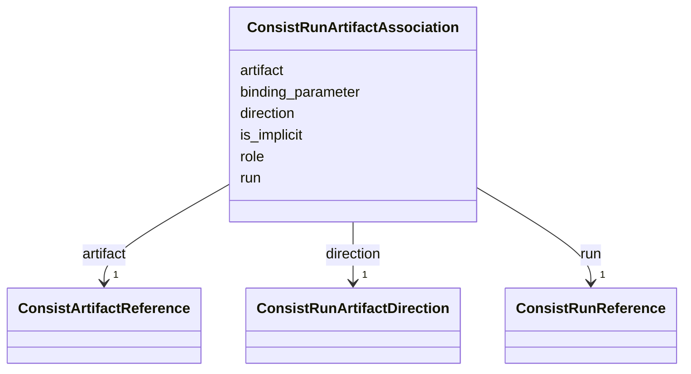

---
search:
  boost: 10.0
---

# Class: ConsistRunArtifactAssociation 


_A durable input or output relationship between a run and an artifact. An output association is a production assertion; if artifact.producing_run is supplied, it must resolve to the same run after context inheritance._


<div data-search-exclude markdown="1">


URI: [https://w3id.org/consist/binding/ConsistRunArtifactAssociation](https://w3id.org/consist/binding/ConsistRunArtifactAssociation)





<!-- no inheritance hierarchy -->

## Slots

| Name | Cardinality and Range | Description | Inheritance |
| ---  | --- | --- | --- |
| [run](run.md) | 1 <br/> [ConsistRunReference](ConsistRunReference.md) | The consuming or producing Consist run | direct |
| [artifact](artifact.md) | 1 <br/> [ConsistArtifactReference](ConsistArtifactReference.md) | The consumed or produced Consist artifact | direct |
| [direction](direction.md) | 1 <br/> [ConsistRunArtifactDirection](ConsistRunArtifactDirection.md) | Whether the run used the artifact as an input or output | direct |
| [role](role.md) | 0..1 <br/> [string](string.md) | The invocation-specific semantic role of the artifact, when known | direct |
| [binding_parameter](binding_parameter.md) | 0..1 <br/> [string](string.md) | The invocation binding parameter for the artifact, when known | direct |
| [is_implicit](is_implicit.md) | 0..1 <br/> [boolean](boolean.md) | Whether Consist discovered this relationship implicitly, when that evidence i... | direct |


## Usages

| used by | used in | type | used |
| ---  | --- | --- | --- |
| [ConsistProvenanceDocument](ConsistProvenanceDocument.md) | [associations](associations.md) | range | [ConsistRunArtifactAssociation](ConsistRunArtifactAssociation.md) |


## Identifier and Mapping Information


### Schema Source


* from schema: https://w3id.org/consist/binding


## Mappings

| Mapping Type | Mapped Value |
| ---  | ---  |
| self | https://w3id.org/consist/binding/ConsistRunArtifactAssociation |
| native | https://w3id.org/consist/binding/ConsistRunArtifactAssociation |


## LinkML Source

<!-- TODO: investigate https://stackoverflow.com/questions/37606292/how-to-create-tabbed-code-blocks-in-mkdocs-or-sphinx -->

### Direct

<details>
```yaml
name: ConsistRunArtifactAssociation
description: A durable input or output relationship between a run and an artifact.
  An output association is a production assertion; if artifact.producing_run is supplied,
  it must resolve to the same run after context inheritance.
from_schema: https://w3id.org/consist/binding
rank: 1000
attributes:
  run:
    name: run
    description: The consuming or producing Consist run.
    from_schema: https://w3id.org/consist/provenance
    rank: 1000
    domain_of:
    - ConsistRunArtifactAssociation
    range: ConsistRunReference
    required: true
    inlined: true
  artifact:
    name: artifact
    description: The consumed or produced Consist artifact.
    from_schema: https://w3id.org/consist/provenance
    rank: 1000
    domain_of:
    - ConsistRunArtifactAssociation
    range: ConsistArtifactReference
    required: true
    inlined: true
  direction:
    name: direction
    description: Whether the run used the artifact as an input or output.
    from_schema: https://w3id.org/consist/provenance
    rank: 1000
    domain_of:
    - ConsistRunArtifactAssociation
    range: ConsistRunArtifactDirection
    required: true
  role:
    name: role
    description: The invocation-specific semantic role of the artifact, when known.
    from_schema: https://w3id.org/consist/provenance
    rank: 1000
    domain_of:
    - ConsistRunArtifactAssociation
  binding_parameter:
    name: binding_parameter
    description: The invocation binding parameter for the artifact, when known.
    from_schema: https://w3id.org/consist/provenance
    rank: 1000
    domain_of:
    - ConsistRunArtifactAssociation
  is_implicit:
    name: is_implicit
    description: Whether Consist discovered this relationship implicitly, when that
      evidence is available.
    from_schema: https://w3id.org/consist/provenance
    rank: 1000
    domain_of:
    - ConsistRunArtifactAssociation
    range: boolean

```
</details>

### Induced

<details>
```yaml
name: ConsistRunArtifactAssociation
description: A durable input or output relationship between a run and an artifact.
  An output association is a production assertion; if artifact.producing_run is supplied,
  it must resolve to the same run after context inheritance.
from_schema: https://w3id.org/consist/binding
rank: 1000
attributes:
  run:
    name: run
    description: The consuming or producing Consist run.
    from_schema: https://w3id.org/consist/provenance
    rank: 1000
    owner: ConsistRunArtifactAssociation
    domain_of:
    - ConsistRunArtifactAssociation
    range: ConsistRunReference
    required: true
    inlined: true
  artifact:
    name: artifact
    description: The consumed or produced Consist artifact.
    from_schema: https://w3id.org/consist/provenance
    rank: 1000
    owner: ConsistRunArtifactAssociation
    domain_of:
    - ConsistRunArtifactAssociation
    range: ConsistArtifactReference
    required: true
    inlined: true
  direction:
    name: direction
    description: Whether the run used the artifact as an input or output.
    from_schema: https://w3id.org/consist/provenance
    rank: 1000
    owner: ConsistRunArtifactAssociation
    domain_of:
    - ConsistRunArtifactAssociation
    range: ConsistRunArtifactDirection
    required: true
  role:
    name: role
    description: The invocation-specific semantic role of the artifact, when known.
    from_schema: https://w3id.org/consist/provenance
    rank: 1000
    owner: ConsistRunArtifactAssociation
    domain_of:
    - ConsistRunArtifactAssociation
    range: string
  binding_parameter:
    name: binding_parameter
    description: The invocation binding parameter for the artifact, when known.
    from_schema: https://w3id.org/consist/provenance
    rank: 1000
    owner: ConsistRunArtifactAssociation
    domain_of:
    - ConsistRunArtifactAssociation
    range: string
  is_implicit:
    name: is_implicit
    description: Whether Consist discovered this relationship implicitly, when that
      evidence is available.
    from_schema: https://w3id.org/consist/provenance
    rank: 1000
    owner: ConsistRunArtifactAssociation
    domain_of:
    - ConsistRunArtifactAssociation
    range: boolean

```
</details></div>