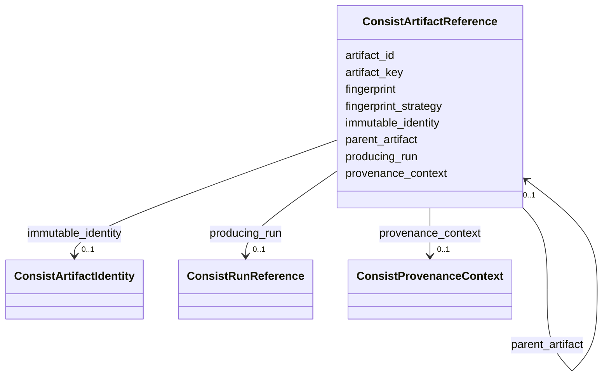

---
search:
  boost: 10.0
---

# Class: ConsistArtifactReference 


_A portable reference to a public Consist Artifact record, including optional portable fingerprint, trusted immutable identity, parent container relationship, and producing run._


<div data-search-exclude markdown="1">


URI: [https://w3id.org/consist/provenance/ConsistArtifactReference](https://w3id.org/consist/provenance/ConsistArtifactReference)





<!-- no inheritance hierarchy -->

## Slots

| Name | Cardinality and Range | Description | Inheritance |
| ---  | --- | --- | --- |
| [artifact_id](artifact_id.md) | 1 <br/> [UUID](UUID.md) | The public Consist Artifact | direct |
| [provenance_context](provenance_context.md) | 0..1 <br/> [ConsistProvenanceContext](ConsistProvenanceContext.md) | The ledger context for this artifact | direct |
| [artifact_key](artifact_key.md) | 0..1 <br/> [string](string.md) | The human-readable Consist artifact key, when known | direct |
| [fingerprint](fingerprint.md) | 0..1 <br/> [string](string.md) | The public Artifact | direct |
| [fingerprint_strategy](fingerprint_strategy.md) | 0..1 <br/> [string](string.md) | The hashing strategy or interpretation for fingerprint, when known | direct |
| [immutable_identity](immutable_identity.md) | 0..1 <br/> [ConsistArtifactIdentity](ConsistArtifactIdentity.md) | A trusted typed immutable identity, when Consist can attest one | direct |
| [parent_artifact](parent_artifact.md) | 0..1 <br/> [ConsistArtifactReference](ConsistArtifactReference.md) | The parent container artifact, when this artifact is a member | direct |
| [producing_run](producing_run.md) | 0..1 <br/> [ConsistRunReference](ConsistRunReference.md) | The Consist run that produced this artifact, when one exists | direct |


## Usages

| used by | used in | type | used |
| ---  | --- | --- | --- |
| [ConsistProvenanceDocument](ConsistProvenanceDocument.md) | [artifacts](artifacts.md) | range | [ConsistArtifactReference](ConsistArtifactReference.md) |
| [ConsistArtifactReference](ConsistArtifactReference.md) | [parent_artifact](parent_artifact.md) | range | [ConsistArtifactReference](ConsistArtifactReference.md) |
| [ConsistRunArtifactAssociation](ConsistRunArtifactAssociation.md) | [artifact](artifact.md) | range | [ConsistArtifactReference](ConsistArtifactReference.md) |


## Identifier and Mapping Information


### Schema Source


* from schema: https://w3id.org/consist/provenance


## Mappings

| Mapping Type | Mapped Value |
| ---  | ---  |
| self | https://w3id.org/consist/provenance/ConsistArtifactReference |
| native | https://w3id.org/consist/provenance/ConsistArtifactReference |


## LinkML Source

<!-- TODO: investigate https://stackoverflow.com/questions/37606292/how-to-create-tabbed-code-blocks-in-mkdocs-or-sphinx -->

### Direct

<details>
```yaml
name: ConsistArtifactReference
description: A portable reference to a public Consist Artifact record, including optional
  portable fingerprint, trusted immutable identity, parent container relationship,
  and producing run.
from_schema: https://w3id.org/consist/provenance
rank: 1000
attributes:
  artifact_id:
    name: artifact_id
    description: The public Consist Artifact.id UUID.
    from_schema: https://w3id.org/consist/provenance
    rank: 1000
    domain_of:
    - ConsistArtifactReference
    range: UUID
    required: true
  provenance_context:
    name: provenance_context
    description: The ledger context for this artifact. When omitted inside a ConsistProvenanceDocument,
      inherit the enclosing provenance_context.
    from_schema: https://w3id.org/consist/provenance
    domain_of:
    - ConsistProvenanceDocument
    - ConsistRunReference
    - ConsistArtifactReference
    range: ConsistProvenanceContext
    inlined: true
  artifact_key:
    name: artifact_key
    description: The human-readable Consist artifact key, when known.
    from_schema: https://w3id.org/consist/provenance
    rank: 1000
    domain_of:
    - ConsistArtifactReference
  fingerprint:
    name: fingerprint
    description: The public Artifact.hash value. It is a portable fingerprint whose
      interpretation follows the hashing strategy and may be content- or metadata-based.
      Artifact.content_id is database-local and is never a portable fingerprint.
    from_schema: https://w3id.org/consist/provenance
    rank: 1000
    domain_of:
    - ConsistArtifactReference
  fingerprint_strategy:
    name: fingerprint_strategy
    description: The hashing strategy or interpretation for fingerprint, when known.
    from_schema: https://w3id.org/consist/provenance
    rank: 1000
    domain_of:
    - ConsistArtifactReference
  immutable_identity:
    name: immutable_identity
    description: A trusted typed immutable identity, when Consist can attest one.
      It must not be inferred from a broader Artifact.hash alone.
    from_schema: https://w3id.org/consist/provenance
    rank: 1000
    domain_of:
    - ConsistArtifactReference
    range: ConsistArtifactIdentity
    inlined: true
  parent_artifact:
    name: parent_artifact
    description: The parent container artifact, when this artifact is a member. This
      is container structure, not an artifact derivation edge.
    from_schema: https://w3id.org/consist/provenance
    rank: 1000
    domain_of:
    - ConsistArtifactReference
    range: ConsistArtifactReference
    inlined: true
  producing_run:
    name: producing_run
    description: The Consist run that produced this artifact, when one exists. For
      an output association, this reference must resolve to the associated run. Leave
      it absent for an external artifact with no producing Consist run.
    from_schema: https://w3id.org/consist/provenance
    rank: 1000
    domain_of:
    - ConsistArtifactReference
    range: ConsistRunReference
    inlined: true

```
</details>

### Induced

<details>
```yaml
name: ConsistArtifactReference
description: A portable reference to a public Consist Artifact record, including optional
  portable fingerprint, trusted immutable identity, parent container relationship,
  and producing run.
from_schema: https://w3id.org/consist/provenance
rank: 1000
attributes:
  artifact_id:
    name: artifact_id
    description: The public Consist Artifact.id UUID.
    from_schema: https://w3id.org/consist/provenance
    rank: 1000
    owner: ConsistArtifactReference
    domain_of:
    - ConsistArtifactReference
    range: UUID
    required: true
  provenance_context:
    name: provenance_context
    description: The ledger context for this artifact. When omitted inside a ConsistProvenanceDocument,
      inherit the enclosing provenance_context.
    from_schema: https://w3id.org/consist/provenance
    owner: ConsistArtifactReference
    domain_of:
    - ConsistProvenanceDocument
    - ConsistRunReference
    - ConsistArtifactReference
    range: ConsistProvenanceContext
    inlined: true
  artifact_key:
    name: artifact_key
    description: The human-readable Consist artifact key, when known.
    from_schema: https://w3id.org/consist/provenance
    rank: 1000
    owner: ConsistArtifactReference
    domain_of:
    - ConsistArtifactReference
    range: string
  fingerprint:
    name: fingerprint
    description: The public Artifact.hash value. It is a portable fingerprint whose
      interpretation follows the hashing strategy and may be content- or metadata-based.
      Artifact.content_id is database-local and is never a portable fingerprint.
    from_schema: https://w3id.org/consist/provenance
    rank: 1000
    owner: ConsistArtifactReference
    domain_of:
    - ConsistArtifactReference
    range: string
  fingerprint_strategy:
    name: fingerprint_strategy
    description: The hashing strategy or interpretation for fingerprint, when known.
    from_schema: https://w3id.org/consist/provenance
    rank: 1000
    owner: ConsistArtifactReference
    domain_of:
    - ConsistArtifactReference
    range: string
  immutable_identity:
    name: immutable_identity
    description: A trusted typed immutable identity, when Consist can attest one.
      It must not be inferred from a broader Artifact.hash alone.
    from_schema: https://w3id.org/consist/provenance
    rank: 1000
    owner: ConsistArtifactReference
    domain_of:
    - ConsistArtifactReference
    range: ConsistArtifactIdentity
    inlined: true
  parent_artifact:
    name: parent_artifact
    description: The parent container artifact, when this artifact is a member. This
      is container structure, not an artifact derivation edge.
    from_schema: https://w3id.org/consist/provenance
    rank: 1000
    owner: ConsistArtifactReference
    domain_of:
    - ConsistArtifactReference
    range: ConsistArtifactReference
    inlined: true
  producing_run:
    name: producing_run
    description: The Consist run that produced this artifact, when one exists. For
      an output association, this reference must resolve to the associated run. Leave
      it absent for an external artifact with no producing Consist run.
    from_schema: https://w3id.org/consist/provenance
    rank: 1000
    owner: ConsistArtifactReference
    domain_of:
    - ConsistArtifactReference
    range: ConsistRunReference
    inlined: true

```
</details></div>