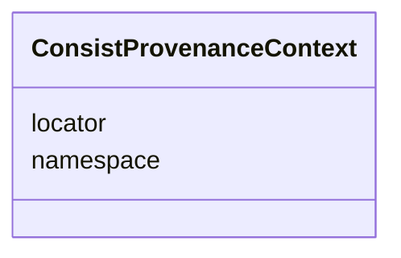

---
search:
  boost: 10.0
---

# Class: ConsistProvenanceContext 


_The ledger context for portable Consist references. Namespace and a local ID form identity; locator is mutable retrieval metadata and never identity-bearing._


<div data-search-exclude markdown="1">


URI: [https://w3id.org/consist/provenance/ConsistProvenanceContext](https://w3id.org/consist/provenance/ConsistProvenanceContext)





<!-- no inheritance hierarchy -->

## Slots

| Name | Cardinality and Range | Description | Inheritance |
| ---  | --- | --- | --- |
| [namespace](namespace.md) | 1 <br/> [string](string.md) | A stable logical identifier for the Consist provenance ledger | direct |
| [locator](locator.md) | 0..1 <br/> [string](string.md) | An optional mutable hint for locating the ledger | direct |


## Usages

| used by | used in | type | used |
| ---  | --- | --- | --- |
| [ConsistProvenanceDocument](ConsistProvenanceDocument.md) | [provenance_context](provenance_context.md) | range | [ConsistProvenanceContext](ConsistProvenanceContext.md) |
| [ConsistRunReference](ConsistRunReference.md) | [provenance_context](provenance_context.md) | range | [ConsistProvenanceContext](ConsistProvenanceContext.md) |
| [ConsistArtifactReference](ConsistArtifactReference.md) | [provenance_context](provenance_context.md) | range | [ConsistProvenanceContext](ConsistProvenanceContext.md) |


## Identifier and Mapping Information


### Schema Source


* from schema: https://w3id.org/consist/provenance


## Mappings

| Mapping Type | Mapped Value |
| ---  | ---  |
| self | https://w3id.org/consist/provenance/ConsistProvenanceContext |
| native | https://w3id.org/consist/provenance/ConsistProvenanceContext |


## LinkML Source

<!-- TODO: investigate https://stackoverflow.com/questions/37606292/how-to-create-tabbed-code-blocks-in-mkdocs-or-sphinx -->

### Direct

<details>
```yaml
name: ConsistProvenanceContext
description: The ledger context for portable Consist references. Namespace and a local
  ID form identity; locator is mutable retrieval metadata and never identity-bearing.
from_schema: https://w3id.org/consist/provenance
rank: 1000
attributes:
  namespace:
    name: namespace
    description: A stable logical identifier for the Consist provenance ledger.
    from_schema: https://w3id.org/consist/provenance
    rank: 1000
    domain_of:
    - ConsistProvenanceContext
    required: true
  locator:
    name: locator
    description: An optional mutable hint for locating the ledger. It is never part
      of identity, equality, deduplication, or namespace assignment.
    from_schema: https://w3id.org/consist/provenance
    rank: 1000
    domain_of:
    - ConsistProvenanceContext

```
</details>

### Induced

<details>
```yaml
name: ConsistProvenanceContext
description: The ledger context for portable Consist references. Namespace and a local
  ID form identity; locator is mutable retrieval metadata and never identity-bearing.
from_schema: https://w3id.org/consist/provenance
rank: 1000
attributes:
  namespace:
    name: namespace
    description: A stable logical identifier for the Consist provenance ledger.
    from_schema: https://w3id.org/consist/provenance
    rank: 1000
    owner: ConsistProvenanceContext
    domain_of:
    - ConsistProvenanceContext
    range: string
    required: true
  locator:
    name: locator
    description: An optional mutable hint for locating the ledger. It is never part
      of identity, equality, deduplication, or namespace assignment.
    from_schema: https://w3id.org/consist/provenance
    rank: 1000
    owner: ConsistProvenanceContext
    domain_of:
    - ConsistProvenanceContext
    range: string

```
</details></div>