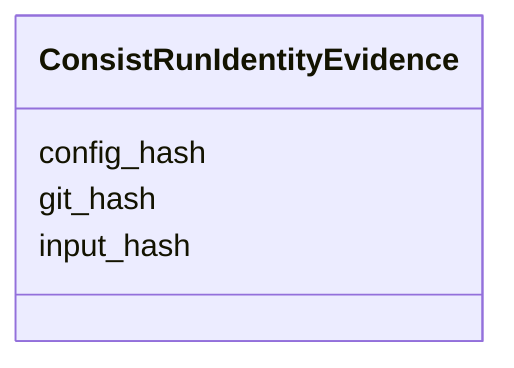

---
search:
  boost: 10.0
---

# Class: ConsistRunIdentityEvidence 


_Optional cache-identity components copied from a Consist Run for audit. These values support comparison but do not replace a run's public ID._


<div data-search-exclude markdown="1">


URI: [https://w3id.org/consist/provenance/ConsistRunIdentityEvidence](https://w3id.org/consist/provenance/ConsistRunIdentityEvidence)





<!-- no inheritance hierarchy -->

## Slots

| Name | Cardinality and Range | Description | Inheritance |
| ---  | --- | --- | --- |
| [config_hash](config_hash.md) | 0..1 <br/> [string](string.md) | The run configuration hash, when available | direct |
| [input_hash](input_hash.md) | 0..1 <br/> [string](string.md) | The run input hash, when available | direct |
| [git_hash](git_hash.md) | 0..1 <br/> [string](string.md) | The code revision hash recorded by the run, when available | direct |


## Usages

| used by | used in | type | used |
| ---  | --- | --- | --- |
| [ConsistRunReference](ConsistRunReference.md) | [identity_evidence](identity_evidence.md) | range | [ConsistRunIdentityEvidence](ConsistRunIdentityEvidence.md) |


## Identifier and Mapping Information


### Schema Source


* from schema: https://w3id.org/consist/provenance


## Mappings

| Mapping Type | Mapped Value |
| ---  | ---  |
| self | https://w3id.org/consist/provenance/ConsistRunIdentityEvidence |
| native | https://w3id.org/consist/provenance/ConsistRunIdentityEvidence |


## LinkML Source

<!-- TODO: investigate https://stackoverflow.com/questions/37606292/how-to-create-tabbed-code-blocks-in-mkdocs-or-sphinx -->

### Direct

<details>
```yaml
name: ConsistRunIdentityEvidence
description: Optional cache-identity components copied from a Consist Run for audit.
  These values support comparison but do not replace a run's public ID.
from_schema: https://w3id.org/consist/provenance
rank: 1000
attributes:
  config_hash:
    name: config_hash
    description: The run configuration hash, when available.
    from_schema: https://w3id.org/consist/provenance
    rank: 1000
    domain_of:
    - ConsistRunIdentityEvidence
  input_hash:
    name: input_hash
    description: The run input hash, when available.
    from_schema: https://w3id.org/consist/provenance
    rank: 1000
    domain_of:
    - ConsistRunIdentityEvidence
  git_hash:
    name: git_hash
    description: The code revision hash recorded by the run, when available.
    from_schema: https://w3id.org/consist/provenance
    rank: 1000
    domain_of:
    - ConsistRunIdentityEvidence

```
</details>

### Induced

<details>
```yaml
name: ConsistRunIdentityEvidence
description: Optional cache-identity components copied from a Consist Run for audit.
  These values support comparison but do not replace a run's public ID.
from_schema: https://w3id.org/consist/provenance
rank: 1000
attributes:
  config_hash:
    name: config_hash
    description: The run configuration hash, when available.
    from_schema: https://w3id.org/consist/provenance
    rank: 1000
    owner: ConsistRunIdentityEvidence
    domain_of:
    - ConsistRunIdentityEvidence
    range: string
  input_hash:
    name: input_hash
    description: The run input hash, when available.
    from_schema: https://w3id.org/consist/provenance
    rank: 1000
    owner: ConsistRunIdentityEvidence
    domain_of:
    - ConsistRunIdentityEvidence
    range: string
  git_hash:
    name: git_hash
    description: The code revision hash recorded by the run, when available.
    from_schema: https://w3id.org/consist/provenance
    rank: 1000
    owner: ConsistRunIdentityEvidence
    domain_of:
    - ConsistRunIdentityEvidence
    range: string

```
</details></div>