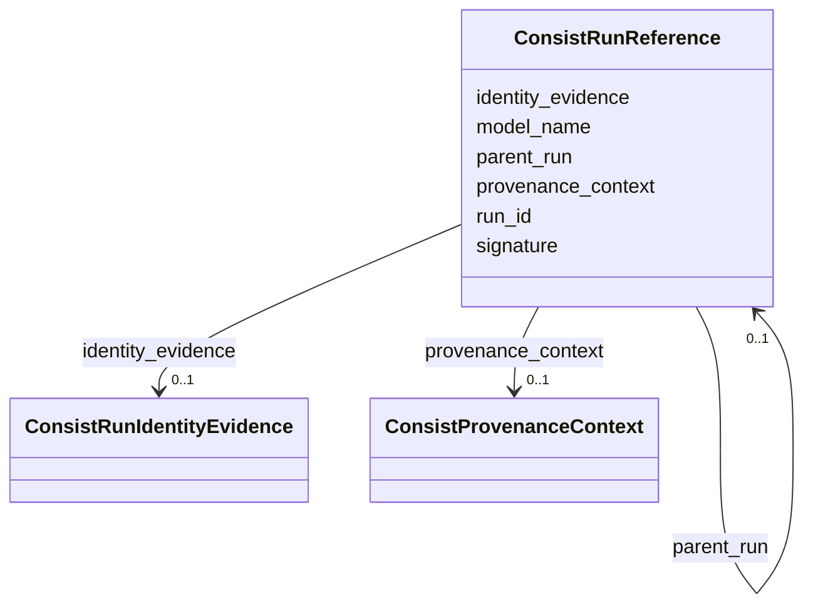

---
search:
  boost: 10.0
---

# Class: ConsistRunReference 


_A portable reference to a public Consist Run record. Its identity is provenance_context.namespace plus run_id. If provenance_context is absent, it inherits the enclosing ConsistProvenanceDocument provenance_context._


<div data-search-exclude markdown="1">


URI: [https://w3id.org/consist/provenance/ConsistRunReference](https://w3id.org/consist/provenance/ConsistRunReference)





<!-- no inheritance hierarchy -->

## Slots

| Name | Cardinality and Range | Description | Inheritance |
| ---  | --- | --- | --- |
| [run_id](run_id.md) | 1 <br/> [string](string.md) | The public Consist Run | direct |
| [provenance_context](provenance_context.md) | 0..1 <br/> [ConsistProvenanceContext](ConsistProvenanceContext.md) | The ledger context for this run | direct |
| [signature](signature.md) | 0..1 <br/> [string](string.md) | The Consist run signature when available | direct |
| [model_name](model_name.md) | 0..1 <br/> [string](string.md) | The Consist model or workflow name, when available | direct |
| [parent_run](parent_run.md) | 0..1 <br/> [ConsistRunReference](ConsistRunReference.md) | The parent Consist run for a nested execution, when one exists | direct |
| [identity_evidence](identity_evidence.md) | 0..1 <br/> [ConsistRunIdentityEvidence](ConsistRunIdentityEvidence.md) | Optional structured run cache-identity evidence | direct |


## Usages

| used by | used in | type | used |
| ---  | --- | --- | --- |
| [ConsistProvenanceDocument](ConsistProvenanceDocument.md) | [runs](runs.md) | range | [ConsistRunReference](ConsistRunReference.md) |
| [ConsistRunReference](ConsistRunReference.md) | [parent_run](parent_run.md) | range | [ConsistRunReference](ConsistRunReference.md) |
| [ConsistArtifactReference](ConsistArtifactReference.md) | [producing_run](producing_run.md) | range | [ConsistRunReference](ConsistRunReference.md) |
| [ConsistRunArtifactAssociation](ConsistRunArtifactAssociation.md) | [run](run.md) | range | [ConsistRunReference](ConsistRunReference.md) |


## Identifier and Mapping Information


### Schema Source


* from schema: https://w3id.org/consist/provenance


## Mappings

| Mapping Type | Mapped Value |
| ---  | ---  |
| self | https://w3id.org/consist/provenance/ConsistRunReference |
| native | https://w3id.org/consist/provenance/ConsistRunReference |


## LinkML Source

<!-- TODO: investigate https://stackoverflow.com/questions/37606292/how-to-create-tabbed-code-blocks-in-mkdocs-or-sphinx -->

### Direct

<details>
```yaml
name: ConsistRunReference
description: A portable reference to a public Consist Run record. Its identity is
  provenance_context.namespace plus run_id. If provenance_context is absent, it inherits
  the enclosing ConsistProvenanceDocument provenance_context.
from_schema: https://w3id.org/consist/provenance
rank: 1000
attributes:
  run_id:
    name: run_id
    description: The public Consist Run.id value.
    from_schema: https://w3id.org/consist/provenance
    rank: 1000
    domain_of:
    - ConsistRunReference
    required: true
  provenance_context:
    name: provenance_context
    description: The ledger context for this run. When omitted inside a ConsistProvenanceDocument,
      inherit the enclosing provenance_context.
    from_schema: https://w3id.org/consist/provenance
    domain_of:
    - ConsistProvenanceDocument
    - ConsistRunReference
    - ConsistArtifactReference
    range: ConsistProvenanceContext
    inlined: true
  signature:
    name: signature
    description: The Consist run signature when available. It supports audit but does
      not replace run_id as the run reference.
    from_schema: https://w3id.org/consist/provenance
    rank: 1000
    domain_of:
    - ConsistRunReference
  model_name:
    name: model_name
    description: The Consist model or workflow name, when available.
    from_schema: https://w3id.org/consist/provenance
    rank: 1000
    domain_of:
    - ConsistRunReference
  parent_run:
    name: parent_run
    description: The parent Consist run for a nested execution, when one exists.
    from_schema: https://w3id.org/consist/provenance
    rank: 1000
    domain_of:
    - ConsistRunReference
    range: ConsistRunReference
    inlined: true
  identity_evidence:
    name: identity_evidence
    description: Optional structured run cache-identity evidence.
    from_schema: https://w3id.org/consist/provenance
    rank: 1000
    domain_of:
    - ConsistRunReference
    range: ConsistRunIdentityEvidence
    inlined: true

```
</details>

### Induced

<details>
```yaml
name: ConsistRunReference
description: A portable reference to a public Consist Run record. Its identity is
  provenance_context.namespace plus run_id. If provenance_context is absent, it inherits
  the enclosing ConsistProvenanceDocument provenance_context.
from_schema: https://w3id.org/consist/provenance
rank: 1000
attributes:
  run_id:
    name: run_id
    description: The public Consist Run.id value.
    from_schema: https://w3id.org/consist/provenance
    rank: 1000
    owner: ConsistRunReference
    domain_of:
    - ConsistRunReference
    range: string
    required: true
  provenance_context:
    name: provenance_context
    description: The ledger context for this run. When omitted inside a ConsistProvenanceDocument,
      inherit the enclosing provenance_context.
    from_schema: https://w3id.org/consist/provenance
    owner: ConsistRunReference
    domain_of:
    - ConsistProvenanceDocument
    - ConsistRunReference
    - ConsistArtifactReference
    range: ConsistProvenanceContext
    inlined: true
  signature:
    name: signature
    description: The Consist run signature when available. It supports audit but does
      not replace run_id as the run reference.
    from_schema: https://w3id.org/consist/provenance
    rank: 1000
    owner: ConsistRunReference
    domain_of:
    - ConsistRunReference
    range: string
  model_name:
    name: model_name
    description: The Consist model or workflow name, when available.
    from_schema: https://w3id.org/consist/provenance
    rank: 1000
    owner: ConsistRunReference
    domain_of:
    - ConsistRunReference
    range: string
  parent_run:
    name: parent_run
    description: The parent Consist run for a nested execution, when one exists.
    from_schema: https://w3id.org/consist/provenance
    rank: 1000
    owner: ConsistRunReference
    domain_of:
    - ConsistRunReference
    range: ConsistRunReference
    inlined: true
  identity_evidence:
    name: identity_evidence
    description: Optional structured run cache-identity evidence.
    from_schema: https://w3id.org/consist/provenance
    rank: 1000
    owner: ConsistRunReference
    domain_of:
    - ConsistRunReference
    range: ConsistRunIdentityEvidence
    inlined: true

```
</details></div>